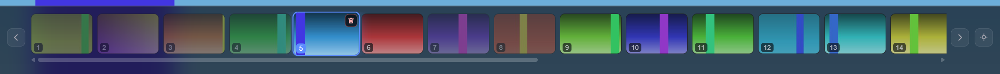
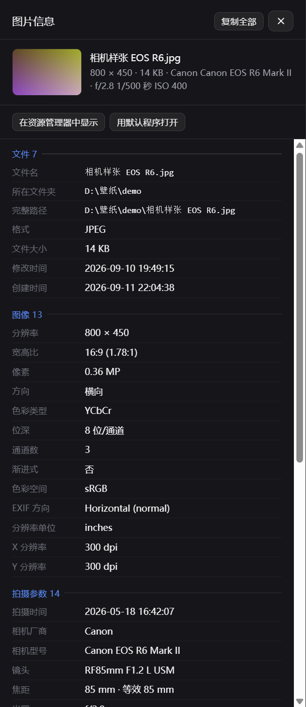
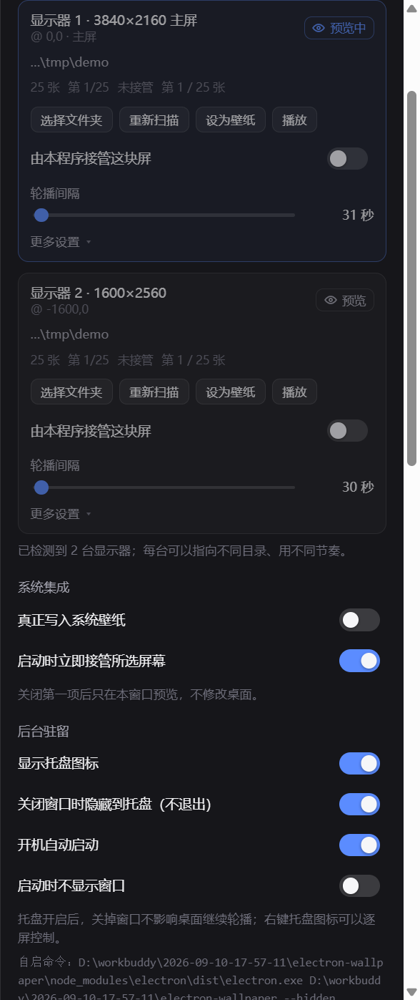

# 更新日志

> 这份文档是开发过程的完整记录：每一轮改了什么、踩了哪些坑、怎么验证的。
> 想快速上手看 [README.md](README.md)。

从 `wallpaper_change.py`（Tkinter + Pillow，3886 行单文件）移植而来。
核心目标不是复刻全部功能，而是**把原来被技术栈卡住的四件事打通**：
GPU 合成动画、原生图片缩放、不靠 ctypes 硬啃系统 API，以及**每台显示器各自独立轮播**。

在第一轮「每屏独立」之后，第二轮补齐了把它当日常工具用的四块拼图：
**缩略图胶片条**、**托盘 + 开机自启**、**EXIF 完整信息面板**、**图片右键菜单**。
详见「[本轮新增的四个功能](#本轮新增的四个功能)」。

## 快速开始

```bash
cd electron-wallpaper
npm start
```

出厂配置（已按你的两块屏设好，可在设置面板里随时改）：

| 屏幕 | 来源 | 间隔 |
|---|---|---|
| 3840×2160 主屏（横） | `D:\壁纸\横屏`（30348 张） | 60 秒 |
| 1600×2560 副屏（竖） | `D:\壁纸\竖屏`（954 张） | 180 秒 |

快捷键：

| 按键 | 动作 |
|---|---|
| `←` / `→` | 上一张 / 下一张（作用于当前预览的那块屏） |
| `空格` | 暂停 / 继续 |
| `F` 或 `F11` | 全屏切换 |
| `Esc` | 关闭设置面板 / 图片信息面板 |
| `Ctrl+O` | 为当前预览的屏幕选择文件夹 |
| `Ctrl+R` | 重新扫描 |
| `Ctrl+,` | 设置面板 |
| `Ctrl+S` | 立即写入当前预览的屏幕 |
| `Ctrl+B` | 显示 / 隐藏胶片条 |
| `Ctrl+I` | 当前图片的完整信息 |

```bash
npm run start:debug        # 带远程调试端口（9222）与日志启动
npm run status             # 一眼看清「每块屏现在挂着什么」+ 应用侧频道状态
npm run verify:unit        # 调度器逻辑单测（111 项，不碰桌面）
npm run verify:resume      # 播放位置存档单测（28 项，模拟「关机再开机」，不碰桌面）
npm run verify:e2e         # 每屏独立端到端验证（40 项，需要 start:debug 先跑起来）
npm run verify:features    # 四个新功能端到端验证（106 项，需要 start:debug 先跑起来）
npm run verify:fixes       # 第五轮四个反馈的修复（29 项，需要 start:debug 先跑起来）
npm run verify:ui          # 第六轮交互修复（36 项，含原生确认框的完整驱动）
npm run verify:order       # 随机顺序端到端（25 项，需要 start:debug）
npm run sim:random         # 两种随机策略的长跑对比（纯计算，不碰系统）
npm run find-dups "D:\壁纸\横屏" --recursive --md 清单.md   # 找内容完全相同的重复图
npm run fixtures           # 重新生成纯色测试图
npm run shot:new           # 抓新功能界面截图（自动避开真实壁纸库）
npm run restore-wallpaper  # 还原壁纸（不带参数＝按存档逐屏还原）
npm run dist               # 打包（需先 npm i -D electron-builder）
```

## 第四轮：四个新功能

### 1. 缩略图胶片条

底栏一条横向缩略图：**当前 / 已经看过的 / 还没轮到的**用三种状态区分，点一下就跳过去。
原本打算做的「播放历史」被它取代了 —— 能直接点回上一张，比翻历史列表更直接。



两个关键设计：

- **缩略图走自定义协议 `wpthumb://`，不在渲染层做缩放。**
  渲染层只拿到 URL，真正生成缩略图的是主进程的 `nativeImage.createThumbnailFromPath`
  （Windows 底层是 IShellItemImageFactory）。实测冷调用 60–180 ms，命中系统缩略图缓存后 6–7 ms；
  生成结果按 `sha1(路径|mtime|size)` 落盘缓存，并发闸门 6，失败回退原图。
  如果让渲染层自己 `img` + CSS 缩放到 40px，两万张的目录第一次滚过去就是灾难。
- **只渲染窗口内的节点。** `syncFilmWindow()` 把 DOM 对齐到 `[start, end)`：
  两端增删、中间复用，切换一张不会重建几百个 ``。
  当前左右的显示数量在设置里可调（默认各 40）。

「看过的」标记存在主进程的 `scheduler.played` 里，跨 rebuild 不丢；
删除/移动文件时序号会跟着列表一起位移，不会把新图片误标成「看过」。

### 2. 托盘图标 + 开机自启

窗口右上角关掉不等于退出：默认隐藏到托盘，桌面继续轮播（第一次会弹一个托盘气泡说明）。
托盘右键菜单里能逐屏控制 —— 下一张 / 上一张 / 暂停 / 设为壁纸 / 重新扫描，以及全部暂停、开机自启开关。

**开机自启有个必须知道的坑**：Windows 上 `app.getLoginItemSettings()` 返回的 `openAtLogin`
**永远是 `false`**，真正表示「启动项存在且指向当前可执行文件」的是 `executableWillLaunchAtLogin`。
只看 `openAtLogin` 的话，开关会一直显示关闭状态。两个字段都读、任一为真即视为开启（见 `src/tray.js`）。

开发模式与打包后的自启命令不同，`loginArgs()` 会分别生成
`electron.exe <项目目录> --hidden` 和 `<exe> --hidden`，否则重启后会弹出一个空窗口。

### 3. EXIF 完整信息面板



`Ctrl+I` 或顶栏按钮打开，用 exifr 解析后按 **文件 / 图像 / 拍摄参数 / 位置 / 来源 / 其他** 分组：

| 分组 | 内容 |
|---|---|
| 文件 | 名称、目录、体积、修改时间 |
| 图像 | 尺寸、宽高比、位深、通道、色彩类型、是否渐进 / 隔行 / 含 Alpha |
| 拍摄参数 | 相机、镜头、光圈、快门、ISO、曝光补偿、焦距、测光 / 曝光 / 白平衡模式、闪光灯 |
| 位置 | 经纬度、海拔、坐标基准、拍摄方向、定位时间 |
| 来源 | 软件、作者、版权、Artist、日期 |

两个细节：枚举值不显示裸数字（`ColorSpace=1` → `sRGB`，`ResolutionUnit=2` → `inches`）；
宽高比命中常见比例时给名字（`16:9`），否则只给小数 —— 否则会出现 `181:128` 这种毫无意义的化简结果。

### 4. 图片右键菜单

在画面上右键，或在胶片条上右键任意一张：

| 菜单项 | 说明 |
|---|---|
| 把这张设为壁纸 / 图片信息… | 直接写入当前预览的屏 / 打开信息面板 |
| 复制图像到剪贴板 | 复制像素，可直接粘进 Word、画图、PS |
| 复制文件到剪贴板 | 在资源管理器里 Ctrl+V 能粘贴出这个文件 |
| 复制文件路径 | 复制完整路径 |
| 移动到 / 复制到 | 子菜单里是「预设文件夹」（可在设置里维护），常用于把不想要的图一键挪进「垃圾桶」目录 |
| 在资源管理器中显示 / 打开所在文件夹 / 用默认程序打开 / 选择打开方式… | 交给系统 |
| 删除到回收站 | **只提供回收站，不做永久删除** |

用 Electron **原生 Menu** 而不是 HTML 自绘：要能弹出系统的「打开方式」对话框、
要跟随系统主题与高 DPI 缩放，自绘得把这些全重做一遍。

移动 / 删除后**不重建整个轮播**：`scheduler.applyFileMutation()` 就地更新文件列表 ——
同目录改名只换路径，移到别处则从这条轮播里摘掉（"这张我不想要了"），
索引和「看过」的序号一起位移，正在显示的那张被删掉时立刻补写下一张，
否则桌面会挂着一张已经进了回收站的图。

## 第五轮：四个反馈的修复

### 1. 「偶尔重复加载同一张图片」→ 不是路径解析的问题，是图库里有重复文件

现象有三种同时出现：预览区同一张图重新淡入、胶片条上两张缩略图一模一样、
桌面连着两轮挂着同一张。三者同时出现只有一个解释：**同一张图被当成了列表里两个序号**。

先排除了程序侧的可能：

| 检查项 | 结果 |
|---|---|
| 同一路径被列出两次（扫描器重复） | 0 处 |
| 符号链接 / junction 导致重复遍历 | 0 个 |
| 胶片条窗口 `syncFilmWindow` 增删逻辑（300 轮压力复现） | 0 次不变量被破坏 |
| **内容字节完全相同的重复文件** | **70 组 / 140 个文件 / 351 MB** |

也就是说扫描和渲染都没问题，是图库里同一张图存了两份（例如同一张图同时有
日文名 `ミルクセーキ 2023-05-04 …` 和罗马音名 `milkshakework [2023-05-04] …` 两个文件）。
30348 张里抽中孪生兄弟的概率约 0.23%/次，11 秒间隔下一小时约 0.7 次 —— 正好是那个「偶尔」。

两边都做了处理：

- **程序侧加护栏**：随机模式下避开**体积与当前这张相同**的候选
  （内容相同 ⇒ 体积必然相同，所以这一步能挡住所有「连着出现同一张」的情况）。
  扫描器为了速度刻意不 stat 每个文件（30348 个全量 stat 要 20 秒以上），
  所以体积是在每轮只对「当前 + 候选」按需取、带缓存的，代价可忽略。
  配置项 `skipSizeTwin`（默认开）。
- **数据侧给工具**：`npm run find-dups` 按「体积分组 → 只对候选做完整 SHA-256」
  找出内容相同的组，`--md` 直接生成一份「保留哪个、删哪个」的清单。

护栏的有效性用**确定性夹具**验证（3 张图里两张字节相同），不做概率碰运气：

```
开启护栏：30 步 → 相邻同体积 0 次
关闭护栏：30 步 → 相邻同体积 6~11 次      ← 对照，证明护栏真的在起作用
```

### 2. 每屏独立 → 播放顺序：切到「按名称」之后切不回「随机」

根因（真实配置里抓到的）：每个屏卡片里的「播放顺序」seg 控件把 `data-value`
原样写进了配置，于是存下去的是 `"shuffle": "random"` 这个**字符串**，
而 `resolveProfile` 里判的是 `shuffle === true` —— 恒不成立。

```
用户配置里真实存在的这一行：
  "\\?\DISPLAY#AAAA1234#…#{…}": { "shuffle": "random", "interval": 5, … }
  → 解析出来 shuffle=false → 卡片高亮停在「按名称」，怎么点都回不到随机
```

修复分三层，确保别的字段不会再踩同一个坑：

1. 渲染层按字段声明取值方式（`SEG_VALUE.shuffle = v => v === 'random'`），布尔字段不再漏字符串；
2. `store.js` 增加 `normalizeBooleans()`，写盘前统一收一遍（14 个布尔键）；
3. `resolveProfile` 用宽松 `toBool()` 读 —— **已经写坏的配置下次启动就自动恢复**，
   不用手动改 JSON。

### 3. 设置面板里的「当前图片」删除按钮

设置面板新增一节「当前图片」：显示当前这张的文件名 + 三个按钮
（查看信息 / 打开所在文件夹 / 删除到回收站）。

删除走 `file:trash-confirm`：**先弹系统确认框再删**。
右键菜单里的删除是一次明确的手势，不需要确认；但面板里这颗按钮夹在一排普通按钮中间，
误点代价太高（壁纸库是长期积累的），所以两条路径的确认策略刻意不同。
没有图片时三个按钮自动置灰。

### 4. 「打开所在文件夹」要定位到图片本身

原来走的是 `shell.openPath(path.dirname(file))` —— 只把文件夹打开，
子目录一多还得自己进去找。改用 `shell.showItemInFolder`，
等价于 Explorer 的 `/select,` 参数：打开 + 选中 + 滚动到可见位置。

顺带合并了一个冗余：菜单里原先同时有「在资源管理器中显示」（选中）和
「打开所在文件夹」（只打开），其实是同一件事，摆两项只会让人犹豫点哪个。现在只留一项。

### 5. 顺带修掉的：切模式时每屏卡片不刷新

`channels:changed` 广播只带 `channels`，而渲染层的 `state.perMonitor` 只在收到
带 `perMonitor` 的载荷时才更新 —— 于是从设置面板切「统一配置 / 每屏独立」时，
显示器卡片不会立刻出现或消失，得等下一次 `listChannels()` 才补上。
现在广播统一走 `channelBroadcast()`，把配置派生的开关一起带上。

### 6. 改配置之后，旧配置的那张图会晚一步写到桌面上（竞态）

这个是在跑端到端验证时被一条**偶发失败**逼出来的：改了图，OS 侧却读到旧图。

先写了个探针把过程摊开（每轮记录应用侧 `lastWrite` 与两块屏的实际文件）：

```
#0 期望 t-02.png
   应用侧 lastWrite: {"ok":true,"method":"com:per-monitor","monitorId":"…AAAA1234…","reason":"command"}
   OS 主屏: t-02.png     命中: ✓
   …6 轮全部命中
```

写入本身没问题。真正的原因是时序：

```
t=0ms    测试把配置切成「统一模式」
t=0ms    _advance 已经在写壁纸 —— 一次 COM SetWallpaper 要几百毫秒
t=+200ms 那次写入才落地，写的还是**旧配置**的目标
         → 正好盖掉刚写上去的新图
```

修法：`_write` 把在途的写入 Promise 登记进 `pendingWrites`，`_rebuild` 在切换前先等它们收尾
（上限 1.5 秒 —— 写入函数万一卡住也不能把重建堵死）。顺带把「已丢弃的频道」打了 `retired`
标记，在途的那一轮连 `tick` 都不再发，不会再有任何一次写入跨过配置切换。

这条时序用「可以卡住的写入函数」写成了确定性单测（不靠碰运气）：

```
✓ 两路都卡在「写壁纸」这一步上   stalled=2
✓ 重建会先等在途的写入收尾（此刻还没建出新频道）   list=0
✓ 放行后重建完成，只剩统一频道
✓ 已丢弃的频道没有重新武装自己（重建后一次都没再写）   写入次数 2 → 2
```

撤掉等待逻辑这条测试就会红（`list=1`），所以它是有牙齿的。

修完之后 `verify:features` 与 `verify:fixes` 各连跑两遍都是满分 —— 之前那条偶发失败不再出现。

## 第六轮：三处交互调整

### 1. 缩略图右上角的删除图标


胶片条每张缩略图的右上角有一个小垃圾桶图标：**当前那张常显，其余悬停才出现**
（20 张都挂一个常驻红图标太吵）。

两个实现上的注意点：

- 图标必须是 `<span>` 而不是 `<button>` —— 外层 `.film-item` 本身就是 `<button>`，
  按钮不能嵌套按钮。
- 点击要 `stopPropagation()`：胶片条用的是事件委托，不拦的话会**先跳到那张图、再删**。
  这条被写成了断言（点非当前那张的图标，取消后画面必须停在原位）。

### 2. 图片信息面板跟着壁纸同步更新

面板开着的时候，轮播切到下一张，面板跟着切（名称、缩略图、全部字段）。
刷新时走 `keepContent` 模式：先不擦掉旧内容，等新数据回来直接替换 ——
否则每切一张都会闪一下"读取中…"。

### 3. 点面板以外的地方关掉面板

图片信息与设置都适用。用 `pointerdown` + 捕获阶段（比 `click` 早一步，切换面板不会错位），
只处理左键；两个开关按钮要放过，否则"点开关想关面板"会先被关掉、紧接着开关又打开，
看起来像点了没反应。两个面板可以同时开着，一次点空白会一起关掉。

### 顺带：把模态框也从系统侧驱动起来了

上一轮留下一条"未覆盖"：原生确认对话框没法在无人值守脚本里点。
这轮补上了 `tools/dialogDriver.js`，于是「确认框 → 真的删掉」这条路可以端到端验证：

| 断言 | 怎么做到的 |
|---|---|
| 点删除图标会弹原生确认框 | 从系统侧找到窗口并确认它属于本应用 |
| 取消 → 文件还在、画面没跳 | Esc 关掉对话框后回读磁盘与状态 |
| 确认 → 文件进了回收站、张数 -1 | 方向键 + 回车按下第一个按钮 |
| 对话框驱动不会误伤别的程序 | 按 pid 锁定；实测系统里另有别人的 `#32770` 窗口，已排除 |

实现上踩了两个坑，都写进注释了：

1. **`FindWindowW('#32770', null)` 返回的是全系统第一个该类窗口** ——
   实测抓到的是别的软件（Geek Uninstaller）的对话框，按键差点发到人家那里去。
   必须先按窗口标题找到自己的主窗口、拿到 pid，再只认 pid 相同的对话框。
2. **`GetWindow(hwnd, GW_HWNDFIRST)` 不是"取第一个子窗口"**，那是"取同级里的第一个"——
   桌面窗口没有同级，所以永远返回 0，看起来像"系统里没有任何窗口"。
   改用 `FindWindowExW(桌面, 上一个, null, null)` 遍历。

按键之前一律先确认对话框就是前台窗口，确认不了就返回 false 让测试跳过 ——
按键漏进应用窗口的后果（空格=暂停、方向键=切图）比测试失败严重。

### 顺带：堵掉「测试配置级联污染」

验证脚本会临时把频道切到测试素材再还原，但脚本中途崩掉时"还原"不会执行 ——
下一轮抓到的"原配置"其实是上一轮的残留，错误一路继承（实测发生了两次）。
现在统一走 `tools/testConfig.js`：第一次跑留一份基线快照且**之后不再覆盖**，
跑完从基线还原并删掉快照。这样即使某一轮崩了，下一轮仍能还原到你的真实配置；
断言里也加了「还原后的目录不能是测试素材」这条硬检查。

## 第七轮：随机 = **把列表本身洗乱**，胶片条能当历史读

### 起因：一句「先是第一页，下一页就跑 100 页去了」

先问了「你现在的随机是不是弄个随机数再跳转」，然后点破了真正的问题：

> 打开程序的时候先做乱序排序，然后就按乱序的顺序切换壁纸就行。这样的话有个好处，
> 就是在看缩略图胶片条的时候就是图片的历史顺序，而不是像现在这个先是第一页、
> 下一页就跑 100 页去了，然后我还没办法追踪上一张我看的图片是哪一张。

我一开始理解偏了 —— 以为是「随机抽取的重复率」问题，还搬了一整套洗牌袋（bag）进去。
真正的问题在**胶片条**：它一直按文件名顺序渲染，而播放走的是另一套随机索引，
两者对不上，于是「上一张在哪」根本无从追踪。

### 改法：随机作用在列表上，不是在索引上

```javascript
// 之前：列表保持文件名顺序，每次随机挑一个索引跳过去
const next = Math.floor(Math.random() * n);
await this.goTo(ch.id, next, dir, reason);

// 现在：扫描时把列表本身洗乱，播放就是顺着列表走
if (shuffle) await this._shuffleFiles(mapped);
...
await this.goTo(ch.id, (ch.index + dir + n) % n, dir, reason);   // 永远 ±1
```

一个改动同时解决四件事：

| | 之前 | 现在 |
|---|---|---|
| 播放方式 | 随机索引跳转 | 顺着列表 ±1 |
| 胶片条顺序 | 文件名顺序（与播放无关） | **就是播放顺序** |
| 「上一张」 | 无从追踪 | 永远在左边一格 |
| 「下一张」 | 可能从第 1 格跳到第 100 格 | 只挪一格 |

顺带把整套 bag 机制（`_refillBag` / `_takeFromBag` / `_pickSlot` / `_consumeFromBag` /
`_remapBag` / `_ensureBag` …）全删了，`scheduler.js` 少了 135 行 ——
**更简单的做法同时更贴合需求**，这是这一轮最大的收获。

### 洗牌结果跟着扫描缓存走

「改个间隔」不该把刚熟悉起来的顺序打乱。所以洗牌结果和目录一起进缓存
（缓存 key 带上 `shuffle` 和 `skipSizeTwin`）：同目录同模式 → 复用同一份洗好的列表。
只有换目录、切「按名称 / 随机」、或主动「重新扫描」才会重新洗一次。

```javascript
const key = `${folder}::${recursive ? 1 : 0}::${shuffle ? 'shuffled' : 'ordered'}::${skipSizeTwin ? 'noTwin' : 'anyTwin'}`;
```

### 孪生避让：连首尾相接一起算

图库里有 70 组内容完全相同的重复文件（同一张图存了日文名 + 罗马音两份），
挨着播看起来就是同一张连着来了两次。小目录（≤ 4096 张）洗牌时会**重洗到没有相邻同体积**
为止；大目录跳过（检查一遍要 stat 全部文件，30348 张要 20 秒以上）。

**列表是循环播的，所以「最后一张接回第一张」也算相邻。** 这条是端到端验证逼出来的：
线性相邻全过，但连续走够一圈之后 `dup-a → dup-b` 还是撞上了。

已知无解的情形：目录极小、同体积的图又占了大半时（3 张里 2 张字节一样），
排成环必然有同色相邻。这时试到上限就照用 —— 不值得为了这个把顺序搅乱。

### UI

- 播放顺序选项文案改成「**随机不重复**」
- 每屏卡片显示「**第 42 / 638 张**」—— 就是它在胶片条上的位置，
  和「上一张 / 下一张」同一套坐标，不用再换算

### 验证

`npm run verify:unit` **59/59**、`npm run verify:order` **24/24**
（真实应用里盯两件事：连续 N 次「下一张」的序号是不是**连续递增**、
胶片条 DOM 里的节点是不是**按序号升序排列**）。

确定性：撤掉列表洗牌、换回「随机跳索引」，单测立刻变红（序号不再连续）。

```bash
npm run verify:order     # 需要 start:debug 先起应用
```

---

## 第八轮：删除确认、托盘删除、全局热键

### 1. 删除前先请求一次许可

截图里那条设置行（「请求删除照片的权限 / 删除项目或文件夹时显示确认对话框」+ 开关）
对应的是一件事：**删除前先问一次**。

原先四个删除入口的行为并不一致 —— 右键菜单直接删，胶片条垃圾桶图标弹确认框。
现在统一成一条路：

```javascript
async function trashWithPermission(imagePath) {
  if (store.get().confirmDelete === false) return performTrash(imagePath);
  if (!(await askDeletePermission(imagePath))) return { ok: false, canceled: true };
  return performTrash(imagePath);
}
```

确认框里带一个「以后删除时不再询问」，勾了就自动把 `confirmDelete` 写成 `false`
并通知界面同步（避免出现「对话框里改了、设置面板还显示开着」）。

设置面板里对应那一行做成了**两行式开关行**：垃圾桶图标 + 标题 + 说明 + 滑块开关。
顺带把设置面板里所有勾选项都从方框改成了滑块 —— 一行开关一行方框看着像坏了。

### 2. 托盘每块屏多了「删除到回收站」

托盘右键 →「显示器 N」→ 子菜单里现在有「删除到回收站」，删的是**这一路当前正在显示的那张**。
走的是和上面完全相同的确认流程。

### 3. 全局热键，自己录

`globalShortcut` 注册，所以窗口藏在托盘里也生效。六个动作：下一张 / 上一张 /
暂停·继续 / 删除当前这张 / 显示·隐藏窗口 / 图片信息。

- **必须带修饰键**。单键全局热键会抢掉全系统的输入 —— 这种坑不能留给人去踩，直接拒绝
- 组合键被别的程序占用时给出原因，界面上标红
- 作用目标是**当前预览的那块屏**：渲染层会把自己的预览选择上报给主进程
  （热键是全局的，窗口可能正藏在托盘里，主进程必须自己记一份）

### 4. 顺手挖出两个真 bug（都不是这一轮引入的）

**① 被删的图会在重建时「复活」。**
频道手里的 `ch.files` 是扫描结果的**副本**（排序/洗牌后新建的数组），
在它上面 `splice` 不会动到 `scanCache`。于是只要之后发生一次重建，
那张已进回收站的图会被重新捞回来 —— 列表里出现一个磁盘上不存在的路径，
轮到它就会黑洞一下。修法：`applyFileMutation` 里把受影响目录的扫描缓存一并作废。

**② 删除后重建，正在看的那张会被顶走。**
重建时索引是从 `progress`（播放进度）里取的，而只有 `goTo` 会写它。
`applyFileMutation` 只改 `ch.index` 不同步 `progress`，于是删除之后一重建，
索引就被那份过期进度顶回原位 —— 画面莫名跳走。修法：一并写回 `progress`。

两个都补了确定性单测（`verify:unit` 第 16、17 节），
撤掉修复立刻变红。这是端到端脚本里一条「删除前基准对齐」的断言逼出来的：
它发现「应用认为自己在放第 8 张，桌面挂的却是第 9 张」。

### 5. 测试工具链修的坑

- **`testConfig` 的还原点漏键**：还原点从 `config.json` 原样读，
  而配置文件里通常只有「被改过的键」—— 新加的配置项在用户没动过之前根本不落盘。
  于是「测试把新项改脏了，还原时因为没有这个键而改不回来」（`confirmDelete` 就这么丢过一次）。
  现在 `begin()` 会把配置补全成「应用实际看到的那份」（缺的键回落默认值），
  `restore()` 还会逐键比对「还原后与还原点是否一致」。
- **原生对话框的复选框也能驱动了**：`Tab` 焦点 → `空格` 勾选 → `Esc` 取消，
  于是「勾不再询问后开关要跟着关」这条也能自动验证。
- **新增 `keyboardDriver.js`**：用 `keybd_event` 往系统里真注入一次按键。
  `globalShortcut.register()` 返回 true 只能说明注册成功，说明不了「按下真的会触发」——
  只有注入一次、再回头看状态变了没有，才算证明了整条链路。

### 6. 附带产出的「读截图」工具

这一轮的起点是一张截图，而当前模型没有视觉能力，于是把「看图」这件事沉淀成了工具：
纯 JS 解 PNG（`imgcodec.js`）→ 版式分析 / 逐字切分 / 字符画 / 区域取色 →
裁一块放大 6 倍再 OCR（`ocr-image.js`，小字必用）。全部不依赖应用在跑。

```bash
npm run verify:tray      # 66 项：删除确认 / 托盘删除 / 全局热键（含真按键注入）
npm run verify:unit      # 79 项
```


## 第九轮：开箱即用的多屏配置，以及「测试不再污染用户系统」

这一轮从三个用户反馈出发，最后挖出三个真 bug + 一处测试基建的系统性缺陷。

### 1. 开箱即用：检测到多屏就自动打开「每屏独立」

以前新用户装完是「所有屏铺同一张图」，得自己进设置开「每屏独立」。
现在**选完目录那一刻**自动打开，并弹一次说明。

触发条件刻意收得很紧，三条都满足才动：

| 条件 | 为什么要这条 |
|---|---|
| 检测到 ≥ 2 块屏 | 单屏开了也没意义 |
| `folder` 非空 | 没目录时每块屏都是空频道，开了等于没开，还让人一头雾水 |
| `autoMonitorSetup !== true` | **只做一次**。用户手动关掉之后再自动打开，那叫抢方向盘 |

两个细节：

- **只有真的检测到多屏才落标记**，所以「先在单屏机器上用了，后来接了第二块屏」还能补上。
- **提示通道分两路**：启动那次走托盘气泡，改配置那次走界面 toast。原因是
  `createWindow()` 之后渲染层可能还没加载完，这时候 `send()` 过去的事件会被丢掉，
  用户就什么提示都看不到。启动路径改用托盘气泡，保证一定能看见。

配套：`resolveProfile` 的「没单独配的屏回落顶层配置」这条规则撑着开箱即用 ——
自动打开之后每块屏都回落到刚选的那个目录，立刻有东西可播。

### 2. 胶片条切走预览再切回来，不跟着当前帧

用户报：「切换显示器后再切回来，缩略图胶带条没有自动移动到当前播放的壁纸，
等时间到了才会滚动过去」。三处叠加：

| 位置 | 问题 |
|---|---|
| `doLoadPreviewChannel` 结尾 | 调的是 `updateFilmstrip(false)` —— 第二个参数就是「不居中」 |
| tick 路径 | `updateFilmstrip(previousIndex !== payload.index)`，只有索引变了才居中 |
| `filmReset()` | 没清 `film.holdUntil`（用户手动翻过后的 8 秒宽限期）——换了一份列表还挂着上一次的宽限期，新列表连一次跟随都捞不到 |

修法：`updateFilmstrip(center, smooth)` 多一个参数（轨道刚重建时用 `behavior:'auto'`
直接落位，否则从 scrollLeft=0 平滑滚到中间会横穿几十张缩略图）；`filmReset()` 清零
`holdUntil`；主路径改成 `updateFilmstrip(true, false)`。顺带修好了「启动时也不居中」。

**另外发现 `centerFilm` 一直算偏 42px**：它用 `el.offsetLeft`，而 `.film-track` 没设
`position`，offsetParent 落到更外层，把轨道左侧两个翻页按钮的宽度算进了目标里。
给 `.film-track` 加一行 `position: relative` 就正过来了（实测偏移 0px）。

### 3. 开机自启「没生效」—— 其实是被测试脚本关掉的

查系统注册表：启动项根本不存在。但手动调一次 `setLoginItemSettings(true)` 写得进去、
回读也对；`--hidden` 启动也是好的（`IsWindowVisible` 为 false）。
最后全项目 grep 抓到真凶：`tools/verify-new-features.js` 第 9 节**无条件**把自启
开一次再关一次，并断言「自启保持关闭」—— 每跑一次 `verify:features`
就把用户的启动项清掉一次。

**这是同类事故的第三次，每次都比上次更深：**

| 次数 | 被污染的东西 | 兜底为什么没拦住 |
|---|---|---|
| 1 | 配置文件（`setConfig` 真的写盘） | 当时还没有 testConfig |
| 2 | 配置文件里的新键 | 还原点从磁盘读，缺键就还原不回来 |
| 3 | **注册表启动项** | testConfig 只管 config.json，系统状态完全没有快照 |

修法：

- `testConfig.snapshotLogin(ev)` / `restoreLogin(ev)`：系统状态单独快照单独还原；
- `restore(ev)` 顺带还原自启，于是任何脚本只要正常跑到结尾都能把上一轮没做完的补上；
- 断言改成**相对**的（记下原值 → 测 → 还原 → 再用**注册表**核一遍），
  不再写「默认应该是关的」这种绝对假设。

### 4. `confirmDelete` 被「镀金」成还原基准，再也回不来

排查 3 的过程中发现用户的「删除前确认」变成了 `false`，而且连兜底快照也是 `false`：

```
run N   : 测试勾了「不再询问」→ confirmDelete 写成 false → 那轮崩了，没走到还原
run N+1 : begin() 看目录是用户的真实目录就判定「干净」→ 顺手写进 config.user-backup.json
          之后无论跑多少次，还原出来的 confirmDelete 都是 false
```

解法是一个**运行标记** `test-in-progress.json`：`begin()` 写下、还原成功才删。
标记还在 = 上一轮没跑完 = 磁盘配置可疑 → 改用兜底快照做还原点，且不再刷新兜底快照
（fail-closed：宁可多还原一次，也不要让脏值变成基准）。

配套：各脚本统一用 `testConfig.describeBaseline(base)` 打印基准告警；
`restore()` 返回的 `diff`（逐键比对实际值与还原点）**在每个脚本里都断言为空** ——
之前只有 `verify:tray` 有这条，所以脏值能静默继承好几轮才被发觉。

### 5. 被掐断的那一轮会把桌面留在测试图上

最后一轮被中断，实况 `config.folder` 停在 `tools\tmp\verify\src`，用户的桌面挂着测试素材。
已按还原点恢复，并从 OS 侧确认两块屏都换回了真实壁纸。
教训记进流程：**中断后必须查 `config.folder`，不能只看有没有报错**。

### 6. README 重写

原文第 2 行就跳进实现细节（随机洗牌、胶片条当历史读），没有一段告诉读者
「这是给谁用的、解决什么问题」。重写后：

- 新增**「谁需要它」场景表**（双屏党 / 几万张图 / AI 出图筛图 / 不想开窗口）；
- 新增**「和 Windows 自带幻灯片的区别」对比表** —— 这是读者决定装不装的关键，
  原来散落在 FAQ 里；
- 功能表分「核心」和「顺手做的」两档，不再 12 行等权重平铺；
- 新增**「首次运行」**章节；
- 验证脚本 / 读截图工具那些开发内容压到末尾，并标注「只想用的话到这里就够了」。

### 验证

- `npm run verify:unit` **85 项**（新增第 18 节：每屏独立时「没单独配的屏回落顶层配置」，
  这是开箱即用的支点；端到端测不到 `monitors` 为空的全新安装状态，因为渲染层没有
  清掉单屏覆盖的接口，所以放单测）
- `npm run verify:features` **129 项**（新增第 10.5 节：没选目录时不动配置、
  选完自动打开、标记只落一次、每块屏都拿到可播的目录、手动关掉后不再自动打开）
- 其余套件复跑通过；`verify:tray` 里的「注册表启动项与测试前一致」是
  「测试不再吃用户设置」的硬证据。

**写这类断言的教训**：`12 张缩略图（88+6）在 1304px 轨道里刚好放下，
scrollWidth === clientWidth` —— 根本不会滚，测「有没有居中」必然通过，测了个寂寞。
要测滚动/居中，先量内容总宽 vs 容器宽，不够就造素材 + 把 index 跳到靠后的位置。

## 第十轮：打包发布，以及踩穿的三个坑

第一次真正跑通 `npm run dist`，产物两个都出来了。过程里踩了三个坑，都是「首次打包必然遇到」的类型。

### 坑 1：ICO 里必须有一帧 256×256

```
⨯ image .../assets/icon.ico must be at least 256x256
```

原来的图标是**一帧 248×256 的 PNG**（从别处裁下来的一张图，不是正方形，也没有 256 那一档）。
写了 `tools/make-icon.js` 解决，顺带做了两件正确的事：

- **cover 裁切**成正方形（短边铺满、长边居中裁），不是拉伸 —— 拉伸会变形；
- 缩小用**盒式滤波**（每个目标像素 = 覆盖到的源像素平均），而不是 `imgcodec.resize` 的
  双线性采样。照片缩到 16×16 时采样会明显起噪点，而图标在任务栏/托盘就是这个尺寸。

```bash
npm run icon      # tools/icon-source.png → assets/icon.ico（6 档）+ assets/icon.png
```

一个诚实的结论：**源图是照片的话，小尺寸必然糊成一块灰**。图标位置小，要的是形状简单的
图形。工具只负责裁方 + 补 256 那一档，不负责把照片变成图标。

### 坑 2：electron-builder 24.x 在 Windows 上解不开 winCodeSign

```
ERROR: Cannot create symbolic link : 客户端没有所需的特权。 : ...\winCodeSign\<tmp>\darwin\10.12\lib\libcrypto.dylib
```

排查过程值得记一笔，因为「看起来像 JS 的问题」其实不是：

1. 先怀疑签名配置 —— 但 `build.win` 里没配 `sign`，无证书时 `winPackager.sign()` 会直接
   `return false`，根本走不到下载。
2. 给 `getSignVendorPath()` 插了栈打印，**栈一次都没打出来**，说明不是 JS 层要的。
3. 查二进制里的符号：`app-builder.exe` 里有 `DownloadWinCodeSign`。而 `winCodeSign-2.6.0.7z`
   里装着 **`rcedit-x64.exe`** —— 改写 exe 的图标和版本信息就用它。所以只要打包（哪怕不签名），
   这个包就必须解开。
4. 试着手工把包解开、放进各种猜的缓存目录（`winCodeSign-2.6.0/`、`winCodeSign/2.6.0/`、
   加 `.version` 标记）——**全都不命中**：没有校验和时 app-builder 每次都重新下载，压根不查缓存。

**结论：17 行的补丁没用，直接升级。** 换成 electron-builder **26.16.1**，同一台机器直接过
（26.x 换了下载与解压实现，会把符号链接降级处理）。这是最干净的修法 —— 留着 24.x 的话，
用户换台机器打包还会撞上。

### 坑 3：输出目录里有旧产物时，它先删再解压

```
⨯ [safe-delete][SAFE_DELETE_BULK_CONFIRM_REQUIRED] {"count":1069,"threshold":50,...}
```

`electron-builder` 解压 electron 之前会 `rm -rf` 目标目录（旧的 `dist/win-unpacked` 有上千个
文件），撞上环境的批量删除保护。换个干净输出目录即可：

```bash
npm run dist -- --config.directories.output=dist-new
```

### 顺带修掉的一个真问题：自动配置挂错了地方

上一轮做的「检测到多屏自动开每屏独立」，我一开始只挂在 `applyConfigChange`（`config:set` 走它）。
写测试时才发现**首次运行「选文件夹」走的是另一条路**：

```
folder:pick（原生目录对话框）→ setChannelProfile() → scheduler.rebuild('profile')
```

`setChannelProfile` 压根不经过 `applyConfigChange` —— 也就是说**最该触发的那条路径反而触发不到**。
测试之所以一开始是绿的，是因为我用 `setConfig({folder})` 造的现场，恰好走了有挂的那条。
现在两条路都挂上了，并且测试改成走**真实路径**（`channelCommand(id, 'set-profile', {folder})`，
少一个原生对话框、其余完全一样）。

教训：**「挂个钩子」一定要先确认用户的真实操作会走到那个函数**。测试自己造的现场越方便，
越容易绕开真实路径。

### 打包版验证

产物：
`dist/壁纸切换器-Setup-0.1.0.exe`（121 MB）、`dist/壁纸切换器-0.1.0-portable.exe`（121 MB）。

不只看「文件生成了」——真的把它跑起来验了一遍（打包版的 exe 直接启动 + CDP 探针）：

| 验的什么 | 结果 |
|---|---|
| 进程能起来、窗口能出 | 页面标题 `壁纸切换器 · Electron` |
| exe 里的资源信息（rcedit 有没有生效） | `ProductName=壁纸切换器`、`FileVersion=0.1.0` |
| 托盘 | 已安装 |
| 多屏识别 | 检测到 2 块屏，建了 2 条独立频道 |
| 配置继承 | 打包版和开发版共用 `%APPDATA%\electron-wallpaper`，启动即用老配置 |

## 第十一轮：全局热键也能换屏，以及换图标时挖出的两个旧 bug

### 1. 新增热键「切到下一台显示器」

原来的六个热键都作用在「当前预览的那块屏」上 —— 但**切换预览目标只能在窗口里点**
（顶栏的「预览：xxx」，或每屏卡片上的小眼睛）。窗口一旦藏进托盘，就只剩一块屏能操作，
另一块要么把窗口叫出来点一下，要么干看着。

现在多了一个 `切到下一台显示器`：按一下，把「当前操作的那一块屏」循环挪到下一块，
`下一张 / 上一张 / 暂停 / 删除 / 图片信息` 的目标都跟着它走，窗口在不在前台都生效。

实现上只有两个要点，但第二个是必须的：

```javascript
// 主进程：循环推进 currentPreviewId
const ids = [...scheduler.channels.keys()];
const next = ids[(ids.indexOf(hotkeyTargetChannelId()) + 1) % ids.length];

// 然后**必须**把它回传给渲染层 —— 不然两边各记一份，迟早漂移
send('preview:select', { id: next, reason: 'hotkey' });
```

热键的「目标」记在主进程（窗口藏在托盘里时它看不到界面状态），而界面上的预览记在渲染层。
只改前者不改后者，用户看到的就是：**画面明明停在 B 屏，热键却在操作 A 屏** ——
而且他多半要等到「怎么删错了图」才发现。所以新增了一条反向通道 `preview:select`：
主进程定目标，渲染层跟着切。

只有一路频道（统一模式）时切不动，这时会明说原因而不是装死
（窗口可见走界面提示，藏在托盘里走托盘气泡）。

### 2. 换图标时挖出的两个旧 bug：`make-icon.js`

换应用图标时顺手核了一下产物，发现两个**一直在生效、只是没人看出来**的问题。

**① cover 裁切用错了缩放基准 —— 主帧根本不是正方形。**

`squareCover` 用的是 `min(size/w, size/h)`，等于按**长边**缩放 —— 那是 contain 的行为：
短边到不了 256，后面的 `crop` 被边界夹住，输出成 249×256 的矩形。
而 ICO 目录项的宽高是「边长」（256 写成 0），于是目录项写着 256×256、载荷其实是 249×256，
图标被**横向拉伸 2.8%**。electron-builder 完全不管（它只看目录项），属于静默错误。

正确基准是 `size / min(w, h)`：短边铺满，长边裁掉。

**② 小尺寸帧的亮度只有主帧的一半。**

`boxDownscale` 求平均时把颜色除以了 `r+g+b`：

```javascript
// ✗ 等于把颜色强行归一化到「三通道和 = 255」
out[wi] = wSum > 0 ? Math.round((r / wSum) * 255) : 0;

// ✓ 分母只能是 alpha 之和
out[wi] = aSum > 0 ? Math.round(r / aSum) : 0;
```

实测后果：256 帧平均色 `rgb(167,161,174)`，缩到 16px 变成 `rgb(83,81,91)` ——
亮度整整掉一半。而 16/32px 恰恰是任务栏和托盘的实际显示尺寸。
改完六帧分别是 `rgb(168,162,175) / rgb(167,162,175) / rgb(167,162,175) / rgb(167,161,174) / rgb(167,162,174) / rgb(167,162,175)`，全部对齐。

顺带把缩图从 `resize` 的双线性采样换成了盒式平均（采样在缩图时等于抽点，
头发这类细节会起噪点），并在生成时加了两道自检：主帧必须是 256×256，
以及**每一帧载荷 PNG 的真实尺寸必须等于目录项声明的尺寸** —— 第二道就是用来堵 ① 的。

### 验证

新增 `npm run verify:cycle`（`tools/verify-monitor-cycle.js`），**38 项全过**。

测试期间把 `applyToSystem` 关掉，所以主流程一张图都不写进系统壁纸；只有第 6 节为了拿到
「热键真的把操作导向了另一块屏」的 OS 侧证据才打开写入，跑完把两屏壁纸存回存档。

覆盖的链路：动作表 / 拒绝无修饰键 / 注册 → 循环切目标且渲染层同步 → 其余热键的目标跟着走
→ 单路时不乱切 → **真往系统里注入一次 `Ctrl+Alt+F10`**（注入前先把窗口藏起来，
顺便证明托盘状态下也生效）→ 切到 B 屏后按「下一张」，OS 侧回读只有 B 屏变了、A 屏一动不动。

还有一步是**负向验证**：把 `send('preview:select')` 那一行注释掉再跑，应该看到 10 项变红
（界面不同步 → 热键仍作用在旧屏 → 误伤另一块屏）。撤掉修复照样全绿的测试，
测的不是那段逻辑，只是在记录现状。

## 第十二轮：热键「不生效」的根子 —— 失败时它一句话都不说

用户反馈「删除当前这张到回收站」这个全局热键不生效。

先说结论：**功能本身没坏。** 三组实测（单屏 / 每屏独立、窗口可见 / 藏进托盘、
`Ctrl+0` / 换一个组合键）都能真把文件移进回收站，回收站条目数跟着 +1；
当前实例里 `Ctrl+0` 也确实注册上了（`hotkeys:get` 的 `registered` 里有它，`failed` 为空），
热键目标和界面预览目标也是同一块屏。

但顺着链路查下去，发现**四条「什么也不说」的失败路径** —— 任何一条走到，
用户能看到的都只有「按了没反应」：

| 位置 | 以前的行为 | 现在 |
|---|---|---|
| `runHotkeyAction` 的 `delete` 支 | `if (id) trash…` —— 目标为空时静默跳过 | 明说「没有可删除的目标」，走界面 toast 或托盘气泡 |
| 同上 | 目标频道 `files` 为空时静默返回 | 明说「XX 现在没有图片，没什么可删的」 |
| 删除结果 | 只发 `send('notice')` —— 那是渲染层的 toast，**窗口藏在托盘时根本看不见** | 托盘态改用 `tray.notify` 气泡，并带上是**哪块屏** |
| 启动注册失败 | 只有 `console.warn` —— 打包版没有控制台，用户永远看不到 | 启动时补一次托盘气泡，点名哪个热键、为什么失败 |

反馈出口统一收进 `notifyHotkey()`：窗口可见走 `notice`，藏在托盘走 `tray.notify`，
两种情况下都往主进程日志写一行 `[hotkey] …`（日志也是可验证的抓手，
`verify-delete-hotkeys` 新加的那节就是靠它）。这条和第九轮 `cycleMonitor` 的处理方式保持一致 ——
当时只给它一个人开了特例，别的动作漏了。

顺带修了 `verify-delete-hotkeys.js` 里一条**过期断言**：结尾原本要求「还原后热键都是空串」，
等于假设用户一个热键都没绑 —— 用户绑了就会被判红（实测就这么红的）。
改成「和开跑前逐键一致」+「测试用的 `Ctrl+Alt+F9` 没漏进配置」。

新增第 8 节验证（`npm run verify:tray`）：把目标目录清空 → 删除 → 必须弹出明确原因；
换回素材 → 删除 → 提示里要说清删了哪张、张数 -1。**75 项全过**。

## 第十三轮：热键「不生效」的真根因 —— 录出来的绑定本身就唤不醒

上一轮修完反馈通路，用户又反馈了一次「还是没生效」。**说明第十二轮的结论只对了一半**：
反馈缺失确实该补，但没说清「为什么按下去真的没反应」。这一轮挖到了两个真正的根因。

### 根因 1：录制只看 `e.key`，小键盘录出来的绑定永远唤不醒

主键盘 `0` 和小键盘 `0` 的 `KeyboardEvent.key` **都是 `"0"`**，
而 Electron 的 accelerator 语法**根本表达不了小键盘数字**：
`Numpad0` 直接抛 `conversion failure`；`num0` 能注册成功，却一次都不触发。

只按 `e.key` 换算，用小键盘录出来的就是一个**看着对、按下去没反应**的绑定 ——
配置里躺着 `Ctrl+0`，界面上显示「已绑定 Ctrl + 0」，用户按小键盘 0 却毫无动静。

决定性实测（不是照文档抄的）：

| 实验 | 结果 |
|---|---|
| 逐个 `try/catch` 注册候选键名 | `Numpad0` / `NumpadDecimal` / `Decimal` → **抛异常**；`num0` / `Num0` → 注册成功 |
| 注册 `Alt+Shift+0` 与 `Alt+Shift+num0`，各注入一次真实按键 | 主键盘 0 命中 `0`；**小键盘 0 一次都没命中 `num0`** |
| 对照：注入后 `GetAsyncKeyState(0x60)` | `0xffff8001`（高位为 1）→ **系统确认小键盘确实被按下**，排除"注入路径有问题" |

### 根因 2：`KEY_NAMES` 把标点映成了 Electron 不认的 DOM 名字

原表把 `.` 映成 `Period`、`,` 映成 `Comma`、`-` 映成 `Minus`……
而实测的结论刚好相反：**Electron 认字面字符 `.`、不认 `Period`**。

| 合法（实测通过） | 非法（抛 conversion failure） |
|---|---|
| `0`–`9`、`A`–`Z`、`F1`–`F24` | `Numpad0`、`NumpadDecimal`、`Decimal` |
| 字面标点 `` ` `` `-` `=` `[` `]` `\` `;` `'` `,` `.` `/` `~` `!` `@` `#` `$` `%` `^` `&` `*` `(` `)` `_` `{` `}` `\|` `:` `"` `<` `>` `?` | DOM 名 `Period` `Comma` `Slash` `Semicolon` `Quote` `BracketLeft` `BracketRight` `Backslash` `Backquote` `Minus` |
| `Plus` `Space` `Return` `Enter` `Up` `Escape` `Delete` `Tab` | |

于是录 `Ctrl+.` 会在配置里留下 `Ctrl+Period` —— 一个**永远注册不上**的绑定。
`+` 单独注意：它是 accelerator 的分隔符，加号只能写 `Plus`。

### 修法

- `acceleratorFromEvent()` 改成**物理键优先**（`e.code` → `CODE_KEYS`）：用 code 才能区分
  主键盘与小键盘，也不受输入法布局影响；
- `Numpad*` **直接拒绝**并说清原因（「小键盘的键绑不上全局热键，请改用主键盘的数字」）——
  与其静默存一个唤不醒的绑定，不如当场告诉用户；
- 标点改用**字面字符**；拿不准的一律拒绝，**绝不把 Electron 不认识的字符串写进配置**；
- 拒绝时**保持录制态**，用户只是按错了键，应该能直接换一个再按；
- 主进程 `applyHotkeys()` 的 catch 里补 `explainAcceleratorError()`，把
  `conversion failure from Ctrl+Period` 翻成「键名「Period」不是 Electron 认识的名字，改成「.」就行」——
  **兜住历史遗留配置**，不用等用户再来问一次。

### 验证（CDP 驱动真实录制流程，5/5）

| 用例 | 期望 | 实测 |
|---|---|---|
| Ctrl + 小键盘 0 | 拒绝 + 保持录制态 | ✓ 提示「小键盘的键绑不上全局热键…」 |
| Ctrl + 主键盘 0 | `Ctrl+0` 且注册成功 | ✓ |
| Ctrl + `.` | `Ctrl+.` 且注册成功 | ✓ **旧代码在这里会存成非法的 `Ctrl+Period`** |
| Ctrl + M | `Ctrl+M` | ✓ |
| 单独按 5 | 拒绝 | ✓ 提示「必须带修饰键」 |

顺带一提：用户自己先我一步找到了绕法 ——「之前是小键盘的 0，我换成字母上的就可以了」。
这恰好印证了根因 1；但**绕得过去不等于没 bug**，静默存下一个唤不醒的绑定仍然是坑，
所以还是按上面的方式修掉了。

## 第十四轮：触摸屏手势、工具栏隐藏时长、换图标

用户提了三件事：换项目图标、让触摸屏也能左右滑动切图、把工具栏自动隐藏的时长交出来给用户调。

### 一、触摸屏左右滑动（原来只有鼠标和触控板能用）

代码里本来就有 pointer 手势，鼠标拖和触控板双指横滑都能用 —— 但触摸屏上**完全没反应**。

根因不在 JS，在 CSS：全项目**一处 `touch-action` 都没有**。于是触摸屏上左右拖会被浏览器判定为
滚动手势接管，接管的那一刻发 `pointercancel`；而手势代码的 cancel 分支是**丢弃这次滑动**
（原本的意图是「被别的交互打断就别切图」，对鼠标合理）。两者凑到一起，结果就是「手指划不动」。
桌面端鼠标不触发这个问题，因为鼠标拖动不会被浏览器抢走。

修法只有一行，但**写在哪一层是关键**：

```css
.layer { touch-action: none; }   /* .layer 是 inset:0 铺满舞台的壁纸表面 */
```

不能写在 `#stage` 上。`touch-action` 是**元素与所有祖先的交集**，祖先写 `none` 会把子孙一起锁死 ——
而 `#stage` 是设置面板、图片信息面板、胶片条的共同祖先，写它上面就等于换来一个更大的坑：
「面板在触摸屏上滚不动」。`.layer` 只管显示图、底下没有任何可滚动内容，面板也不是它的子孙。

另外把唤醒工具栏从 `mousedown` 换成 `pointerdown`：触摸屏不产生鼠标事件，只用鼠标事件的话，
工具栏一旦自动隐藏，**手指就再也叫不回来了**（点一下都不行）。这条比滑动本身更容易被忽略。

顺手写了个 `-webkit-touch-callout: none` 想压掉长按菜单，结果**验证时发现它被 Chromium 直接丢弃**
（那种属性是 Safari/iOS 专有的，Chromium 的 CSS 解析器不认）—— 读样式表规则时 `st.webkitTouchCallout`
是空的。既然无效就删掉：Electron 里长按图片本来就走 `contextmenu`，交给应用自己的右键菜单即可。
**写了等于没写的 CSS，比不写更坏 —— 它会让人以为这里已经处理过了。**

### 二、工具栏自动隐藏时长可配

`pokeBars()` 里原来写死 2400ms。改成读配置 `autoHideDelay`（毫秒，**0 = 一直显示**），
设置面板加了滑块（0 – 20000，步进 200，标签按 2.4 秒 / 800 ms / 一直显示 三种形态显示）。

### 三、换图标

源图是一张 AI 生成的方形图，走项目自己的 `npm run icon`（cover 裁方 → 盒式平均缩图 → ICO）。
ICO 结构另外**独立解了一遍**做交叉验证，不复用生成脚本的自检代码：

```
256×256 / 128×128 / 64×64 / 48×48 / 32×32 / 16×16 共 6 帧
每帧目录项声明尺寸 与 内嵌 PNG 的 IHDR 实际尺寸 逐项一致 ✓
含 256×256 帧 ✓（electron-builder 的硬要求）
```

### 验证

触摸这块**必须派发可信触摸事件**才测得出来：合成 `PointerEvent` 走不到浏览器的 touch-action 仲裁，
用它测等于没测。所以用 CDP 的 `Input.dispatchTouchEvent`（可信事件，走真实输入管线）。

| 组 | 结果 |
|---|---|
| 对照实验（证明测试有效 & 这行 CSS 是必需的） | **3/3**：有 `touch-action:none` 切图 ✓ / 打回 `auto`（等效修复前）**不**切图 ✓ / 去掉覆盖又恢复切图 ✓ |
| 触摸手势 + 自动隐藏全量 | **11/11**：左滑切下一张、右滑切上一张、纵向拖动不误触、触摸唤醒工具栏 |
| 唤醒工具栏（确定性，用 20 秒时长排除倒计时干扰） | **3/3**：一次触摸即唤醒 / 唤醒后保持 / 鼠标移动仍能唤醒（回归） |
| 新设置的 UI 接线（走真实滑块事件，不是直接调 IPC） | **5/5**：字段排版正常、拖动时标签实时更新、松开落盘、0 显示「一直显示」、面板纵向可滚 |

**对照实验这一环是本轮最该记下来的做法**：先证明「把修复撤掉，测试会红」，再相信「测试绿」。
否则一次全绿的测试完全可能只是因为测试根本抓不到差别 —— 尤其是「派发事件」这类测试。

### 顺带记一个自己踩的坑：断言不要挑时间窗

第一版把「滑动后工具栏是否还在」塞进「睡 1200ms 之后」，而默认隐藏时长是 2400ms。
两次跑出相反结果：第一次通过、第二次失败 —— 不是功能不稳，是**断言撞上了倒计时**，
再叠上 CDP 往返延迟就随机飘。改成先把时长调到 20 秒、把这个变量隔离掉，结果立刻稳定。
**读数要看变量，别让两个时间尺度互相污染。**

## 第十五轮：切「播放顺序」主页面不动 —— 指纹漏了一项

用户反馈：在设置面板切换播放顺序后，回主页面没有马上换。

复现出来的判据是**主进程与渲染层的分歧**（主进程已经重排，渲染层还停在旧顺序）：

| 采样 | 主进程顺序 | 渲染层顺序 | loadedSignature |
|---|---|---|---|
| 切换前（随机） | 随机序 | 同左 | `…\|1\|638\|0` |
| 点了「按名称顺序」 | **已变成名称序**（下划线 / 数字开头的排到了最前） | **纹丝不动** | 与切换前完全相同 |

调度器没问题：`_orderFor` 里 `saved.shuffle !== shuffled` 就会重洗，`channels:changed` 也照发了。
问题在渲染层 —— 判断「要不要重新取文件列表」的那个指纹，没把播放顺序算进去：

```js
// 改前
return [ch.id, ch.profile.folder, ch.profile.recursive ? 1 : 0, ch.count, ch.rev || 0].join('|');
```

切模式时指纹不变 → `loadPreviewChannel()` 不执行 → 界面继续用旧的 `state.files`。
所以「怎么切都不动」，而底层数据其实早就换了。

### 顺着这条线又揪出第二处（同一成因，但更隐蔽）

`onTick` 是拿 `state.files[payload.index]` 渲染的，**并不用 tick 里带的 `entry.path`**。
而随机模式**走完一轮**会调用 `_startNextRound` 重洗列表 —— 这同样不进指纹，
而且**只发 `tick`、不发 `channels`**。于是那段指纹比较根本不会执行：
它住在 `applyChannelInfo` 里，只在 `channels:changed` 时才跑。

结果是走完一轮之后：窗口预览与桌面壁纸**各显示一张不同的图**，胶片条停在上一轮的顺序。
这个用户还没报，是查第一个问题时顺出来的。

### 改法

1. 指纹补上两个会改变顺序的因素：`ch.profile.shuffle`（播放顺序模式）与 `ch.rounds`（走完一轮会重洗）。
2. 走完一轮后补发一次 `channels` 事件（`reason: 'new-round'`）——
   顺序变了就必须走 channels 通道，否则渲染层不会去比指纹。

### 验证

| 组 | 结果 |
|---|---|
| 切换播放顺序（真实点击 UI，走完整链路） | **6/6**：主进程重排 ✓ / **渲染层跟着重排** ✓ / 两边逐项一致 ✓ / 指纹随模式变化（`\|r\|`→`\|n\|`）✓ / 切回仍一致 ✓ |
| 走完一轮（3 张图 + 1 秒间隔，把一轮压到几秒） | **2/2**：指纹随 rounds 变化 ✓ / **`loadedSignature` 跟上新指纹（证明确实重载了）** ✓ |
| 原有单元测试 | **85/85** 无回归 |

这里有个**测试强度**问题值得记一笔：3 张图重洗有可能恰好又洗回原顺序，
那么「两边顺序一致」就是白过。所以补了一条与顺序无关的检查 ——
只看「rounds 自增时指纹是否跟着变、`loadedSignature` 是否跟上」，
直接验机制本身，不依赖洗牌结果碰巧不同。

### 两个教训

1. **「判断某件事变没变」的指纹，必须把所有会改变那件事的因素列全。**
   漏一项不会报错，只会表现为「怎么点都没反应」—— 这类静默失效最难查：
   看起来像功能没实现，其实是实现对了、通知没到位。
2. **同一个成因可能同时藏在两条事件路径上。**
   第一处修复（指纹加 `shuffle`）能生效，是因为它走 `channels:changed`；
   第二处（走完一轮）只走 `tick`，光改指纹完全没用。
   我是先在验证里看到「指纹变了、但 `loadedSignature` 没跟上」，才发现那段比较逻辑压根没被执行。
   **改了判断条件之后，要确认那段判断到底在不在目标事件的路径上。**

## 第十六轮：桌面右键菜单，以及热键第 8 个动作

这轮加的两样都属于「不想先打开程序」的场景：在桌面上直接对**光标所在的那块屏**动手。

### 桌面右键菜单（两项，各一个开关）

写在 `HKCU\Software\Classes\DesktopBackground\Shell` 下：**切换到下一张壁纸**、**删除当前显示器的壁纸**。

- `src/shellMenu.js` 用 koffi 直调 `advapi32` 读写注册表（`RegSetKeyValueW` / `RegGetValueW` / `RegDeleteTreeW`），
  不依赖 `reg.exe`，也不需要管理员权限 —— 写的是 HKCU，跟用户自己的设置一个级别。
- 两项都按**光标落在哪块屏**生效，共用 `channelAtCursor()` 定位目标频道；
  `runDesktopMenuAction()` 是唯一入口，`second-instance` 转发与「App 没在跑时点菜单」的启动补办都走它。
- 设置面板里两个独立开关，勾选状态**直接回读注册表**（不是读配置），
  否则「用户手工删了注册表项、界面还显示开着」。

三个踩出来的坑：

| 现象 | 根因 | 处理 |
|---|---|---|
| 点菜单必现 `RPC_E_CALL_REJECTED` | 点菜单那一刻 explorer 正忙，COM 调用被拒 | 退避重试（150ms 起，上限 2s） |
| 拿光标坐标永远定位不到显示器 | `monitorIdForRect` 只认**整块屏**的矩形，拿一个点去问必然 null | 新增 `monitorIdForPoint()`（按包含关系判定） |
| 点一次菜单留一个吊住 30 秒的僵尸进程 | 转发进程在 ready 之前走 `app.quit()` 会挂住 | 改 `app.exit(0)`；补办完事的实例窗口静默、办完自退 |

### 全局热键第 8 个动作：打开所在文件夹

打开当前操作那块屏**正在显示**的图片所在目录并选中它，不弹主窗口。托盘态下用气泡回执，讲清楚定位的是哪块屏的哪张图；图片不在或目录没了都有明确提示。

---

## 第十七轮：重启后接着上次那张播

用户反馈：**开机自启之后总是从第一张开始**，希望「记住上一张的位置，从那张继续」。

### 先确认现象

配置里确实只有播放参数，没有任何进度字段；`MonitorScheduler` 的进度（`this.progress`）是一个**内存 Map**，
随进程一起消失。所以每次启动 `_rebuild` 时 `saved` 都是 undefined → `index = 0` → 接管时写第一张。
实测（两块屏、共 15k 张、随机模式）：启动后两路都停在 `index = 0`。

### 为什么不只是「把 index 存下来」

这是这轮最容易被做错的地方：**随机模式下列表每次启动都会重新洗牌**（见 `_orderFor`），
序号只对「当时那份列表」有意义。存「第 27 张」，下次启动会落到另一张图上。

所以记录的是**路径**，启动后在重排过的列表里把它找回来；找不到（图被删/改名）才退回序号并对齐到列表范围内。
实测数据正好证明了这一点 —— 重启前后：

| 频道 | 重启前 | 重启后 | 说明 |
|---|---|---|---|
| 主屏 3840×2160 | 第 3 张 `真理-Mari_兔兔_…p0.png` | **同一张**，位置变成第 531 张 | 列表重洗了，序号完全对不上 |
| 副屏 1600×2560 | 第 2 张 `Anima-…00010_.png` | **同一张**，位置变成第 1608 张 | 同上 |

### 改法

- 新增 `src/playbackState.js`：位置存档，独立文件 `userData/playback.json`。
  **不塞进 `config.json`** —— 它每次换图都要写（间隔可能只有几秒），
  混进配置文件只会让 diff 全是噪声，还会和用户手改配置撞车。
- `scheduler` 的起点优先级变成三段：**本次会话的内存进度 → 磁盘存档 → 第一张**。
  统一入口 `_remember(ch)`：所有会改变「当前是哪张」的地方（`goTo` / `setPlaying` / `pauseAll` /
  `applyFileMutation`）都走它，免得漏一处就出个「偶尔回到第一张」。
- 换过目录的旧记录不认（`folder` 不匹配直接作废）—— 上一次的「第 27 张」指的是另一个目录里的另一张图。
- 写盘合并 1.5 秒内的多次改动，正常退出时 `flush()` 补一次；进程被强杀最多丢最后一次切换。
- 超过 120 天的记录在读盘时丢弃（显示器拔了、目录换了，老记录留着没意义）。
- 新增设置项 `resumeLast`（默认开），位置在「设置 → 系统集成」；新增 `npm run verify:resume`。

### 验证

| 组 | 结果 |
|---|---|
| 新增单测 `npm run verify:resume` | **28/28**（两个 scheduler 实例 + 各自重新读盘的 Store 模拟「关机再开机」） |
| 原有单测 `npm run verify:unit` | **85/85** 无回归 |
| 真实应用重启（CDP 读状态） | 两路都回到同一张图，**name 完全一致**，序号因重洗而变化 |
| 真实应用重启（系统层对账） | 关机前后 `IDesktopWallpaper::GetWallpaper` 逐屏比对，**两张都没变** |
| 界面开关 | 元素存在、默认勾选、文案正确 |

其中「系统层对账」这条是关键：`applyOnStart` 为 true 时启动必定会写一次壁纸，
如果没恢复就会写成第一张（另一张图）；比对结果两张都没变，说明写的确实是上次那张。

### 顺带确认的一件事

开机自启走的是 `app.setLoginItemSettings({ path: process.execPath, args: loginArgs() })`，
而本机注册表里那条是这个源码目录：

```
electron-wallpaper = "...\electron-wallpaper\node_modules\electron\dist\electron.exe" "...\electron-wallpaper" --hidden
```

也就是说**自启跑的就是这份源码**（不是打包版 exe）—— 所以这个修复对开机自启直接生效，
不需要重新打包。打包版要等下次出包才带上。

---

## 第二十四轮：不是「写不进去」，是**同步编码把主进程冻住了 6.8 秒**

### 起因：用户追问「以前是可以的」

第二十三轮把根因写成「`clipboard.write()` 永不返回」，并据此加了超时 + 兜底。
用户随后问了一句很关键的话：**「为什么不能复制，以前是可以的？」**

这句话逼出了两个结论，第一个是**我上一轮判断错了**。

### 纠正：`write()` 并不「永不返回」

对递增尺寸的图实测（同一台机器、同一个 Electron 44.3.0）：

| 尺寸 | 像素 | `clipboard.write` 返回情况 |
|---|---|---|
| 1000×2000 | 2 MP | 正常返回，86 ms |
| 2560×2560 | 6.6 MP | 正常返回，184 ms |
| 10000×6667 | 66.7 MP（254 MiB 载荷） | **正常返回，1330 ms** |

从 2 MP 到 66.7 MP 全部正常。所谓「永不返回」在这台机器上**复现不出来**，
第二十三轮据此做的修复方向是偏的（超时和兜底仍然有价值 —— 它们是安全网，
但**不是**用户遇到的这件事的原因）。

### 真因：`toPNG()` 是同步的，而且没人告诉用户它在跑

分阶段计时（`nativeImage.createFromPath` → `toPNG` → `clipboard.write`）：

| 尺寸 | 读盘解码 | **`toPNG()`** | 写剪贴板 | 端到端 |
|---|---|---|---|---|
| 1000×2000 | 20 ms | 460 ms | 86 ms | **0.5 s** |
| 2560×2560 | 75 ms | 925 ms | 184 ms | **1.2 s** |
| 9000×6300 | 390 ms | 3294 ms | 1072 ms | **6.6 s** |
| 10000×6667 | 363 ms | **4887 ms** | 1330 ms | **6.8 s** |

`toPNG()` 在主进程里**同步**执行。用独立进程采样主线程的 CPU 时间，量到的
「梗死」是 **4888 ms**，与耗时完全吻合 —— 那 4.9 秒里界面**一个像素都不会更新**。

于是用户看到的是：右键 → 菜单关闭 → 界面死 5~7 秒 → 没有任何提示。
在这个窗口里切出去 Ctrl+V，粘到的是**上一次**的剪贴板内容 → 「粘贴不出来」。

**数据其实是写进去的**：写完立刻 `TerminateProcess` 杀掉属主进程，
再换一个 Python 进程去读，拿到 `CF_DIBV5 254.3 MiB、头里尺寸 10000×6667`，
系统还自动合成了 `CF_DIB` + `CF_BITMAP`。所以「复制失败」是假象。

### 为什么「以前可以」：因为图变大了

扫过用户四个相册目录共 **12 695 张**：

| 分位 | 像素 | 该尺寸的端到端耗时 |
|---|---|---|
| p50 | 4.7 MP | ≈ 0.9 s（感觉是「瞬间」） |
| p90 | 11.7 MP | ≈ 2 s |
| p99 | 34.8 MP | ≈ 4 s |
| max | 66.7 MP | 6.8 s（超 33 MP 的有 158 张，超 40 MP 的有 77 张） |

2 MP 的图 0.5 秒就完事，用户「右键 → 切窗口 → Ctrl+V」的节奏本来接得住；
换成 9000×6300 那批就接不住了。**没有任何代码被改坏，是数据越过了感受阈值。**

### 修法：一档快路 + 一句「正在复制」

**① 大图快路（> 12 MP）：跳过 PNG 编码，直接拼 `CF_DIBV5`**

Windows 程序读剪贴板要的是 `CF_DIB` / `CF_DIBV5` / `CF_BITMAP`。
Chromium 写 `image/png` 时会**多注册一个 `PNG` 格式**，但那份 PNG 编码是白烧的
—— 而 `clipboardWin.writeImage` 本来就能只拼 `CF_DIBV5`（+ 预乘 BGRA）直接交出句柄。

同一张 66.7 MP 的图：**原生直写 813 ms vs 走 Electron 6782 ms，快 8.3 倍**
（端到端 6.8 s → 0.9 s）。代价只有一个：剪贴板里少注册格式 `PNG`。
所以**小图不走快路** —— 小图上 `toPNG` 只要几百毫秒，保留 `PNG` 格式更划算。
阈值取 12 MP 的依据就是上面那张分位表：p90 = 11.7 MP，九成图片行为完全不变
（阈值与理由都写在 `fileActions.js` 的 `FAST_PATH_PIXELS` 注释里）。

**② 先报进度，再干活**

`copyImageWithNotice()`：先用 `imageSize.readImageSize()` **只读文件头**
（不解码，几百字节）算出「这张图多大、走哪条路」，把提示交出去，
**让出一帧（80 ms）**让渲染层真的画到屏幕上，然后才去做那段会把主进程冻住的同步活。

这一条比快路更根本：它把「点了没反应」变成「在等」，而且**对任何尺寸都成立**
—— 就算将来有更慢的图，用户至少知道程序在干活。

### 验证（`npm run verify:clipboard`，38/38）

新增 §7 一节专门钉住快路：

| 断言 | 结果 |
|---|---|
| `planCopy` 认得出大图/小图（只读文件头） | 3600×3600 → 快路；1280×720 → 老路 |
| 强制快路的位图 == Chromium 写的同一份（逐字节） | 16 / 16 字节相同 |
| 大图不传参数也自动走快路 | `fast:true`，`method:native` |
| **快路一次 `clipboard.write` 都没调** | 0 次（成本全在 `toPNG`，绕开它就是全部收益） |
| 两条路回读的位图都装得下整图 | dibv5 = 51 840 124 ≥ 51 840 000 |
| 同一张大图，快路更快 | **快路 155 ms vs 老路 349 ms** |
| 快路没写注册格式 `PNG`（代价，钉住免得将来当 bug 修） | formats=[17,2,8] |
| 小图（Electron 路）带注册格式 `PNG` | formats=[49582,17,2,8] |
| 提示发生在冻结**之前**（不是干完活才报） | 提示 1 ms / 总 257 ms |

> §7 用的是**合成纯色图**（12.96 MP），纯色极易压缩，所以「155 vs 349」这个
> 2.25 倍是**低估** —— 真实照片上量到的是 8.3 倍。夹具选纯色是为了跑得快，
> 结论以真实图那组数为准。

顺带钉住的既有行为：unit **153** / wiring **37** / resume **28** 全绿。

### 顺手挖出的两个「跑不起来」的坑（都不是业务代码的问题）

排查过程中验证脚本连着两次「卡住不动、没有任何输出」，都与代码无关：

| 坑 | 表现 | 根因 | 处理 |
|---|---|---|---|
| `ELECTRON_RUN_AS_NODE` 被环境注入 | `Cannot read properties of undefined (reading 'write')` —— 报的错和真实代码毫无关系 | Electron 见到这个变量就退化成**纯 Node**，`require('electron')` 只返回 exe 的路径字符串，于是 `app` / `clipboard` 全是 `undefined` | 启动前从环境里剔掉（**只看「在不在」，不看值：空串和 `0` 一样致命**） |
| 与运行中的应用**共用 `user-data-dir`** | 卡死、无输出，脚本顶层代码一行都没执行 | 用户的应用常年开着，第二个实例在 **Chromium 启动阶段**就被 `ProcessSingleton` 挡住 | 验证脚本必须给一次性的隔离 profile |

第二个坑还解释了一个巧合：第二十三轮的 21/21 之所以能跑过，
是因为**那会儿用户的应用正好没在跑**（被我误杀的那次）。这类「上次能跑、这次卡住」
最容易误判成「改坏了」。

于是新增 `tools/run-electron.py`（前台跑 Electron 脚本）：
剔环境变量 + 一次性隔离 profile + 输出重定向到文件后回读（Windows 上 Electron 是
GUI 子系统程序，正常模式 stdout 不一定接得上）。
`launch-dev.py` 负责**后台启动应用**，它负责**前台跑脚本并等退出码**，分工不重叠。
`npm run verify:clipboard` 已改走它。

---

## 第二十三轮：复制图像「点了没反应」，以及「打开方式」入口

### 现象

右键菜单的「复制图像到剪贴板」失效 —— 而且是**最难受的那种失效**：点了没有任何提示、
粘贴也拿不到东西。不是报错，是彻底没反应。

「没反应」本身就是线索：菜单项 `click` 里是 `await fileActions.copyImage(...)` 之后
再弹提示。中间任何一环不返回，用户就什么都看不到；报错反而好查。

### 根因（实测，不是推测）

Electron 44.3.0 的主进程 clipboard 是 W3C 异步风格（`write([ClipboardItem])`），
它返回的 Promise 在**剪贴板被别的程序占着、或 Chromium 内部状态没走完**时
**既不 resolve 也不 reject** —— click 里的 await 就永远停在那儿。

复现方式：把 `clipboard.write` 换成 `() => new Promise(() => {})`，
症状与用户描述完全一致（见「验证」§3）。修复前后的差别：

| | 改前 | 改后 |
|---|---|---|
| write 挂死 | 永远等下去，无提示、无复制 | 1500ms 后判超时，转原生直写，提示「已复制」 |
| write 报错 | 提示一行错误 | 提示错误 + 自动落到原生直写 |
| 写成功但其实是空壳 | 无从知道 | 写完立刻回读系统剪贴板核体积 |

顺手挖出的同族问题：

| 问题 | 根因 | 处理 |
|---|---|---|
| 「写成功」不代表剪贴板里真有图 | Chromium 用**延迟渲染**：`write()` resolve 只代表它认领了剪贴板，真实字节要等粘贴方来要时才生成 | 写完立刻用 Win32 回读，量 `CF_DIB` / `CF_DIBV5` 的载荷体积，对得上 `宽×高×4` 才算成功（这一步顺带把延迟数据实体化） |
| 文件不在时一排灰项 | 置灰不写理由，用户看到的就是「点了没反应」 | 菜单顶上补一行置灰说明「文件已不在（可能被移走或删掉了）」 |
| BMP / GIF / WebP 复制不了 | Electron 的 `nativeImage` 解码器只认 PNG / JPEG（实测 BMP、GIF 都返回空图） | 错误信息直说原因并给替代做法（「复制文件到剪贴板」）。**没有**硬造一条解码路径 —— 代价与收益不成比例 |

### 设计决定

| 决定 | 理由 |
|---|---|
| **给 `clipboard.write()` 加 1500ms 硬超时** | 它可能永远不返回；没有死线就没有兜底可谈。超时后照样把图复制出去，用户至少看到结果 |
| **兜底用 Win32 直写 `CF_DIBV5` + 注册格式 `PNG`** | 与既有的 `CF_HDROP` 同一条思路：绕开 Chromium，`SetClipboardData` 交的是**真实句柄**，不依赖延迟渲染，也不依赖属主进程当时忙不忙 |
| **像素原样照抄 `nativeImage.toBitmap()`（预乘 BGRA）** | 实测：Chromium 自己写进 `CF_DIBV5` 的就是这份字节，**逐字节相同**。粘贴方怎么认 Chromium 的输出，就怎么认我们的 —— 不引入第二套 alpha 语义 |
| **正常路径仍然是 Electron 的 `write()`** | 原生兜底要在 JS 里持有一份整图字节（9000×4500 约 162 MB），只该在必要时用；结果里用 `method: 'electron' \| 'native'` 标出走的是哪条，提示语也会说明 |
| **「打开方式」用 `rundll32 shell32.dll,OpenAs_RunDLL` 另起进程** | `SHOpenWithDialog` 是**模态**的，直接调会把主进程的消息循环卡到对话框关闭为止 —— 本应用的全部轮播定时器都在主进程里，卡住就是桌面定格。慢一秒换「对话框开着的时候壁纸照样轮播」 |
| **程序列表与系统对话框并存** | 列表是日常主路径（选过一次就记住、一点就开）；系统对话框用来对付没添加过的格式或临时换程序。两者在同一个子菜单里 |
| **`copyImage()` 全程不抛异常** | 它由菜单 click 直接 await。抛出去 = 又是「点了没反应」。所有分支都返回结构化结果 |

### 改动

- `src/clipboardWin.js`（129 → 326 行）：新增 `readImageStatus()`（枚举格式 + 量 DIB 载荷体积）、
  `writeImage()`（自建 `BITMAPV5HEADER` + BGRA → `CF_DIBV5`，另注册 `PNG`）、`buildDibV5()`；
  `OpenClipboard` 统一带重试（被占用时用 `Atomics.wait` 同步等待 —— 这层是同步 API，
  重试不该把调用方染成 async）
- `src/fileActions.js`（334 → 463 行）：`copyImage()` 改成三步（硬超时 → 回读校验 → 原生兜底）
  且不抛异常；新增 `openWithDialog()`
- `src/main.js`：复制项改为「成功才提示、失败给原因」，并标注是否走了兜底；
  文件不在时菜单顶部补说明；`openWithSubmenu()` 增加「打开方式…（系统对话框）」；
  新增 IPC `file:open-with-dialog`
- `src/preload.js`：暴露 `openWithDialog`
- `tools/clipboardReader.js`：`inspect()` 增加 `sizes`（位图载荷体积，「格式在」和「图在里面」是两件事）
- `tools/verify-clipboard.js`：**新增**（257 行，21 条断言），`npm run verify:clipboard`
- `tools/verify-new-features.js`：复制断言加深（核对 `method` 与载荷体积）、
  新增「「打开方式」入口存在且接了动作」「文件不在时有说明」两条

### 验证

| 层次 | 结果 |
|---|---|
| **新增** `npm run verify:clipboard`（要 Electron，不碰桌面） | **21/21** —— §1 回读接口 / §2 正常路径（体积对得上）/ §3 write 挂死→超时→兜底（实测 1537ms）/ §4 write reject→兜底 / §5 **像素级**：兜底写出的 `CF_DIBV5` 与 `toBitmap()`、与 Chromium 自己写的逐字节相同，且等于手算的预乘 BGRA（4 个 alpha 边界）/ §6 四个守卫分支 |
| `verify:unit` | **153/153**（未动调度逻辑） |
| `verify:wiring` | **37/37** |
| `verify:resume` | **28/28** |
| 真机菜单核对（隔离 `--user-data-dir` 实例 + CDP 取模板） | 「用其他程序打开 ▸ 选择程序… / **打开方式…（系统对话框）**」两项都在且都接了 click；文件不存在时菜单顶部出现「文件已不在（可能被移走或删掉了）」 |
| ⚠️ `verify:features` | **未跑** —— 它会临时把配置改成测试素材（`testConfig` 直接读写真实 `%APPDATA%` 配置），而用户此刻正在用这个应用，跑起来桌面会开始播测试图。等这轮告一段落再单独跑 |

> 补一句为什么「像素级」那条值得写：`CF_DIBV5` 的 32bpp 像素**预乘 alpha 还是直存 alpha**
> 在 Windows 上两种实现都有，猜错的表现是「透明图粘出来边缘发黑」这种很难归因的问题。
> 那就别猜 —— 拿 Chromium 自己的输出当基准，逐字节比。

### 一条操作教训（和我改的代码无关，但很值钱）

收尾清理调试实例时用了 `proc-list.py --kill --under=<项目目录>`。它按**镜像路径**过滤，
而调试实例和用户正在跑的实例**共用同一个 `electron.exe` 路径** —— 结果把用户正在用的
壁纸切换器一起关掉了（8 个进程）。

**按路径过滤只能区分「哪个项目」，区分不了「同一项目的哪个实例」。**
要关自己起的实例，必须**按 PID 关它那棵树**（先子后父，子进程要递归收齐）。
已用同样方式把用户实例重新拉起（`resumeLast` 会接着上次那张继续播）。

---

## 第二十二轮续：设置面板分类标签页 + 托盘「重新启动」

### 为什么要改

设置面板塞了 **21 个字段块 / 二十来个分组**，一整条长列从头滚到尾 —— 找一个开关（比如
「开机自动启动」）要滚好几屏，且没有锚点可以跳。用户反馈「抽屉东西太多了，太杂乱」。

### 方案选择（用户拍板）

| 选项 | 结论 |
|---|---|
| 结构：分类标签页 / 手风琴折叠 / 搜索过滤 / 分组标题+锚点 | **分类标签页** —— 一次只显示一组，不用反复展开收起，也不需要用户先想好关键词 |
| 状态：记住上次那一页 / 每次都从第一页开始 | **记住上次那一页** —— 用户调设置往往连着好几项都在同一类里 |

### 设计决定

| 决定 | 理由 |
|---|---|
| **四类：轮播 / 外观 / 操作 / 系统** | 按「改它是为了什么」分，不是按字段类型分；<br>用户 90% 的动线落在「轮播」（选相簿、调间隔） |
| **整页 `hidden`，不是滚动定位** | 隐藏的控件不该被 Tab 键走到；只用 CSS 藏起来的话键盘还能聚焦进去 |
| **标签栏 + 底栏不跟着内容滚** | 原来 `.settings` 整块滚动，滚到底就看不见分类了；<br>改成内容区 `.settings-body` 自己滚（`min-height:0` 不能少，<br>否则 flex 子项不肯缩到容器高度以内，滚动条出不来） |
| **每屏模式下统一项照旧隐藏** | 过渡动画 / 填充这些在显示器卡片「更多设置」里逐屏设，<br>标签页不额外画一份 —— 模式规则（`unified-only` / `per-monitor-only`）优先级不变 |
| **切页不重建频道** | `config:set` 走到 `applyConfigChange` 会 `scheduler.rebuild()`；<br>为纯界面状态重扫一遍相簿、重排定时器是白干活。<br>新增 `UI_ONLY_KEYS = ['settingsTab']`，**patch 全部由这些键组成时只写盘不重建** |
| **值不认识就退回第一页** | 手改 config.json / 老版本残留值不该把面板点成空白；`clampSettingsTab` 兜底 |
| **`settingsTab` 不进 `PROFILE_KEYS`** | 它是全局界面状态，不该被每屏覆盖表继承 |

### 改动

- `src/store.js`：`SETTINGS_TABS = ['play','look','action','system']`、`DEFAULTS.settingsTab`、
  `clampSettingsTab()` + `normalizeConfig` 收紧
- `src/main.js`：`UI_ONLY_KEYS` 短路；托盘与窗口「文件」菜单加「重新启动」（`restartApp()`：
  `app.relaunch({args})` + `app.quit()`，保留 `--hidden` 等参数并走完整退出流程）
- `src/tray.js`：菜单加「重新启动」，拿不到 `restart` 时降级为「退出」
- `src/renderer/index.html`：21 个字段块重排进四个 `.settings-pane`；新增标签栏与 `.settings-body`
- `src/renderer/style.css`：标签栏样式、`.settings-body` 滚动区、`.settings-pane[hidden]`
- `src/renderer/app.js`：`selectSettingsTab()` / `persistSettingsTab()`、标签点击绑定、
  `applyConfigToUI` 恢复上次那一页、「快捷文件夹」跳转先翻到「操作」页再滚

### 验证

| 层次 | 结果 |
|---|---|
| 单元测试 | **153/153**（新增 §28 共 10 条：默认值、id 顺序、四个 id 都能存、<br>拼错 / 空串 / null / 数字一律退回第一页、落盘再读仍是上次那一页、改完再读一致） |
| 静态接线检查 | **37/37**（`tools/tmp/check-settings-tabs.js`，一次性）：标签↔内容页一一对应、<br>21 个块无遗漏、每页非空、代表项归属、**app.js 里 97 个 `$('id')` 全部还在 HTML 中**、<br>无重复 id、CSS 规则齐全、主进程 UI_ONLY 短路在位 |
| ⚠️ 真机 CDP | **未做** —— 本次会话 Electron 起不来（连最小 app 都秒退，与项目代码无关），<br>标签页的实际观感与滚动手感待用户实测 |

> 静态检查当场抓到一个真 bug：`.settings-body` 只有 class 没有 id，`els.settingsBody` 取到 `null`
> （切页滚回顶部的那一行会静默失效）—— 已补 `id="settings-body"`。

---

## 第二十二轮：定时自动扫描相簿（间隔可调）

### 为什么要它

扫描缓存只在「手动重新扫描 / 目录内容被程序改动」时失效，所以**外部往目录里丢新图**
（Syncthing 同步、ComfyUI 出图、手动拷进去）程序自己是不知道的 —— 不重扫就永远播不到。
定时扫描就是补这一段：按固定间隔再扫一次相簿目录。

### 设计决定

| 决定 | 理由 |
|---|---|
| **只丢扫描缓存，不洗牌** | 手动「重新扫描」= 用户要重来一遍，会连播放顺序一起洗；<br>自动扫描是后台静默发生的，把正在看的顺序搅乱只会让人莫名其妙。<br>只清缓存的效果：新图接在列表末尾（`_orderFor` 既定行为）、已删的图自然消失 |
| **按路径找回当前帧** | progress 存的是序号，列表前面少一张图时序号整体前移 ——<br>实测：播到第 2 张时第 1 张被删，画面凭空跳到第 3 张。<br>所以扫描后按**路径**把当前帧找回去（单测 §27 专门盯这条） |
| **定时器挂在 `rebuild` 末尾** | 改配置、切模式、插拔显示器、手动重扫最后都落到 rebuild，<br>于是不管哪条路径改的间隔都立刻重新计时，不用每个调用点记得刷一次 |
| **定时器 unref** | 进程存活不该由它决定（主进程靠窗口 / 托盘），单测里没 stop 也能干净收尾；<br>到点照旧开火 |
| **最小 1 分钟、上限 24 小时** | 相簿动辄上万张，扫一次要走一遍目录树；图库本就在 Syncthing 目录里，<br>太频繁就变成后台常驻的磁盘压力 |
| **0 = 关闭（默认）** | 新装用户不该被一个默默跑的定时任务惊到，需要时自己开 |

### 改动

- `src/store.js`：`autoScanMinutes`（分钟，默认 0）+ `clampAutoScanMinutes`（0 / 1–1440），
  `normalizeConfig` 里收紧
- `src/scheduler.js`：`_armAutoScan()`（按配置武装定时器）、`autoScan()`（清缓存 + 重建 + 按路径复位当前帧）、
  `stop()` 清理；`lastAutoScanAt` 记录上次扫描时刻
- `src/renderer`：设置面板「自动扫描相簿」下拉（关闭 / 5 / 15 / 30 分钟 / 1 / 3 / 12 小时），
  说明行显示当前档位与「上次扫描 hh:mm:ss」
- `src/main.js`：`channels:list` 与 `channelBroadcast` 带上 `lastAutoScanAt`

### 验证

| 层次 | 结果 |
|---|---|
| 单元测试 | **143/143**（新增 §27 共 15 条：默认不装定时器、配置收紧三档、开定时、<br>扫到新图、删掉的图消失、当前帧不动、顺序不洗牌、新图接末尾、<br>记录时刻、广播渲染层、定时器真的开火、stop 后清空） |
| 静态接线检查 | 24/24（`tools/tmp/check-autoscan-wiring.js`，一次性） |
| ⚠️ 真机 CDP | **未做** —— 本次会话 Electron 起不来（连最小 app 都秒退，与项目代码无关），<br>下拉与说明行的实际观感待用户实测 |

## 第二十一轮：失效图片不再卡住轮播（写前预检 + 就地摘除 + 立即补张）

### 现象

图片被外部删掉（资源管理器、Syncthing 同步删除）后，轮播切到它时会**卡一拍**：
桌面停在上一张不动，渲染层弹一条「写入失败：文件不存在」，卡片状态区挂着红字，
而且这条已失效的路径**还留在播放列表里**，一轮之内还会再踩到几次。

还有一类更隐蔽的同源问题：文件还在但读不出来（Syncthing 半同步、损坏、
webp/avif 解码失败）时，`ensureNativeFormat` 兜底返回**原路径**（Windows 根本
不认识的格式）→ `SystemParametersInfoW` 返回成功 → **假成功**：桌面黑一下或纹丝不动，
却没有任何错误提示。用户看到的就是「这张壁纸加载不出来」。

### 修法（用户拍板的四个取舍）

| 取舍 | 选择 |
|---|---|
| 失效帧怎么处理 | 静默跳过、立即补一张（不给用户看到死帧） |
| 什么时候发现 | 切换时探测（`fs.existsSync`，微秒级，零额外开销） |
| 怎么提示 | 聚合提示，不逐张刷屏 |
| 存在但读不出来 | 本轮跳过、不摘除，重扫/重启后再试 |

实现（`src/scheduler.js`）：

1. **`_seekLiveEntry`**：写前找出一张真正可用的图 —— 已不存在的条目**就地摘除**
   （复用 `applyFileMutation` 那条经过验证的删除链路：索引对齐 / `rev++` /
   作废该目录扫描缓存 / 通知渲染层），已判定读不出的条目跳过；
2. **`_write` 重试循环**：一次切换最多试 4 张，直到有一张能写成功 ——
   桌面永远不会停在一张死图上；
3. **失败分类**：`文件不存在`（含预检后的竞态）→ 摘除；其余（解码/转码失败）→
   记进 `ch.badFiles`，本次会话不再尝试它，但**留在列表里**；
4. **大面积失效保护**：一次切换摘掉 ≥12 张 → 说明列表整体过期，异步对该频道
   `rescan` 拿真实列表（带 60s 冷却），而不是逐张试错；
5. **聚合提示**：`tick` 载荷带 `skipped: {dropped, bad, total}`，渲染层合成一条
   「已跳过 N 张失效图片（N 张已被删除，N 张读不出来）」。

`src/win32.js`：`ensureNativeFormat` 对解码不出来的图不再返回原路径冒充成功 ——
GIF/TIFF 这类系统可能认识的仍交给系统碰运气，webp/avif 这类明确抛错，
让调度器把它当作「读不出来」处理（见上）。

### 一个踩到的坑

`toast` 只有一个 DOM 槽位，**后一条会顶掉前一条**：一开始聚合提示和写入失败提示
分两条发，结果跳过信息瞬间被覆盖、永远看不见。改成两者合并进同一条消息。

### 验证

| 层次 | 结果 |
|---|---|
| 单元测试 | `verify:unit` **128/128**（新增 §24/25/26 共 17 条：删除跳过、坏图跳过、大面积失效触发重扫） |
| 真机（隔离实例 + CDP） | **11/11**：删除图 → 不写它、补写下一张、列表减一、`rev++`、聚合提示、零红色错误；坏图 → `ok:false + 无法解码`（不再假成功）、不摘除、标记为「读不出来」 |
| 桌面安全 | 测试 A 走预览模式（`applyToSystem:false`）；测试 B 素材全是坏图，写入必然在触碰桌面之前失败 |

## 第二十轮续（QA 反馈续）：预览菜单左对齐；轮播间隔预设；选目录记忆上次路径

### 3. 选目录对话框不记忆上次选择

**现象**：相簿页「添加目录」每次打开都落在系统默认位置；顶栏「添加目录」虽定位到
当前相簿的第一个目录，但那不是用户上次选的地方。

**修复**：加「上次选择的目录」记忆 —— 选完目录后把路径写进 userData 下的
`last-pick.json`（独立小文件，不进带 schema 的 config.json —— 纯 UI 便利状态）；
两个选目录框（`folder:pick` / `album:pick-dirs`）打开时用它做 `defaultPath`，
选中后回写。目录已不存在（盘被拔了）时静默失效回退默认位置。

### 1. 预览切换菜单改左对齐

第二十轮把菜单挂到了「预览」徽章上（右缘对齐右缘），用户实测觉得还是别扭：
**菜单应与徽章左对齐**（菜单比徽章窄，右对齐时左缘悬空没参照物）。
`.preview-menu` 的 `right: 0` 改 `left: 0`。验证：menuLeft 789 vs badgeLeft 788。

### 2. 轮播间隔快捷预设

滑条拖到 1800 秒要拖半天。间隔滑条下加一排胶囊预设：**30 秒 / 1 分钟 / 5 分钟 / 30 分钟**
（设置面板统一模式 + 每屏卡片各一组）。点 chip 落值后走滑条同款 `change` 保存路径，
与当前间隔一致的 chip 高亮；顺带把间隔文案统一成 `formatInterval`
（≥60 秒显示分钟，不再出现「3600 秒」这种反人类读数）。

## 第二十轮：新用户实测反馈三连 —— 相簿空窗 / 顶栏词汇打架 / 菜单没对齐

### 1. 「设置时好时坏，弹窗里全是未选择相簿」

**根因是渲染时序，不是数据**：频道推送（渲染卡片、顶栏相簿状态）早于相簿列表就位
（init 里 `refreshChannelInfo` → `refreshAlbums`），而 `refreshAlbums` 加载完不回头重渲染
已画好的占位 —— 每次启动 / reload 后的头几秒，所有相簿下拉、顶栏状态都停留在
「未选择相簿」，等下一次频道推送（最长一个轮播间隔）才自愈。观察者日志全程零异常，
纯属「画早了、没人补画」。

修复：`refreshAlbums()` 末尾补 `renderCards()` + `updateBadges()` —— 相簿集合一变，
凡引用它的界面全部重画。验证：reload 后 2.5s，顶栏与两块屏卡片均已显示「ai图 · 2/2 目录」。

### 2. 顶栏「选择文件夹 vs 未选择相簿」词汇打架

同一行里按钮说文件夹、状态说相簿，而按钮的实际行为是「把目录加进当前相簿」。
用户拍板：**按钮改名对齐相簿语义** —— 顶栏「选择文件夹」→「添加目录」、
空态「还没有壁纸文件夹 / 选择壁纸文件夹」→「还没有图片目录 / 选择图片目录」、
托盘「选择壁纸文件夹…」→「添加图片目录…」、选中后的提示改为「已把「xxx」加入相簿」。

### 3. 预览切换菜单没对齐

菜单挂在整组按钮的容器上（`right:0` 对齐到组右缘），从「壁纸通道 / 相簿 / 设置」那边
冒出来，和「预览」徽章对不上。改为挂在徽章自身（`#preview-badge` 加 `position:relative`），
右缘严格对齐徽章；菜单行名称列加 `flex:1` + 溢出省略，两行的「N 张 · Ns」数值列
右对齐成一条竖线。验证：menuRight = badgeRight = 985，截图确认。

## 第十九轮：新用户实测揪出首跑竞态 —— 预览空态永久搁浅


用户以全新档案实测（QA 实例），首跑选完目录后界面卡在「还没有壁纸文件夹」，再选目录也无反应。

### 现场取证（CDP 探针）

- 主进程完全正常：两块屏都绑定了刚建的相簿，`playback.json` 一直在推进（已经在播第 6 张）；
  直接在渲染层调 `channelFiles` —— **3865 张图、21ms 返回、无错误**。
- 但渲染层 `state.loadedSignature === 'none'`：**加载从未被套用过**，`loadingChain` 也没卡。
- `Page.reload` 后一切正常 → 排除逻辑错误，定性为**一次性时序竞态**。

### 根因

`doLoadPreviewChannel` 的防过期机制：取文件期间签名（`id|albumId|albumSig|recursive|shuffle|rounds|count|rev`）变了就丢弃结果，
依赖「改变签名的那次 channels 推送会触发 applyChannelInfo 末尾的补载」来兜底。首跑选目录恰好集齐了所有要素：

1. `folder:pick` 建相簿 → 自动开每屏 → **重建①**（count 0）→ 目录入簿 → **重建②**（count 3865）；
2. 首次 fetch 是**冷扫描**（3865 张，秒级），足够两次推送都落在窗口内；
3. 最后一次丢弃之后推送恰好停了 —— 没有任何触发再来一次，空态永久搁浅。

### 修复

丢弃时不再静默返回，挂一个 300ms 去抖的**补载定时器**（`schedulePreviewRetry`）：
触发时若签名仍与已加载不符就重新加载。取列表是缓存命中（毫秒级），最多多一次取列表的开销，
换来「最后一次触发丢失」这一整类竞态的自愈。

### 验证

- 搅动实验：快速来回切统一/每屏 4 次（每次重建+推送），终态 files 3875、空态隐藏、模式归位；
- 定点验证：人为伪造 `loadedSignature` 失配 → 定时器开火 → 签名恢复、列表完好；
- `Page.reload` 热加载修复后，运行中的 QA 实例当场恢复正常。


用户需求：**目前查看图片是以文件夹为单位的，想以相簿为单位——项目可以自由增加或删去多个不同的图片目录，进行自由组合。**

### 数据模型

频道不再绑目录，改绑相簿。相簿是全局实体，频道通过 `albumId` 引用：

```jsonc
"albums": [
  { "id": "alb_XXXX", "name": "横屏精选",
    "folders": [ { "path": "D:\\壁纸\\横屏", "enabled": true },
                 { "path": "D:\\壁纸\\风景", "enabled": false } ] }
],
"albumId": "alb_XXXX",           // 顶层默认相簿
"monitors": { "\\\\?\\DISPLAY#...": { "albumId": "alb_YYYY" } }   // 单屏覆盖
```

四个设计决策（与用户逐项确认过）：

| 决策 | 选择 | 理由 |
|---|---|---|
| 播放顺序 | 目录顺序即播放顺序 | 顺序模式下相簿有「章节感」：目录按列表顺序依次播，组内按名称排；随机模式拼好再整池洗，不受影响 |
| 目录粒度控制 | 开关 + 排序 | 每个目录可临时停用（保留但不扫描）、可上下移；「临时不想看某个目录」不需要删了再加回来 |
| 旧配置 | 自动包装成相簿 | `folder` 字段在读取/写入时自动换成「同名单目录相簿 + albumId 引用」，用户无感升级 |
| 增值项 | 封面缩略图 + 胶片条目录分隔 + 信息面板来源 | 三个都要 |

### 关键实现

- **store.js**：`albums` 规范化（路径大小写不敏感去重、坏条目剔除）、`findAlbum`、
  `migrateLegacyFolders`（旧 `folder` 字段 → 复用或新建单目录相簿，幂等，顶层与单屏覆盖都处理）。
- **scheduler.js**：`_scanAlbum` 按目录顺序并行扫描再拼接；**完整路径去重**（同时加 `D:\图` 和
  `D:\图\子目录` 时同一张图只收一次）；失效目录不炸相簿，标注进 `missingDirs` 给设置面板警告。
  每个条目带 `dir` 来源字段（胶片条分隔与信息面板「来源」用，调度逻辑本身不依赖）。
- **顺序复用**（`_orderFor`）本来就以 albumId 为键：**往相簿里加目录不会重洗**——现有路径原位保留，
  新目录的图接在末尾，正在看的那张不跳。换绑相簿、切播放顺序、重新扫描才重洗。
- **播放进度**：存档记录新增 `album` 字段；旧记录（只有 `folder`）按「路径在相簿内」认亲，
  升级后接着上次那张播。
- **main.js**：`folder:pick` 重写为多选目录（一次勾选多个目录，自动组建相簿）；
  新增 `album:list/create/update/delete/pick-dirs` 与 `folders:pick` 多选。删除相簿时自动解绑所有频道。
- **渲染层**：相簿管理独立成**整页**（顶栏「相簿」进入，Esc / 返回 / 点空隙退出；
  设置面板已塞了十几个字段，目录列表、排序、停用开关挤在里面放不开也难找）——
  新建 / 重命名 / 增删目录 / 停用 / 排序 / 删除都在这页里做；设置里只留每屏卡片的相簿下拉
  和统一模式的相簿选择（绑定动作，不是管理）。**统一模式原来的「添加目录…」按钮一并拆掉**
  （相簿页每张卡片本就有同款，留两个入口只会挤）；每屏卡片保留「添加目录」快捷入口
  （`folder:pick` 语义：这块屏还没相簿时选目录即自动建一个并绑上）；
  相簿下拉带封面缩略图（取自扫描缓存，零额外 IO）；
  顺序模式下胶片条在目录交界处画分隔线；信息面板新增「来源」一组。

### 兼容层（这轮踩到的坑）

e2e 验证脚本和 `tools/status.js` 还在用旧的 `folder` 语义，直接改数据模型会大面积误报。
处理分两层，而不是回头改数据模型：

1. `set()` / `setMonitorProfile()` 的兜底迁移：旧脚本发 `setConfig({ folder })` 或
   `set-profile { folder }` 时自动换算成相簿引用——**相簿列表非空时也换**（初版只在空表时迁移，
   恢复过基线的脚本会静默丢载荷，实测抓出来的）。
2. `resolveProfile` 派生只读 `folder`：绑定单目录相簿时回填目录路径，多目录相簿留空。
   `status.js` 显示与旧断言继续可用，配置存储不受影响（`writeProfile` 只按 `PROFILE_KEYS` 落盘）。

### 验证

| 组 | 结果 |
|---|---|
| 单测 `npm run verify:unit`（新增 19-23 节：多目录拼接/去重/停用/失效目录、加目录不打断播放、旧配置迁移、旧进度认亲、兼容层） | **111/111** |
| `npm run verify:resume`（模拟关机再开机） | **28/28** 无回归 |
| `npm run verify:order`（真实 app + CDP，隔离 userData） | **25/25** 无回归 |
| `node --check` 全部改动源文件 | 通过 |
| store.js 迁移独立冒烟（node -e 断言） | 通过 |

**CDP 实例跑法备注**：真实实例正在运行时占着单实例锁，调试实例会静默秒退（`app.exit(0)`）。
绕法：`electron.exe . --remote-debugging-port=9222 --user-data-dir=<隔离目录>` 起隔离实例，
脚本侧设同样的 `APPDATA` 对齐 testConfig 的配置路径，两端落在同一个隔离档案里——不碰用户真实配置，
也不需要关掉正在轮播的真身。跑完用 CDP `Browser.close` 收掉。

**遗留**：`verify:features` / `verify:ui` / `verify:fixes` / `verify:tray` / `verify:cycle` 里还有
直接读 `cfg.folder` 的断言（需要逐条改成相簿语义，属于下一轮 UI 迭代一起做的事）；
`verify:e2e` 需要预置两屏配置并真实接管桌面，与正在运行的实例抢桌面，本轮未重跑。

---

## 每屏独立轮播（第一轮）

系统自带的「幻灯片」只有一套全局配置，做不到「A 屏放这个目录、B 屏放那个目录」。
这版把轮播拆成**频道**：一路频道 = 一路独立轮播，各持有自己的图片列表、索引、随机序列和定时器。



（截图由 `npm run shot:readme` 生成，会自动清空图层再截，避免把壁纸内容带进图里。）

```
                     ┌─ 频道「显示器 1」  每 60 秒 ─► SetWallpaper(屏1, 图)
主进程调度器 ────────┤
（scheduler.js）      └─ 频道「显示器 2」  每 180 秒 ─► SetWallpaper(屏2, 图)
       │
       └─ channel:tick ──► 渲染进程：只把被预览的那一路画出来（带过渡动画）
```

### 为什么调度器必须搬到主进程

上一版渲染进程自己数秒、自己推进、自己写壁纸 —— **一个窗口只有一条时间线**，
物理上不可能同时跑「30 秒」和「5 分钟」两种节奏。
现在渲染进程退化成一台监视器，于是：

- 每块屏的节奏互不干扰；
- 窗口最小化 / 被挡住也不影响桌面切换；
- 预览哪一路由用户点选（卡片右上角眼睛图标），和实际写入解耦。

### 配置模型：默认值 + 单屏覆盖

```jsonc
{
  "folder": "D:\\壁纸\\横屏",     // ← 默认值，所有屏共用
  "interval": 60,
  "perMonitor": true,                // 打开每屏独立模式
  "monitors": {
    "\\\\?\\DISPLAY#BBBB5678#…#{…}": { // ← 只写与默认值不同的项
      "folder": "D:\\壁纸\\竖屏",
      "interval": 180
    }
  }
}
```

- 单屏只落盘**差异项**：以后改默认值能一次性带动所有没单独设过的屏；
- 单屏可以设 `"enabled": false` 让程序不管它（那块屏保持原样，不写壁纸）；
- 总开关 `applyToSystem` 仍然是一票否决，关掉后全部只预览不落桌面。

### 实现要点（COM 部分）

`koffi` 没有 COM 封装，所以**手工做 vtable 分发**：
接口指针 → 解引用拿 vtable → 按槽位偏移取函数指针 → `koffi.call` 调用。

`IDesktopWallpaper` 的 vtable 布局（`IUnknown` 占 0–2）：

| 槽 | 方法 | 槽 | 方法 |
|---|---|---|---|
| 0 | QueryInterface | 4 | GetWallpaper |
| 1 | AddRef | 5 | GetMonitorDevicePathAt |
| 2 | Release | 6 | GetMonitorDevicePathCount |
| 3 | **SetWallpaper** | 7 | GetMonitorRECT |

踩到的四个坑，都写进代码注释了：

1. **`CLSCTX_ALL` 不能省。** 这台机器上 `IDesktopWallpaper` 是 LocalServer 注册，
   只用 `CLSCTX_INPROC_SERVER` 会返回 `0x80040154 REGDB_E_CLASSNOTREG`。
2. **vtable 索引错一位就是从「读」变「写」。** 第 3 槽是 `SetWallpaper`，
   所以模块启动时先用槽 0 做 `QueryInterface(IID_IDesktopWallpaper)`，
   确认返回同一个指针才继续；不通过就整体禁用该功能。
3. **`koffi.func(definition)` 里的函数名会被当成 DLL 导出符号去查。**
   不能像 `koffi.proto` 那样随便起名 —— 写 `WpMonitorFromWindow` 会静默查不到符号。
4. **`CoTaskMem` 字符串取一次就要释放一次**，且不能再拿那个裸指针去调别的接口。

### 一个必须说清楚的边界

**桌面上的切换是瞬间完成的，没有过渡动画。**
Windows 的壁纸接口就是「换一张图」，没有可用的交叉淡入。
滑动 / 淡入 / 缩放三种过渡只作用于**本程序的预览窗口**。
（原 Python 版是靠不断写入混合后的中间帧来伪造动画，代价是主线程实时重采样，
4K 图上直接掉帧 —— 不值得沿用。）

### 与旧版 Python 切换器的冲突

原版每次切换都调 `SPI_SETDESKWALLPAPER` —— 那是**全局单槽位** API，
一旦触发就会把所有屏幕的每屏设置抹平成同一张图。
两个程序同时跑会互相覆盖。另外它也会把 Windows 自带的「幻灯片」模式顶掉。

## 项目结构

```
src/
  main.js              主进程：窗口、菜单、IPC、统一模式的目标解析、右键菜单
  scheduler.js         多频道轮播调度器（每屏一路，独立定时器）
  preload.js           contextIsolation 下的白名单桥
  win32.js             壁纸写入：优先 COM，SPI 仅兜底
  desktopWallpaper.js  IDesktopWallpaper COM 手工 vtable 分发
  scanner.js           目录遍历 + Collator 排序
  imageSize.js         图片头部解析（不解码像素就能拿到分辨率）
  exif.js              完整图片信息（exifr），分组 + 枚举值可读化
  thumbnails.js        缩略图生成 + wpthumb:// 自定义协议 + 磁盘缓存
  fileActions.js       复制 / 移动 / 删除到回收站 / 外部打开
  clipboardWin.js      koffi 直写 CF_HDROP（Electron 44 的 clipboard 写不了文件）
  tray.js              托盘图标 + 菜单 + 开机自启
  store.js             配置持久化（默认值 + 单屏覆盖，原子写）
  renderer/
    index.html         双图层舞台 + HUD + 胶片条 + 信息面板 + 设置面板
    style.css          只动 transform / opacity 的动画
    app.js             频道预览器：被 tick 驱动画过渡，不自己数秒；胶片条窗口化渲染
assets/icon.ico
tools/
  test-scheduler.js      调度器单测（注入假写入函数，不碰真实桌面）
  verify-per-monitor.js   每屏独立端到端验证（应用侧 CDP + 操作系统侧回读）
  verify-new-features.js  四个新功能端到端验证（106 项）
  verify-fixes.js         第五轮四项修复的验证（29 项，含确定性重复图夹具）
  verify-ui-fixes.js      第六轮交互修复的验证（36 项，含原生确认框的完整驱动）
  verify-shuffle-order.js 随机顺序端到端（24 项，盯「序号连续」与胶片条排列）
  simulate-random.js      两种随机策略的长跑对比（纯计算）
  dialogDriver.js         原生模态对话框驱动（koffi + user32，按 pid 锁定自己的窗口）
  testConfig.js           测试期配置基线快照（防「中途崩溃污染下一轮」）
  locate-annotation.js    定位截图里标注的红框位置
  repro-filmstrip-dup.js  胶片条窗口同步的压力复现（随机大跳 + 小步 + 贴边折返）
  find-duplicates.js      找内容完全相同的重复图（体积分组 → 候选做 SHA-256）
  clipboardReader.js      真实剪贴板格式回读（koffi + user32）
  recycleBin.js           回收站条目数回读（koffi + SHQueryRecycleBinW）
  registryReader.js       HKCU\...\Run 回读（koffi + advapi32）
  screenshot-new-features.js 抓新功能截图（自动绕开真实壁纸库）
  make-exif-fixture.js    合成带完整 EXIF（含 GPS）的 JPEG 测试样本
  status.js            状态速览（每屏挂什么 + 频道在干什么）
  capture-app/         抓屏小应用（必须是「目录 + package.json」才能拿到 electron 内置模块）
  restore-wallpaper.js 壁纸还原
  make-fixtures.js     生成纯色 BMP 与渐变 PNG 测试图
```

## 架构对照

原来一个类吃掉全部职责、跑在唯一主线程；现在按进程边界拆开：

| 职责 | Python / Tkinter | Electron |
|---|---|---|
| UI 渲染 | 主线程软渲染，无 GPU 无垂直同步 | 独立渲染进程 + Chromium 合成器 |
| 图片解码 | Pillow 同步解码，阻塞 UI | Blink 图像解码线程池，异步 |
| 图片缩放 | LANCZOS 全尺寸重采样（几十~几百 ms/张） | `object-fit: cover`，Skia 原生缩放 |
| 过渡动画 | `after()` 逐帧改 `place(relx=)` + `update_idletasks()` | `transform` / `opacity`，合成器线程 |
| 双缓冲 | 3 个 Label 常驻 3 张全屏位图 | 2 个合成层交替 |
| 全局壁纸 | `ctypes.windll.user32` | `koffi` FFI 调同一函数 |
| **每屏壁纸** | 无（只能 PIL 拼一张跨屏大图） | `IDesktopWallpaper` COM，真正的 per-monitor |
| **每屏独立节奏** | 无（单线程单时间线） | 主进程多频道调度器，N 条独立时间线 |
| 迁移/配置 | 手写数百行 `_normalize` / `_migrate` | `deepMerge` 一次搞定 |
| 并发 | GIL 锁死，线程无用 | 多进程 + 多线程真实并行 |

## 实测数据

在你的机器上（双屏：3840×2160 主 + 1600×2560 副）实测：

| 指标 | 结果 |
|---|---|
| **调度器逻辑单测** | **59 / 59 通过** |
| **第六轮交互修复验证** | **36 / 36 通过** |
| **每屏独立端到端验证** | **40 / 40 通过** |
| **新功能端到端验证** | **106 / 106 通过** |
| **第五轮修复验证** | **29 / 29 通过** |
| **第七轮随机顺序验证** | **24 / 24 通过** |
| 全库重复图扫描（30348 张 / 116 GB） | 冷跑 38 s、热跑 3.3 s（只对同体积候选做哈希） |
| 扫描 30348 张（含递归 + URL 转换） | 309 ms（176 ms 纯扫描） |
| 扫描 21807 张 | 106 ms |
| 过渡动画帧率（slide / fade / zoom） | 144.8 / 145.2 / 145.2 fps（等于刷新率，零丢帧） |
| 双屏独立节奏实测 | 3 秒频道走 3 步 / 8 秒频道走 1 步，比值 3.0 : 1 |
| 显示器枚举 + 逐屏回读当前壁纸 | < 20 ms |
| 主进程内存 | 173 MB |
| Electron 运行时 | 368 MB（`electron.exe` 单文件 235 MB） |

### 每屏独立的验证方式（两条独立证据链）

`tools/verify-per-monitor.js` 不信任应用自己的说法，而是同时看两处：

| 来源 | 拿什么 |
|---|---|
| 应用侧（CDP 直连渲染进程） | 应用认为有几路频道、各自目录、累计推进次数 |
| 操作系统侧（另开一份 `IDesktopWallpaper` 回读） | Windows 认为每块屏现在挂的是哪个文件 |

关键结果：

```
起始 ticks=[3,1]  索引=[0,1]
8s 后 ticks=[6,2]  增量=[3,1]      ← 3 秒频道走 3 步，8 秒频道走 1 步

OS 采样：#1 ~ #4   [0] a-2-red     [1] b-2-green
         #5 ~ #8   [0] a-3-red     [1] b-1-green      ← 两块屏各走各的，从未串台
         #9 ~ #11  [0] a-1-red     [1] b-1-green
```

像素级复核（抓两块屏的实际画面）：主屏背景**红**（dirA 的内容）、副屏**绿**（dirB 的内容），
同一时刻两块屏显示的确实是不同来源的图片。

另外还覆盖了：暂停一路另一路照常、改一路配置另一路不受影响、
配置里只落盘差异项、`enabled: false` 时切图也不动桌面、切换预览目标后画面与徽标同步。

### 移植过程中修掉的真实性能问题

1. **排序用了逐次 `localeCompare`** —— 十万张规模下每次比较都重建 Collator。
   改成模块级 `Intl.Collator` 常量后，`涩涩涩涩涩`（21807 张）从 868 ms 降到 106 ms。
2. **扫描上限是软限制** —— 原实现在外层循环判上限，装了几万张图的大目录会突破。
   改成内外层都判，并返回 `truncated` 标记在界面上提示。
3. **`koffi.func` 的静默符号查找失败** —— 导致「窗口所在显示器」永远返回 null 且不报错。
4. **`takeString` 之后的 use-after-free** —— 指针已释放又被拿去调 `GetMonitorRECT`，二次释放。

### 顺手发现的原版 bug（Python 端）

原 `wallpaper_change.py` 里配置项 `animation.duration` 和 `animation.steps`
**实际是失效的**：104–105 行从配置读入，144–146 行又被硬编码 `500` / `20` 覆盖。

### Electron 44 里三个「文档没说、实测才知道」的坑

这一轮踩到的三个坑都写进了对应模块的注释里，这里汇总一下，免得以后有人再花一晚：

**① 主进程的 `clipboard` 换成了 W3C 异步风格。**
`writeImage` / `writeBuffer` / `readImage` / `availableFormats` 全部消失，只剩
`clear / has / read / readText / write / writeText`，且都返回 Promise。
其中：

| 想做的事 | 能不能做 | 正确写法 |
|---|---|---|
| 复制图片像素 | ✅ | `clipboard.write([new ClipboardItem({ 'image/png': Blob })])`，Chromium 会自动转出 CF_DIBV5 / CF_BITMAP / CF_DIB |
| 复制文本 | ✅ | `clipboard.writeText()`（同时写 CF_UNICODETEXT / CF_TEXT） |
| 复制文件（资源管理器可粘贴） | ❌ | 见 ② |

**② 用 `CF_HDROP` 这个名字去 `clipboard.write()` 是假的。**
Electron 会 `RegisterClipboardFormat("CF_HDROP")` 注册一个**同名自定义格式**——
实测 id 是 `0xc323`，而资源管理器认的是系统标准 `CF_HDROP`（**id 15**）。
`EnumClipboardFormats` 能看到它、`IsClipboardFormatAvailable(15)` 却是 `false`，
只看前者会以为成功了。所以 `src/clipboardWin.js` 用 koffi 直接走
`EmptyClipboard → GlobalAlloc → 填 DROPFILES → SetClipboardData(15)`。

**③ `shell.trashItem` 会假失败。**
文件明明已经进了回收站，Promise 却以 `Operation was aborted`（E_ABORT）reject。
如果照实报失败，上层就不会更新轮播列表 —— 用户看到的是「删不掉」，
而列表里还留着一张已经不存在的图。`fileActions.trash` 现在以磁盘事实为准：
报错之后再 `fs.existsSync`，文件真的没了就算成功。

另外两处 API 现实：

- **`app.getLoginItemSettings().openAtLogin` 在 Windows 上恒为 `false`**，
  要看 `executableWillLaunchAtLogin`（见「托盘图标 + 开机自启」）。
- **`nativeImage.createThumbnailFromPath` 是 Windows 上最快的缩略图路径**
  （底层 IShellItemImageFactory），但要接受冷调用 60–180 ms，所以必须缓存。

### 新功能的验证方式

`tools/verify-new-features.js`（106 项）与 `tools/verify-ui-fixes.js`（36 项）
沿用「不信应用自己说的话」的思路，
关键断言都从**系统侧**回读：

| 断言 | 回读手段 |
|---|---|
| 点了胶片条真的换了壁纸 | 另开 `IDesktopWallpaper` 读桌面当前文件 |
| 缩略图真的解出了像素 | 渲染进程里读 `img.naturalWidth`，再看 `wpthumb://` 缓存落盘数量 |
| 复制图片 / 文件真的进了系统剪贴板 | `tools/clipboardReader.js`（koffi + user32）枚举**真实**剪贴板格式，`CF_HDROP` 还要 `DragQueryFileW` 取出路径 |
| 删除是真的进回收站（可还原）而非永久删除 | `tools/recycleBin.js`（koffi + `SHQueryRecycleBinW`）对比条目数 +1 |
| 开机自启真的写了启动项 | `tools/registryReader.js`（koffi + `RegEnumValueW`）直接读 `HKCU\...\Run` |
| 移动/删除后轮播列表与磁盘一致 | 磁盘 `existsSync` + 频道 `count` / `index` / `played` 三方对齐 |

有三件事没法靠应用自己证明，所以专门绕开：
`reg.exe` 会被沙箱拦（改用 advapi32）、PowerShell 的 COM 被安全策略禁（改用 shell32）、
删除只验证「文件不见了」不够（必须证明回收站里多了一件）。

## 已验证 / 未验证

**已自动化验证：**

- 调度器：频道划分、独立推进、暂停隔离、配置继承与覆盖、接管开关、统一模式回退
- 随机顺序：列表被洗乱（没丢没多）、改间隔不打乱顺序、切「按名称」可逆、
  播放逐格推进（序号连续、上一张退回一格）、删一张后相对顺序不变、
  洗牌结果无相邻同体积（含循环接缝）、换目录清空「看过」标记
- 配置落盘：`monitors` 下只保留与默认值不同的键
- 端到端：两屏不同目录 / 不同间隔同时轮播，OS 侧回读确认全程不串台
- 写入路由：每次 `SetWallpaper` 只带自己那块屏的 `monitorID`
- 预览：切换预览目标后图片列表、HUD、徽标全部同步
- COM：`QueryInterface` vtable 校验、显示器枚举、逐屏回读当前壁纸
- 像素级：主屏红 / 副屏绿，哈希不同
- 胶片条：窗口化渲染、`wpthumb://` 真实解码、点击跳转后 OS 侧壁纸同步、
  三种状态标记、翻屏按钮只滚动不切图
- 图片信息：EXIF 21 个字段全量回读（含 GPS、曝光、枚举值映射）
- 文件操作：移动 / 复制 / 删除到回收站后，磁盘、轮播列表、索引、`played` 四方对齐；
  删除当前帧时桌面立即改挂下一张；同名不覆盖；复制不改变轮播张数
- 右键菜单：13 个菜单项齐全、全部接线、文件不存在时相关项置灰
- 托盘 / 自启：注册表启动项写入与清除、状态双向回读
- 粘贴能力：系统剪贴板里真的出现 CF_DIB / CF_UNICODETEXT / 标准 CF_HDROP(15)
- 防重护栏：确定性夹具（3 张图里两张字节相同）下，开启护栏 30 步 0 次相邻同体积，
  关闭护栏 30 步 6~11 次 —— A/B 对照证明护栏真的在起作用
- 播放顺序：历史脏值 `"random"`/`"order"` 能正确解析；UI 点击后能来回切，
  落盘恒为布尔；连续来回切 5 轮不卡死
- 设置面板删除按钮：无图时置灰且点击不弹框、文件不存在时返回结构化失败；
  带确认的删除通道已接线
- 「打开所在文件夹」：菜单里只剩一项，返回 `method: 'select'`；目录不存在时结构化失败
- 重建竞态：在途写入未收尾前不建新频道；重建后被丢弃的频道一次都没再写桌面
  （用可卡住的写入函数做成确定性时序，撤掉修复这条测试就红）
- 胶片条删除图标：每张都有、用 span 实现（无嵌套 button）、当前那张常显其余隐藏；
  **点非当前那张的图标不会冒泡成跳转**（取消后画面停在原位）
- 原生确认框全流程：点图标 → 弹出属于本应用的对话框 → 取消则文件还在、
  确认则文件进回收站且张数 -1（键从系统侧发，且按键前校验前台窗口）
- 信息面板跟随：连续切两张，面板的名称 / 缩略图 / 字段都跟着变，不卡在「读取中…」
- 点空白关闭：面板内部点不关、外部点关、开关按钮的 toggle 不被抢、
  两个面板可同时开着并被一次点空白一起关掉

**仍未覆盖：**

- 显示器热插拔时的频道重建（挂了 `display-added/removed/metrics-changed` 监听，
  但没实际插拔验证过）
- 只在 100% / 150% 缩放下测过，没有覆盖 HDR 与更多缩放组合
- 长时间运行（数小时）的内存增长曲线
- 托盘图标在系统托盘折叠区里的显示效果、气泡通知的实际观感（需要人眼确认）
- 「选择打开方式…」与「用默认程序打开」只验证了路由接通，没有真的点开对话框
- 缩略图的悬停样式（图标的淡入淡出）没法用脚本模拟 `:hover`，
  只断言了「当前那张常显 / 其余默认隐藏」，真实悬停的观感需要人眼确认
- 确认框的**正文文字**读不到：Electron 44 在 Windows 上用 TaskDialog，
  没有可读的 Static 子控件；「弹的是不是这张图的确认框」只能靠
  「确认后删掉的正是点的那一张」间接证明

## 第二十五轮：验证脚本把测试图留在了用户剪贴板里

### 现象：用户粘出来一张「不像自己的图」

用户报「只能粘贴这个？」，附了一张 1280×720 的红渐变色带图。
像素级比对（PIL：最大通道差 0、`ImageChops.difference().getbbox()` 为 `None`）
确认它与 `tools/fixtures/gallery/g-001-h0.png` **逐字节相同** —— 是本项目自己的测试夹具。

### 根因：`verify:clipboard` 必须写真剪贴板，但收尾没还原

这个脚本要验的就是「复制图像到剪贴板」，只能把测试图写进**真剪贴板**；
而它的最后一处写入（§7⑥ `copyImageWithNotice(GALLERY_PNG)`）恰好就是那张夹具。
脚本退出后，剪贴板里留的就是它。

**它同时也是「复制还没落地」的指纹**：用户当时跑的还是第二十三轮的构建
（进程启动早于第 24 轮的提交），点复制后主进程要冻 6.8 秒（见上一轮），
这期间剪贴板里仍是上一次的内容 —— 所以粘出来的必然是夹具。
夹具本身不是 bug，但它**替我们把「写入尚未生效」这件事显示出来了**。

### 修复

- `tools/clipboardReader.js` 增加 `snapshot()` / `restore()` / `describeSnapshot()` / `setUnicodeText()`：
  枚举全部格式并整块存下 HGLOBAL 类格式（`GlobalLock` + `GlobalSize` → `Buffer`），
  还原时 `GlobalAlloc` → 拷贝 → `SetClipboardData`。`CF_BITMAP` / `CF_METAFILEPICT` /
  `CF_ENHMETAFILE` 是 GDI 句柄，读不出字节，记进 `skipped` —— 不影响图片还原：
  只要 `CF_DIBV5` 还原回去，系统会自己合成 `CF_DIB` 和 `CF_BITMAP`。
- `verify-clipboard`：开跑前拍快照，结束**和崩溃路径**都还原；新增 §8 共 6 项自证
  （快照含图 + 文字、覆盖后还原回原图、`CF_DIB` / `CF_BITMAP` 仍被合成、
  文字按 `CF_UNICODETEXT` 原始字节核对）。**38 → 44 项**。
- `verify-new-features`：同样快照 + 还原 —— 它在真实右键菜单里会复制图像 / 文件。
- 新增 `tools/restart-app.py`：默认**只列出**会关掉的进程树，加 `--yes` 才按 PID 树后序关闭，
  再用用户自己的桌面 VBS 拉起。判据是「镜像路径在项目目录之下」，不再按名字或路径批量杀
  —— 这是第 14 条坑的正式解法。

### 真实大图上的数字（补上一轮的缺口）

上一轮 §7 用的是**合成纯色图**，纯色极易压缩，量出的倍率被严重低估（约 2.3×）。
拿用户壁纸库里真实的图重测（复现脚本 `tools/verify-real-copy.js`，同样会快照 + 还原剪贴板）：

| 真实文件 | 像素 | 新代码（自动） | 强制快路 | 强制老路（旧行为） | 倍率 |
|---|---|---|---|---|---|
| deyui 10000×6667 PNG | 66.7 MP（254 MiB 载荷） | **1012–1044 ms** | 973–1166 ms | 6044–6209 ms | **≈6×** |
| deyui 9500×6531 JPEG | 62.0 MP（237 MiB 载荷） | **715 ms** | 741–773 ms | 6004–6543 ms | **≈8–9×** |

（多次运行有 ±10% 抖动，所以写成区间。复现：`python tools/run-electron.py tools/verify-real-copy.js <图片> [<图片> ...]`。）

`copyImageWithNotice` 的提示在这两张上分别发生在 **5 ms / 0 ms**，确实在冻结之前。

另外顺手核了一遍库存分布 —— 这次用 PIL，而不是手写的 JPEG 头解析器：
后者会把个位数 MP 的图报成 3000+ MP（上一轮那个「最大 3397 MP」就是它误报的），
用 PIL 复算的 p50 / p90 / p99 / max 与上一轮一致，结论不受影响：
12,723 张里 p50 = 4.7 MP、p90 = 11.7 MP、p99 = 34.8 MP、max = 66.7 MP，
**超过 12 MP 阈值的只有 998 张（7.8%）**。

## 第三十八轮：桌面上的雨与樱花（粒子系统）

### 现象：动态桌面缺一层「活」的点缀

用户拍板（交接文档 11.7 #9）：要雨落 / 樱花落 —— 独立 canvas 粒子图层，盖在图片层之上、
交互层之下；接现有 rAF tick + stage:pause 暂停体系；粒子数/种类可配（profile 键）；
默认保守 200~300 粒；Ken Burns 缩放不带动粒子。

### 设计决定

- **落点在舞台窗口（stage.html），不进预览窗口**：动态桌面特效（kenBurns / breath /
  timeOfDay）全部只活在舞台，粒子同类。预览窗没有 rAF，不为它单开一条动画链路。
- **层级用 z-index 钉死**：过渡期间 `.layer` 会被内联提到 `z-index:2`，粒子层 3 恒在其上；
  `#tod` 从 auto 提到 4 —— 时段滤镜连粒子一起调色，画面是一体的。
- **摆动是速度项不是位移项**：花瓣横摆按 `x += sin(phase)·sway·dt` 积分，stage:pause
  恢复后相位连续不会瞬跳；单步 dt 一律钳到 ≤50ms。Ken Burns「重置即跳变」的教训
  （2026-09-25 实锤）在粒子这边从第一天就避开。
- **初始铺满全屏**：开启瞬间就是「正在下雨」，不是从零攒出来的空场。
- **默认 256 粒、默认关闭**：数量收紧 0~1000（「保守 200~300」的拍板中值）；装饰效果不替
  用户做主。绘制只走 2d 路径（线段/椭圆），不用 shadow、不用每粒子渐变 ——
  常驻图层的预算按「用户零感知」给。
- **纯逻辑与绘制分离 + require-safe**：`particles.js` 在 Node 里 require 直接测
  clamp / spawn / step，在渲染层 `<script>` 挂 `window.WPParticles` ——
  无打包器，两种加载方式共用一个文件。

### 改动

- 新增 `src/renderer/particles.js`（218 行）：雨 = 短线段雨丝带 8%~16% 风斜、900~1400 px/s；
  樱花 = 慢落花瓣（55~125 px/s）+ 横摆 + 自旋、三档固定粉；出屏回收到顶部、左右绕回。
- `stage.html`：两层 `.layer` 之后、`#tod` 之前插 `<canvas id="particles">`，
  particles.js 先于 stage.js 加载；`stage.css`：`#particles` z-index:3 + pointer-events:none，
  `#tod` 提到 z-index:4。
- `stage.js`：rAF gate 块内 `particleFx.frame(now)` —— 与过渡/缓动共享 fpsCap 闸门，
  stage:pause 停 rAF 即冻结，恢复的时间跳变由 DT_MAX 兜住；`applyChannelConfig` 透传
  profile.particles / particleCount；resize 时同步粒子画布。Ken Burns 只 transform
  图层的内层 canvas，兄弟画布天然不被带动。
- `store.js`：PROFILE_KEYS 13 → 15（`particles` / `particleCount`，可每屏覆盖、
  随 channels 载荷广播到舞台）。
- 设置面板「系统 → 动态桌面」区块加「粒子特效」下拉（关闭/雨落/樱花落）与「粒子数量」
  滑条（0~1000，步进 4）—— 控件并入现有字段块，字段块总数保持 22，check-wiring 期望不动。
- 新增 `tools/test-particles.js`（96 行，28 项纯逻辑单测；`npm run verify:particles`）。

### 验证

- 纯 Node 全绿：test-scheduler **159** / test-live-desktop **42** / check-wiring **37** /
  verify-resume **28** / test-particles **28**。
- 真机隐形探针（`python tools/run-electron.py tools/tmp/probe-particles.js`，13 项，
  隔离 profile、**不挂桌面不碰 Z 序** —— 用户实例运行中也安全）：真 Chromium 里雨/樱花
  真的出像素（页内 getImageData 非透明像素统计，300 粒 ≈ 2 万像素）、同种子下 1000 粒
  覆盖像素多于 100 粒、关闭态清屏 + display:none、脏值回落；真实 stage.html 的
  `<script>` 相对路径加载成功、`#particles` z-index:3 / pointer-events:none 与
  `#tod` z-index:4 计算样式生效、console 无 particle 相关报错。
- 桌面观感未实测：等用户重启实例肉眼验收（雨丝/花瓣的密度与配色都在 particles.js
  顶部区间表里，调参不用动结构）。

## 第三十九轮：重启后黑屏——首帧被一次 resize 静默作废

### 现象：重启后桌面黑屏，必须等满一个 interval

用户重启（载入第三十八轮构建）后报：动态桌面黑屏，直到下一个轮播间隔才有壁纸；
恢复之后一切正常。不是偶发——每次重启都撞。

### 根因：onResize 的重画作废了取图途中的首帧，自己却画进未点亮的图层

启动链路里有一个天然的 resize 竞态：舞台窗口按 DIP 创建、按**物理取整坐标**挂载
（±1px，任务书 §2.4 的已知差），加上开机阶段 Windows 的 DPI 收敛，渲染层在首帧
取图途中会收到一次 resize。onResize 的旧实现是：

    const token = ++animToken;                       // ← 作废一切在途的 showFrame
    const bmp = await fetchBitmap(currentEntry);
    if (token !== animToken) { bmp.close(); return; }
    paintLayer(layers[active], bmp);                 // ← 画进 active 图层

首帧 showFrame 还在等 wpimg 流 / 解码时，这个 token 自增把它标记为「过期」——
showFrame 的 token 校验分支随后把**已取到的首帧位图静默丢弃**（连「取图失败」
的日志都没有）；而 onResize 自己的重画画进的是 active 图层，此刻它**从未被点亮
（opacity 恒 0）**。两层都不可见、currentEntry 却已设置、rAF 里没有任何东西会再把
图层点亮——桌面纯黑，直到下一个 tick 的 showFrame 正常走完。

竞态窗口的宽窄由首帧图决定：用户图库普遍 2~6MB（流式 + 解码 200~800ms），
mount 后的 resize 稳稳落进去；夹具图 10KB 解码几毫秒，窗口窄到之前的验证全部错过。
这也解释了「时好时坏」：rescue 只取决于 resize 是否恰好落进取图窗口。

### 复现（隐形探针）

`python tools/run-electron.py tools/tmp/probe-startup-frame.js`——隔离 profile 起真实
main.js：`interval=3600`（观察窗内**绝无 tick**）、大图 BMP 顶到 `files[0]`、把首帧的
wpimg 流压住 3 秒（模拟慢盘 / 半同步文件），在「首帧上屏」日志出现（取图在途）时
派发 resize。修复前判定 `no-first-frame-no-error`：25 秒内两层 opacity 恒 0、可见像素
0、tick=0——黑屏坐实且无人兜底。探针全程不挂桌面、不写系统壁纸，用户实例运行中
也安全。

### 修复

- `stage.js onResize`：重画当前帧改走 `showFrame(currentEntry, 1, false)` 本尊——
  token 互斥由它自己管理，画完的图层一定是被点亮的那块。不再手工
  `++animToken` + `paintLayer`（那正是「作废首帧 + 画进暗层」的组合）；
  `paintLayer` 随之失去唯一调用点，删除。
- `showFrame` 的 duration=0 快照式上屏补 `anim = null`：两层刚被钉回原位，
  进行中的旧过渡的收尾帧不能再写它们（此前这条路径会留下僵尸过渡）。
- 视频/网页壁纸仍走原早退路径（下一 rAF 自动按新画布重画 / iframe 自适应），行为不变。

### 验证

- 复现探针修复前/后对照：`no-first-frame-no-error` → `first-frame-ok`
  （可见像素 0 → 320/320，tick 恒 0，同一套恶劣条件：首帧流压 3 秒 + resize 打进取图途中）。
- 纯 Node 全绿：test-scheduler **159** / test-live-desktop **42** / check-wiring **37** /
  test-particles **28** / verify-resume **28**。
- 桌面观感：重启实例后首帧应立即可见，不再等 interval。

## 第四十轮：粒子特效按屏配置 + 「随机」种类

### 现象：特效想一块屏一个样，换图想换花样

用户拍板两件事：① 粒子特效以**显示器为单位**配置（一块屏下雨、另一块飘樱花）；
② 新增「随机」种类——**每次壁纸切换时在雨落 / 樱花落之间随机抽一种**。

### 设计决定

- **沿用既有覆盖模型，不发明新通道**：`particles` / `particleCount` 本来就在
  PROFILE_KEYS 里（随 channels 载荷广播到每块舞台），这一轮只是把 UI 接上——
  每屏卡片加控件，顶部「系统」页的全局设置保留为默认值。三态语义：
  「跟随全局」= 不写覆盖（落盘发 `null`，writeProfile 删除该键回落顶层）；
  「关闭」= 显式写 `''`；其余 = 这块屏固定用该种类。
- **卡片读「跟随全局」态必须读 monitors 原始覆盖**，resolveProfile 合并后的值
  区分不出「没设过」和「设成和全局一样」——cardHtml 直接读
  `state.config.monitors[ch.id]`；存完用 set-profile 返回的最新 config 重画
  （该接口本来就带 `config: store.get()`，不用再发一次 config:get）。
- **random 在舞台侧解析，不进 particles.js**：`cfg.particles` 存配置值，
  `cfg.particlesActive` 存实际生效种类；每次 channel:tick（手动翻页也走 tick）
  重抽一次并同步给粒子层，particles.js 的白名单继续只认 rain/sakura。

### 改动

- `stage.js`：新增 `rollParticles()` + `cfg.particlesActive`；applyChannelConfig
  解析后生效，onTick 在 random 时每次换图重抽。
- `app.js`：每屏卡片「更多」区加「粒子特效」块（种类下拉 + 数量输入，留空 =
  跟随全局）；change 委托新增 particles / number 两类分支（null 语义见上）。
- `index.html`：全局「粒子特效」下拉加「随机（每次换图抽一种）」选项。

### 验证

- 纯 Node 全绿：159 / 42 / 37 / 28（particles）/ 28（resume）；app.js / stage.js
  语法检查通过；字段块总数保持 22（卡片控件不是 field block）。
- 桌面观感未实测：等用户重启验收（一块屏下雨另一块飘樱花、random 换图换特效）。

## 第四十一轮：粒子特效全家桶（11 种）

### 现象：两种不够看

用户看完候选清单拍板：「都加上我看看」。在雨/樱花之外一次加九种：
**雪、萤火虫、星空流星、泡泡、落叶、柳絮、光粒漂浮、彩带纸屑、雷雨**。

### 设计决定

- **类型注册表取代 if/else 链**：`particles.js` 的 `TYPES` 里每种特效登记
  `make / step / draw` 三个纯函数（可选 `begin/end` 做批次级 ctx 状态，比如萤火虫的
  lighter 混合）。11 种特效共用同一套 clamp / spawn / step / draw 出口与 DT_MAX 钳位
  —— 以后再加一种就是注册表里 +1 项，外加两个下拉各 +1 行。
- **雨/樱花的数学逐字节不动**：注册表化是纯搬运，单测对这两类的断言
  （同种子确定性、速度区间、回收坐标）原样通过，证明重构没有顺手改行为。
- **雷雨的闪电长在粒子里**：~2% 的粒子是 flash 载体（fTimer 倒数 → fDur 亮 ~0.1s
  全屏白），不引入第二套状态机；星空的流星同理 —— 86% 静星 + 候场流星
  （wait 倒数，2~10s 一颗），都在同一条粒子数组里按 kind 分派。
- **random 自动扩池**：`rollParticles` 从 `WPParticles.PARTICLE_TYPES` 抽取，
  新增种类自动进池，不用改随机逻辑。

### 改动

- `particles.js`：类型注册表化 + 九种新特效（218 → ~500 行）；顺手修掉一个旧瑕疵
  —— 关闭态不再养「影子粒子」（此前 `setConfig('', 256)` 会 append 一批永不被画的粒子）。
- `stage.js`：rollParticles 抽取池改为全种类。
- 全局/每屏下拉补齐 11 种；`test-particles.js` 白名单断言更新 + §5 全种类冒烟
  （spawn/step 逐种跑一遍），28 → 32 项。

### 验证

- 纯 Node 全绿：159 / 42 / 37 / **32**（particles）/ 28（resume）。
- 真机探针（隐形）全绿：11 种特效逐种真画出像素
  （rain=19636, sakura=25118, snow=14543, fireflies=63888, stars=6014, bubbles=33161,
  leaves=58429, fluff=39924, dust=4473, confetti=18242, storm=22972，非透明像素数），
  数量单调、关闭态清屏、脏值回落、stage 接线不变，共 11 项。
- 观感调参都在 `TYPES` 各自的区间表里（密度/速度/大小/透明度）；用户挑定之后，
  不想要的种类从下拉里删一行即可（白名单照旧兜底）。

## 第四十二轮：粒子放大 + 光效类（丁达尔/光晕）

### 现象：粒子偏小；想要「光」

用户反馈两点：① 部分特效观感偏小，让我判断哪些该放大；② 想要光特效——
丁达尔现象、光晕这类，其余候选列出来再挑。

### 设计决定

- **放大的判据是「自然界里该多大」**：花瓣/雪花/泡泡/叶片/绒絮/彩带有真实参照物，
  整体上调一档（4K 物理像素下 3px 的雪花根本看不见）；尘埃和星点**保持小**——
  那是它们的存在方式，只微调；雨丝长度微调。像素取证印证放大量：
  樱花 25118 → 41065 非透明像素、雪 14543 → 29100。
- **光效类不是粒子雨，是场景光**：大面积、低透明度、慢呼吸、lighter 混合。
  数量内置（`cap` 字段：丁达尔 6 根封顶、光晕 3 团封顶，spawn/setConfig 经
  countFor 收口），不随「粒子数量」滑条走 —— 256 根光柱会把整个桌面刷白。
- **丁达尔的软边用惰性预渲染贴图**：横向衰减 × 纵向渐隐（destination-in 做乘法
  遮罩）离屏画一次，之后每帧只是一次 drawImage + rotate；比每帧拼两层渐变便宜，
  效果也更柔。纯 Node（单测）没有 document，sprite 返回 null 直接不画。
- **random 自动扩池**：两种光效进 PARTICLE_TYPES，随机抽取自动包含。

### 尺寸调整明细（单位 px）

| 特效 | 原 | 现 |
|---|---|---|
| 樱花（长半轴） | 2.6~6 | 3.5~8 |
| 雪 | 1.2~3.4 | 2~5 |
| 泡泡 | 2~7 | 3~11 |
| 萤火虫核心 | 1.2~2.4 | 1.6~3.2（光晕随之） |
| 落叶 | 4.5~10.5 | 7~14 |
| 柳絮 | 1.4~3.2 | 2~4 |
| 彩带 | 4~9 × 2.5~5 | 6~12 × 3.5~7 |
| 光粒 | 0.6~1.6 | 0.8~2（本性小，微调） |
| 雨丝长 | 12~28 | 14~32（微调） |

星空星点保持自然小；雷雨复用雨。

### 改动

- `particles.js`：TYPES 加 `rays`（丁达尔光束）/ `halo`（光晕）+ cap 机制；八种粒子
  尺寸上调（明细见上表，区间也写在各自 make 的注释里）。
- 全局/每屏下拉补齐 13 种；提示文案注明光效类数量内置。
- `test-particles.js`：白名单 13、樱花新尺寸、cap 断言（rays=6 / halo=3 / rain 原样）。

### 验证

- 纯 Node 全绿：159 / 42 / 37 / **34**（particles）/ 28（resume）。
- 真机探针（隐形）13 种逐种取证全绿：rays=448937、halo=403703（大面积低 alpha，
  符合预期）、rain=21877、sakura=41065、snow=29100、fireflies=118305、stars=6118、
  bubbles=52039、leaves=99507、fluff=62397、dust=6526、confetti=30344、storm=22972；
  数量单调、关闭态清屏、脏值回落、stage 接线不变，共 11 项。
- 观感未实测：等用户重启验收（光效类上真机后如果太亮/太暗，改各自 alpha 区间即可）。

### 补充（同轮后续）

用户报「粒子没有生效」——排查结论：**链路没问题，是每屏覆盖在起作用**。
隐形探针（probe-live-particles.js）走完用户的完整操作链：主窗口 setConfig →
重建 → 广播 → 两块舞台的粒子画布都在真画花瓣（44483 / 42818 非透明像素），
profile 载荷两路都带 particles。而用户配置里一块屏覆盖了 `particles:"random"`、
另一块覆盖了 `particles:""（关闭）+ particleCount:0` —— 全局的樱花到不了它们。
顺手补一条当场提醒：全局粒子设置保存时，若存在每屏覆盖，toast 直接点明
「N 块屏设了独立粒子覆盖」。

## 第四十三轮：四种「隐约系」特效按反馈调亮

### 现象：流星/光晕/光粒/丁达尔都看不出来

用户上机验收：这四种当初按「隐约质感」调的，实际观感是「看不见」。逐项提亮。

### 改动（全是 TYPES 区间表调参，无结构变化）

| 项 | 原 | 现 |
|---|---|---|
| 流星星点 | 0.6~1.6px / alpha 0.4~1.0 | 1.1~2.7px / alpha 0.55~1.0 |
| 流星拖尾 | 长 70~160 / 每 2~10s 一颗 / 线宽 1.4 | 长 90~220 / 每 1~5s 一颗 / 线宽 1.8 / 占比 14%→22% |
| 光晕 | alpha 0.05~0.11，半径 160~380，3 团 | alpha 0.11~0.19，半径 200~420，4 团 |
| 光粒 | alpha 0.08~0.26，0.8~2px | alpha 0.16~0.40，1~2.6px，微加速 |
| 丁达尔 | alpha 0.05~0.11，宽 70~200，呼吸下限 0.15 | alpha 0.10~0.17，宽 90~240，呼吸下限 0.35 |

### 验证

- 纯 Node 全绿：159 / 42 / 37 / **34**（particles）/ 28（resume）。
- 真机探针 13 种逐种取证全绿，可见度在像素上兑现：stars 6118 → **11248**、
  dust 6526 → **10349**、halo 403703 → **439792**、rays 448937 → **458939**
  （非透明像素数，其余种类不变）。
- 观感终验：等用户重启后再看；还嫌淡/嫌闹就继续改区间（都在 TYPES 注释里）。

## 第四十四轮：特效阵容调整——下线三种，新增四种

### 现象：丁达尔/光晕确实不明显，雷雨不要了；想要烟花、火焰灰烬、雨落水花、雨滴挂屏

用户上机后拍板：丁达尔、光晕删掉（不明显），雷雨也删掉；换成烟花、火焰的灰烬、
雨滴落地的水花，还有挂在屏幕上的雨珠。阵容 13 → 14 种。

### 设计决定

- **烟花是一条粒子的三段人生**：wait（候场）→ rocket（升空亮点，~1.1s）→
  burst（36~61 颗火花：阻力减速 + 重力 260 + 渐灭 + 末段闪烁，炸开瞬间有一圈闪光）。
  数量内置 cap=5 —— 大场面特效，256 发齐炸没有意义。
- **火焰灰烬是「火源在画面下方」的雨**：橙红四色、上升 + 摇曳 + 高频闪烁、
  越高越淡（hFade 按 y 收），lighter 混合让重叠的火屑发亮。
- **雨落水花复用 rain 的造型**：一条粒子两段人生 —— 雨丝触地 → 变成水冠
  （半圆弧 0.22~0.38s 展开）→ 变回顶上重来的雨丝，数组长度恒定。
- **雨滴挂屏是「挂-滑-挂」**：水珠挂着（0.4~4s）→ 缓缓下滑一小段（带渐隐拖尾 +
  左上高光的玻璃质感）→ 接着挂；滑出屏底才换位置。
- 配置兼容：手改 config.json 里残留的 storm/rays/halo 会被白名单回落为关闭，
  不会炸。

### 改动

- `particles.js`：删除 storm/rays/halo；新增 fireworks（cap=5）/embers/splash/raindrops。
- 全局/每屏下拉同步为 14 种；提示文案改为「烟花数量内置（最多同时 5 发）」。
- `test-particles.js`：白名单 14、fireworks cap=5、烟花三段人生断言、
  水花两段人生断言（34 → 35 项）。

### 验证

- 纯 Node 全绿：159 / 42 / 37 / **35**（particles）/ 28（resume）；app.js 语法过。
- 真机探针 14 种逐种取证全绿（烟花取 8 秒峰值）：rain=22058, sakura=44190,
  snow=30270, fireflies=118374, stars=11248, bubbles=54424, leaves=111627, fluff=65102,
  dust=10509, confetti=32627, **fireworks=3554, embers=66577, splash=22733,
  raindrops=32242**（非透明像素）；关闭态清屏、脏值回落、stage 接线不变。
- 观感未实测：等用户重启验收。

## 第五十四轮：启动黑闪的余党 —— 3s 兜底亮黑窗，以及缩略图「黑块」观感

### 现象：用户验收 53 轮首帧门控后的反馈

重启还是有黑闪，而且是**同步**出现的：重启那一刻桌面本来有壁纸（系统壁纸层
正常），但主窗口的缩略图条是黑的，同时舞台也是黑的——过几秒才一起缓过来。

### 根因：53 轮自己留的「3s 兜底」就是黑闪余党

53 轮的首帧门控挂载后窗口保持隐藏、等渲染端画完第一帧再亮 —— 但留了一个
「3 秒超时兜底显示」：超时就 `showInactive` 把窗口亮出去。而窗口的底色是
纯黑（`backgroundColor: '#000000'`）。冷启动时首帧要做什么？GPU 进程冷启、
wpimg 拉 8K 原图、解码 130MB 位图，加上主窗口同时在生成缩略图、调度器在写
系统壁纸 —— 3 秒根本不够。于是时间线变成：

- 0~3s：舞台藏着，桌面显示系统壁纸（对，用户看到的「有壁纸」）；
- 3s：**兜底把纯黑舞台亮出去**，正好盖在壁纸上（黑闪 + 舞台黑）；
- 同一时刻主窗口的缩略图还在加载（黑块）—— 两个黑同步出现；
- 5~7s：首帧画完、缩略图到位，一起缓过来。

53 轮探针其实打出过「首帧超时(3s)兜底显示」，当时误判成预期路径了。

### 改动（第一批，commit eee7034）

- `liveStage.js`：兜底**不再亮窗**，超时（放宽到 30s）只打一条告警日志、
  保持隐藏。首帧无论多晚到达都由 `onFirstFrame` 正常亮窗 —— 桌面显示系统
  壁纸永远比亮一块黑窗好，隐藏着等没有任何代价。
- `stage.js`：网页壁纸的首帧改为等 iframe 真正 `load` 再通知亮窗（10s 兜底），
  此前提前亮窗露的是空白 iframe；被切走的帧不通知（token 判定）。
- `app.js` + `style.css`：胶片条缩略图加载完成前 `img` 透明，格子显示一层
  缓缓扫过的微光占位（shimmer），加载完 0.22s 淡入 —— 启动那几秒读作
  「正在载入」而不是「一排黑块坏了」；404 的破格子停掉动画、垫稍亮的底。

### 改动（第二批，用户追加两个诉求：黑改透明 + 「是不是在等壁纸读出来」）

- **舞台窗口透明化**：`transparent: true` + `backgroundColor #00000000` +
  `stage.css` body 透明 —— 今后任何「还没画上内容」的空窗期透出的都是底下的
  系统壁纸/图标，物理上不可能再露黑（内容画上后是不透明 canvas，鼠标行为
  与之前一致）。
- **缩略图快亮**（对症「等壁纸读出来」）：等首帧的时间大头其实是**原图取回 +
  解码**（8K 秒级），不是频道清单（有启动缓存）。首帧先用磁盘缩略图
  （`wpthumb://`，缓存命中 ~6ms）垫一帧、点亮窗口，原图解码完无缝重绘 ——
  观感是「壁纸先略糊一瞬、马上变清晰」，而不是「先黑一下再出图」。
  只在首帧做（正常运行中的过渡有旧图垫底，垫模糊帧反而穿帮）。
- **挖出一个老坑**：`registerSchemesAsPrivileged` **多次调用会互相覆盖**——
  main.js 里 wpthumb（line 39）和 wpimg（line 40）各注册了一次，wpthumb 的
  特权（含 fetch 支持）从第一天起就被 wpimg 清掉了；胶片条只用 ``
  （不走 fetch）所以六年……五十四轮都没暴露。舞台垫图一用 fetch 立刻
  「Failed to fetch」（0ms 即拒、连 no-cors 都拒 = scheme 特权没生效，
  ACAO 响应头都轮不到看）。修法：两个协议合成一个数组、只调一次。

### 验证

- 新探针 `probe-firstframe-noblack.js`（隐形不挂桌面）：6s 延迟大图流压住原图
  路径做负向对照 —— 核心不变式「**每次亮窗时页面必有非透明内容**」（亮黑窗/
  空窗在此现形）+ 页面底色 = rgba(0,0,0,0) + 首帧快亮 <5s。最终 showInactive
  @0.7s、画布 192/192 像素、wpthumb 页内 fetch 31ms 成功。VERDICT OK。
- 39 轮回归探针 `probe-startup-frame.js` 依旧 first-frame-ok（elapsed 1.4s）。
- 纯 Node 基线全绿：live-desktop 72 / scheduler 162 / particles 45 / resume 28 /
  wiring 42。
- 未实测：透明窗口挂上 Progman 后的真机观感与独占全屏游戏的兼容性（透明会改变
  交换链的 alpha 路径，艾尔登法环场景如有异常第一时间回退一行配置即可）——
  等用户重启验收。

### 追记（真机验收翻车：透明窗口与桌面挂载不兼容，整体回退）

用户重启验收：黑闪确实没了，但**舞台位置不对、没有完整覆盖显示器**。

`b3f421b` 里唯一碰几何的改动就是 `transparent: true`。透明窗口走 DirectComposition
合成路径，挂成 Progman 子窗口后，合成面的几何与 HWND 的位置/尺寸脱钩——
这正好呈现为「窗口在、内容整体错位、盖不满屏」。而且 2026-09-25 那套按不透明
GDI 重定向表面实测调出来的「边框补偿 + 窗口区域裁剪」，与 DComp 合成路径
天生不在一个层面，补偿前提已失效。

决定：**transparent 整体回退**（窗口 `transparent: false` + `backgroundColor
'#000000'`、stage.css body 回 `#000`），保留其余全部 54 轮改动（首帧门控、
缩略图快亮、协议特权合并注册）。防黑闪靠「有内容才亮窗」——第一帧垫的是
壁纸缩略图而不是黑底，透明的兜底价值本就趋近于零，不值得拿几何正确性换。

验证：首帧探针 VERDICT OK（亮窗 @0.6s、每次亮窗画布 192/192 像素、底色
rgb(0,0,0)）；五套基线 72/162/45/28/42 全绿。附带教训写进交接文档坑 33：
沙箱里创建透明窗口会原生崩溃，**这个改动当时根本不可能被任何探针拦下**，
纯靠真机验收兜住——「探针全绿 ≠ 可上线」的又一例。

### 追记四（真机反馈：QQ 截图/录屏把舞台干掉 → 排除 QQ + 全屏暂停默认不藏窗）

用户反馈：开 QQ 截图或录屏时**主屏舞台会掉**（副屏不受影响），且任何全屏
退出时都能看到一段「恢复过程」。

**根因**：QQNT 的截图/录屏遮罩是全屏窗口，被全屏自动暂停（fullscreenWatch）
判成「全屏应用」；而 52 轮引入的「暂停时隐藏舞台」（`hideOnPaused`，为防
艾尔登法环独占全屏把驱动挂死）把这个暂停变成了隐藏 —— 遮罩一出现舞台就被
藏起来，退出全屏再经历「亮窗 + 首帧」的恢复过程。

**改动一：QQ 镜像路径排除。** QQNT 是 Electron 套壳，遮罩窗口类名是
`Chrome_WidgetWin_1`，与所有 Chromium 应用相同 —— **不能按类名排除**（会
误伤浏览器 F11 全屏）。改为按 `exeOf(pid)` 的**进程镜像文件名**排除：
`EXCLUDED_IMAGE_NAMES = { 'qq.exe' }`（小写比较）。只对「eligible 且完整
盖住某块屏工作区」的窗口才调 OpenProcess 解析路径（通常 ≤2 个/轮，开销可
忽略）；路径取不到（权限等）一律**不排除**——宁可误暂停、不可漏暂停。

**改动二：全屏暂停默认改为「冻结不藏窗」。** `hideOnPaused` 默认值翻转为
关（`=== true` 才隐藏），设置项文案同步改写。现在全屏/锁屏暂停的行为是：
舞台留在原地、画面钉在当前帧（停 rAF = 粒子也停）、调度器停表不走针，退出
全屏 1 秒内原地续播，**没有任何掉/恢复的视觉过程**。

⚠️ **代价与取舍（重要）**：独占全屏游戏（艾尔登法环，实测 6 次黑屏无信号）
的风险随隐藏的默认关闭而回来 —— **玩独占全屏游戏前请在设置里勾回「全屏 /
锁屏暂停时隐藏桌面画面」**；无边框全屏不受影响（52 轮用户对照实验实证）。
已存了旧配置的用户注意：配置里已落盘的 `hideOnPaused: true` 不会被新默认
覆盖，需要手动去设置里把勾去掉。

**验证**：fullscreen-watch 单测新增 §7 共 5 条断言（QQ 排除 / 大小写 /
非名单 exe 照常暂停 / imageName 缺失不排除 / QQ+真全屏并存），30/30 全绿；
五套基线 72/162/45/28/42 不变。QQ 遮罩的进程归属（是否真是 QQ.exe）未能在
沙箱探针里实测到（采样输出两次被超时杀丢），待真机验收：开 QQ 截图若舞台
仍掉，回报我再扩名单。

### 追记五（新功能：桌面手势切壁纸 —— 鼠标横向拖拽 / 触屏横扫）

用户需求：在桌面上按住拖一下就能切壁纸；触摸屏横扫同理。

**行为**：在桌面空白处**按住左键横向拖 ≥120px**（纵向偏移不超过横向的 1/4）
松手 —— 往左扫 = 下一张，往右扫 = 上一张。切换发生在**起手点所在的那块屏**，
多屏互不影响；统一模式归唯一一路频道。触摸屏的按下/移动由 Windows 合成鼠标
输入，无需单独处理。

**实现要点**：

- **轮询不钩子**：16ms 轮询三个 Win32 调用（GetAsyncKeyState / GetCursorPos /
  WindowFromPoint），事件一个都不吞 —— 桌面框选、拖图标、右键菜单完全不受
  输入层影响。低级鼠标钩子要自带消息泵，卡一下全系统鼠标都卡，壁纸常驻功能
  不值得冒这个险。
- **起手点判定**：WindowFromPoint → GetAncestor(GA_ROOT) → 类名 ∈
  {Progman, WorkerW} 才算桌面（图标层是 Progman 子树，根还是它；任务栏与
  应用窗口都不算）。本项目舞台窗口 WS_EX_TRANSPARENT 穿透命中测试，无需特判。
- **复用链路**：从 `channelAtCursor` 抽出 `channelAt(pt)` 与
  `stepWallpaperAt(pt, dir)`，桌面菜单与手势共用同一条「定位屏 → step(±1)」
  路径，失败都给 notice。
- **已知取舍**：横向橡皮筋框选、横向拖图标与手势同形，也会触发切图 ——
  语义如此，设置里有开关（`swipeSwitch`，默认开，即时生效）。

**验证**：新增 `tools/test-swipe-watch.js` 17 条纯函数断言（方向 / 阈值 /
横向主导 / 脏输入 / 常量），17/17；koffi `WindowFromPoint` 按值传 POINT 冒烟
实测命中正确；wiring 42/42（UI_ONLY_KEYS 断言同步）；其余基线
live 72 / scheduler 162 / particles 45 / resume 28 不变。真机手势观感待用户验收。

## 第五十三轮：统一模式画面形态（跨屏拼一幅/每屏同一幅）+ 粒子 UI 互斥 + 暂停联动粒子与按钮

### 现象：用户三连反馈

1. 「统一配置」我本来想要的是**每块屏各自显示同一张壁纸**，不是拼成一幅——
   不过拼幅效果意外的棒，也想留着。「写入目标显示器」选了没反应。
2. 粒子特效全局关了屏上还在动（其实是每屏覆盖 random 在起作用）——对新手不友好，
   全局和按屏两套入口要有**互斥**；切每屏模式时希望有个指路提示。
3. 点了暂停粒子还在飘（想要也停）；全屏自动暂停时工具栏按钮图标没跟着变。

### 定性与决定

- 「写入目标显示器」（config `monitor`）只作用于**系统壁纸层**（写入哪几块屏的
  静态壁纸），动态桌面开着时画面全由舞台窗口绘制，切它当然无感 —— 提示文案写明。
- 画面形态做成双选项 `liveStage.unifiedSplit`：`span` 跨屏拼一幅（默认，保留）/
  `per-display` 每屏同一幅（新增）。展开逻辑进纯函数 `stagePlan.expandUnifiedChannel`：
  伪频道 id 带 `::d<displayId>` 后缀防 stages Map 撞 key、`_displayId` 让 stageBounds
  直达 Display（displayForMonitor 按尺寸匹配，同尺寸双屏会全部落主屏 z-fight）、
  保留原 channelId —— stage 渲染端按 channelId 过滤 tick，同一频道的每块舞台
  吃同一拍，调度器零改动。
- 粒子 UI 互斥：全局控件加 `unified-only`（每屏模式下收起），每屏模式给指路
  字段；首次切每屏弹指路弹窗（含「下次不再提示」，存 `hintParticlesPerMonitor`，
  进 UI_ONLY_KEYS 不惊动调度器）。数据模型不动：卡片「跟随全局」的屏仍吃全局值。
- 暂停联动：手动暂停（频道 playing=false）→ `liveStage.applyManualPause` 下发
  `stage:pause` 冻结舞台（**粒子也停**），但**不藏窗口**——用户只是要画面停，
  不是要让出桌面；自动暂停照旧按 hideOnPaused 藏。全屏/锁屏自动暂停态经
  `live:paused` 推给主窗口，工具栏图标同步显示暂停态（tooltip 说明自动暂停中）。

### 验证

- test-live-desktop 56 → **66**（§10 统一频道展开 10 项：span 透传/per-display
  展开/channelId 保留/_displayId/物理 monitor 形状/非统一频道透传/空显示器/
  脏输入/split 脏值默认）。
- scheduler 162 / particles 45 / resume 28 / wiring 39 全绿（wiring 字段块
  23→24、UI_ONLY_KEYS 期望同步更新）。
- 真机探针双形态：probe-unified-split.js per-display **VERDICT OK**（两块屏各挂
  一块舞台，bounds 精确盖各自屏幕，channelId 保留）；probe-unified-stage.js span
  复测 OK（3627×1707 并集）无回归。

### 追记（用户验收反馈后，同轮）

- 画面形态开关从「系统」页挪到**「轮播」页统一配置区**（形态是统一配置自己的
  事，跟相簿/间隔放一起更顺）。
- **撤掉「写入目标显示器」UI**（用户拍板「以舞台为主」）：config `monitor` 键与
  后端 resolveUnifiedTarget 保留兼容，只是没有入口了——它只作用于系统壁纸层，
  动态桌面开着时入口只会误导。app.js 三处接线（回填/refreshMonitorTargets/
  change）随之删除；wiring 字段块计数复核：撤一添挪总数仍 24。

### 追记（层级审计 + 重分类，同轮）

- **层级审计**（用户追问「写入目标显示器这类还有没有」）：逐控件核对消费者，
  实锤系统壁纸写入（win32.setWallpaper 写原图路径）不吃 fit/动画/视频/粒子/呼吸；
  无第二个失效控件。补准 5 处提示文案（过渡动画/填充方式/粒子局部/画面形态依赖
  动态桌面/视频只在舞台播）。
- **重分类**（用户拍板，按作用层归堆）：「视频播完再切」→「轮播」页（自动扫描
  下方，节奏类行为，始终显示）；「呼吸缩放」3 项 →「外观」页（填充方式下方，
  画面动效类，无每屏覆盖故始终显示）。系统页动态桌面块瘦身为纯接合开关
  （启用 + 暂停隐藏；fpsCap 以后接 UI 也归这）。
- 验证：wiring 39→**42**（字段块 24→**26** + 视频/呼吸/动态桌面三条 pane 归属
  断言）；live 66 / scheduler 162 / particles 45 / resume 28 全绿。

## 第五十二轮：暂停时隐藏舞台窗口（防独占全屏黑屏）+ 统一配置的动态桌面补齐

### 现象：艾尔登法环 6 连黑屏，用户对照实验定性

- 玩艾尔登法环必黑屏：突然卡顿 → 主屏失去信号 → 副屏画面冻结、游戏有声，
  只能强断电。事件日志 6×Kernel-Power 41（Bugcheck=0），无 TDR / WHEA /
  nvlddmkm 记录、无 dump —— GPU 显示管线挂死形态，非蓝屏非断电。
- 用户对照实验实锤：**独占全屏 + 壁纸程序 = 必炸**（主界面挂着都炸，连切
  无边框都来不及）；退壁纸程序 + 无边框 = 不炸；**开壁纸程序 + 无边框 = 正常游玩**。
- 机理：舞台窗口挂在桌面下、暂停只是停 rAF，手里始终攥着 4K flip 交换链；
  独占全屏接管显示器要做模式切换，DWM 在该屏被旁路 —— 带活动交换链的桌面
  窗口正好挡在驱动最脆的路径上。全屏暂停检测 2s 轮询，切换瞬间的间隙还在渲染。

### 决定与改动

- **暂停时隐藏舞台窗口**（`liveStage.hideOnPaused`，默认开，设置 → 系统 →
  动态桌面有开关）：`applyPauseState` 对暂停屏 `win.hide()`、恢复
  `showInactive()`——把交换链从显示路径里整个摘掉。画面留在原帧不重载；
  看门狗重挂尊重 `rec.hiddenForPause`，不把隐藏态在暂停中亮出来。
- **统一配置的动态桌面补齐**：`liveStage.syncTo` 此前按「width=0 跳过统一
  伪频道」处理（注释写着「阶段 2 再接」一直没接）——统一模式下动态桌面
  从未生效（用户实报「切统一配置舞台就没了」）。新增纯函数模块
  `src/stagePlan.js`：`virtualBounds` 算虚拟桌面 DIP/物理并集（混合缩放、
  负坐标屏都处理），统一频道建一块跨屏窗口；`isStagePaused` 统一舞台
  「任一覆盖屏被暂停即暂停」。
- `isChannelFrozen` 走同一判定；`stats()` 增加 `hiddenForPause` / `unified`。
- store.js 顺手清掉 `normalizeConfig` 里重复的 liveStage 收紧行。
- 设置面板「系统 → 动态桌面」新增开关（`cfg-live-hide-paused`），改设置
  实时生效（applyConfigChange 对 liveStage 键重启轮询读新值）。
- README（防护说明 + 配置键）、交接文档 11.1 同步。

### 验证

- 新增 `stagePlan` 纯函数断言 14 项（并集几何 7 + 暂停映射 7，含本机
  150%+100% 混合缩放、负坐标竖屏、away 优先、脏输入防御）：
  **test-live-desktop 42 → 56 项全绿**。
- 回归：test-scheduler 162 / test-particles 45 / verify-resume 28 /
  check-wiring 39 全绿；5 个改动文件语法过。
- 真机验收未做（用户正在游戏，探针会动真实桌面）：重启实例后需验收
  ① 统一配置下动态桌面出现 ② 全屏游戏时桌面画面消失、退出恢复。

### 追记（真机探针抓漏，用户实报「重启了还是没舞台」）

- 新增 `tools/tmp/probe-unified-stage.js`：隔离 profile 走真实 createStage +
  真实 mount 建统一跨屏窗口取证。首轮即抓到真凶——
  **`创建失败: 统一频道：枚举不到任何显示器`**：`stagePlan.virtualBounds`
  期望 `{width,height}` 扁平字段，而 Electron `Display` 只有 `bounds.width`
  （顶层 `width` 不存在），真实对象全被脏值过滤砍光返回 null。
  单测喂的是扁平假数据，恰好掩盖了这个形状差——纯函数单测绿 ≠ 真机能跑。
- 修复：stageBounds 统一分支把 `getAllDisplays()` 显式拍平成扁平方块再传入。
- 复测：探针 VERDICT OK——统一舞台挂载成功（strategy=progman），
  bounds `(-1067, 0, 3627×1707)` 精确覆盖双屏 DIP 并集，边框补偿 L10/R10/B10、
  裁剪区域 ok；回归 56 / 162 / 39 全绿。

## 第五十一轮：泡泡七彩膜 + 灰烬每粒一色 + 精简重复特效（14 → 12 种）

### 现象：用户两点反馈

① 泡泡想要「反射太阳光的七彩光芒」，且上升途中缓缓变大；② 有些特效重复，要求合并/删除。

### 设计决定

- **泡泡重做**：白色圆环 → 肥皂泡七彩膜——圆环拆 3 段弧、各占一个色相（相隔
  120°），色相随时间流转（8~28°/s）、起始角跟摆动相位慢转，膜面彩虹光在流动；
  加极淡白色填充当泡体 + 保留白色高光点；弧段留 18% 缺口才像膜不是环。
- **泡泡变大**：`grow`（0.15~0.4 px/s）持续长到 `maxSize`（初值 ×2.0~2.6，硬顶
  26px）封顶；飘出顶边回收时整体重置回初生小泡（复用 make），「长大 → 重来」
  天然循环。按升程估算（v 20~65 px/s），一屏 35~100s 途中肉眼可见地鼓大。
- **精简（拍板删两个）**：柳絮（与雪高度重复：同为白点+摆动慢落）→ 删；
  光粒（与萤火虫高度重复：同为慢速漂浮光点）→ 删。**老配置迁移走
  `TYPE_ALIASES`**（fluff→snow / dust→fireflies，clampType 内落地），
  不会静默变「关闭」。
- **灰烬全彩**：4 色橙红固定盘 → 每粒独立随机色相（全轮 0~360°，饱和度
  75~95%、亮度 55~70% 各自微抖），lighter 混合下重叠处混成流光。

### 改动

`src/renderer/particles.js`（PARTICLE_TYPES 14→12、TYPE_ALIASES、删
TYPES.fluff/TYPES.dust、bubbles 重做、embers 全彩）、`index.html` / `app.js`
（两处下拉删柳絮/光粒）、README（14→12 种 + 新观感描述）、交接文档 11.3。

### 验证

- `test-particles.js` 35 → **44** 项全绿：新增别名迁移 ×2、泡泡
  maxSize/grow/hue 区间、推进变大与色相流转（按 DT_MAX 钳位步长核对精确值）、
  maxSize 封顶、顶边回收重置、灰烬 30 粒 ≥24 个不同色。
- check-wiring 39 项全绿（下拉删项未触字段块期望）；渲染层语法 OK。
- 真机探针（probe-particles，12 种逐种取证）与观感：待用户重启验收。

## 第四十七轮：单屏/幻影屏治理 + 设置重排 + 卡片折叠 + 呼吸可调

### 现象：新电脑上「两个显示器」；设置越堆越乱

用户在只有一块屏的新电脑上跑免安装版，界面出现「显示器2」（无分辨率信息、
预览能切过去但不生效）；另提出设置面板五项整理需求。

### 根因与修复（幻影屏）

系统（IDesktopWallpaper）偶尔会枚举出「没有当前分辨率」的幽灵输出，频道建出来
预览能切但写入永不生效。`listMonitors()` 现在过滤掉无有效宽高/无设备路径的条目 ——
频道、徽章、卡片、托盘从此只认真屏；显示热插拔的动态增减本来就有（display 事件
触发 rebuild）。

### 其余四项

- **单屏治理（拍板：隐藏切换，单卡片）**：只接一块屏时隐藏「统一/每屏」切换
  （body.single-monitor CSS），refreshChannelInfo 自动落到每屏语义 —— 单屏下两者
  等价，且只有每屏语义显示器卡片才可编辑。
- **控件集中（拍板：集中到轮播页）**：「过渡动画 / 动画时长」从外观页、「粒子特效 /
  数量」从系统页，统一搬进「轮播」页（全局默认在显示器卡片之前；过渡动画/时长
  保持 unified-only——每屏模式下由卡片接管）。系统页的时段滤镜 UI 整体移除
  （timeOfDay 键与渲染端能力保留，暂不暴露）。
- **每屏卡片折叠（拍板：默认全折叠、记住状态）**：卡片默认只留头 + 相簿行 + 状态条；
  头部加折叠按钮（chevron），点「预览」自动展开对应卡片；状态记在
  `config.expandedMonitors`（UI_ONLY_KEYS，改动不触发频道重建），重进保持。
- **呼吸缩放可调（拍板：速度+幅度两条滑条）**：新 profile 键 `breathPeriod`
  （2000~15000ms，默认 6000）与 `breathAmplitude`（0.5%~5%，默认 ±2%），
  PROFILE_KEYS 15 → 17，stage.js kenTick 改由 cfg 驱动（BREATH 常量退役）。
- **释放内存旁显示缓存**：设置面板底部常驻「缩略图缓存 X MB（N 张）」，
  释放后附带主进程 RSS。

### 改动

`store.js`（PROFILE_KEYS/DEFAULTS）、`main.js`（listMonitors 过滤 + UI_ONLY_KEYS）、
`stage.js`（呼吸参数化）、`index.html`（轮播页特效区 + 呼吸滑条 + 删旧位 + mode-field id）、
`app.js`（折叠/预览展开/呼吸滑条/mem-label/单屏逻辑）、`style.css`（折叠样式）、
`tools/check-wiring.js`（字段块 23、归属断言 ×2、UI_ONLY 正则）。

### 验证

- check-wiring **38** 项全绿（+2 归属断言）；渲染层语法 OK；
  159 / 42 / 35 / 28 全绿。
- 观感与单屏行为未实测：等用户上机验收（尤其幻影屏过滤是否命中他那台机器）。

## 第四十八轮：性能优化周（平板供电场景驱动）

### 现象：性能三连问

用户把壁纸跑在华为 MateBook E 2022（平板，供电吃紧）上，要求「能做的都做」，
外加一条：全屏暂停时把「切图」也停掉。

### A. fpsCap 断线（bug 级，实锤）

`liveStage.fpsCap` 从未生效：profile 的 fpsCap 取的是**顶层** config.fpsCap ——
这个键根本不存在（真值住在嵌套的 liveStage 里），stage 拿到 undefined 永远跑默认 60。
用户的 30 形同虚设，舞台渲染量整整翻倍。修复：resolveProfile 里 fpsCap 回落
liveStage.fpsCap（每屏显式覆盖仍优先）。顺手清掉 store.js 的历史重复定义：
liveWallpaper/liveStage 双份 DEFAULTS、clampLiveFps/clampLiveStage 双份函数、
module.exports 重复导出 —— 全是「后定义生效」的暗坑。

### B. 静态画面停表

rAF 循环条件 `anim || currentEntry` 恒真（currentEntry 首帧后永远非空），
纯静态壁纸也在以刷新率空跑心跳。改为「有东西在动才续帧」：过渡中 / 视频壁纸 /
Ken Burns / 呼吸 / 粒子层任一开启；否则循环死掉，tick / showFrame /
applyChannelConfig / 暂停恢复都会 ensureRaf 唤醒。静态图 + 无特效 = 渲染心跳归零。

### C. 粒子画布 DPR 封顶 1

粒子不读文字，不需要 retina 精度。DPR 封顶 1 后填充率按 dpr² 下降
（150% 屏 −56%，2K 屏 −75%），观感只是边缘更柔。图层画布保持满 DPR。

### D. 雨/雪/水花批量绘制

alpha 归并 3 档、同档合并成一条 path：300 粒从 300 次 stroke/fill 降到 3 次。
fireflies/embers（逐粒闪烁）、樱花/落叶（逐粒旋转）保持逐粒绘制。

### E. 后台图层释放

过渡结束把被替换层的整屏 canvas 缩到 1×1（下次过渡由 canvasSize 重新分配），
每屏常驻省一块全屏物理像素缓冲（竖屏 4K ≈ 16MB）。

### F. 扫描缓存落盘 + 启动后台校准

大图库冷启动要扫完才出画面。每轮真扫后把清单原子落盘到 userData/scan-cache.json
（>10 万条的目录跳过）；下次启动先把上次的清单喂进 scanCache 立即建台出画面，
再由 drainRefreshQueue() 后台逐目录真扫校准，有变化（新增/删除）补一次 rebuild ——
索引按路径对齐，播放进度不跳；死图/坏图由 §24/§25 的既有兜底消化。

### G. 深度暂停：全屏/锁屏/电池时「停表不走针」

此前 stage:pause 只停渲染（rAF 取消），调度器照样走针、照样尝试写入。
48 轮：liveStage 新增 isChannelFrozen(channelId)，main 注入调度器；定时器到点
发现频道被冻结 → 不推进、不写入，1 秒后再看一眼，取消全屏后 ≤1s 恢复。
手动翻页不受影响。冻结只影响自己那块屏（与按屏暂停的既有哲学一致）。
**pauseOnBattery 顺带接线** —— 配置里这个键此前从未被读取：用电池时全停
（MateBook E 的核心诉求）。evaluatePause 纯函数加 battery 规则，默认关闭，
既有单测不受影响。

### 验证

- 纯 Node 全绿：test-scheduler 159 → **162**（新增 §30 冻结停表：冻结不推进不写入 /
  只影响自己 / 解冻 ≤1s 恢复）、live 42、particles 35、resume 28、wiring **38**。
- 真机探针：14 种特效逐种取证全绿（批量绘制后 rain=11512 等，阈值全过）、
  启动首帧探针 first-frame-ok（停表与后台层释放不影响首帧）。
- 量化收益待用户上机实测：任务管理器 GPU 占用（fpsCap 30 × 静态停表）与
  平板电池续航。

## 第四十九轮：抓到一个「从没启动过」的功能——暂停轮询漏挂

### 现象：最大化后胶片条仍前跳（48 轮修完深度暂停还跳）

用户实测（新版）：最大化程序，切回项目发现胶片条跳过了好几张——冻结停表没有生效。

### 根因：startFullscreenWatch() 定义了，却没有任何调用

`src/fullscreenWatch.js` 的判定算法本身完全正常（探针实测：最大化 → 窗口覆盖
100.0% → 2 秒内判定暂停、且只暂停那块屏；还原 → 2 秒内恢复）。
断的是**启动**这一环：`startFullscreenWatch()` 在 main.js 里被定义后从未挂上调用，
轮询从未启动，pauseDisplays 恒空——于是全屏/锁屏/电池/挂机四类暂停在生产里
**从来没有生效过**（阶段 3 写好那天起就漏了）。单测只覆盖了 watch 纯函数与
applyPauseState，「有没有人调它」没有测试，这就是漏网原因。

### 修复

- 启动（liveWallpaper 开）与动态桌面开关切换两处接线 startFullscreenWatch /
  stopFullscreenWatch；will-quit 的 stop 原本就有。
- `check-wiring` 新增防回归断言：startFullscreenWatch 调用数 ≥ 2（启动 + 开关）。
- 诊断利器留档：`tools/tmp/probe-fs-watch.js` —— 逐拍打印每屏最佳候选窗口的
  类名与覆盖率，最大化没触发时一眼看出差在哪。

### 验证

- 纯 Node 全绿：162 / 42 / 35 / 28 + check-wiring **39**（+1 接线断言）。
- 探针实测（用户配合三轮最大化/还原）：判定 100% 跟手——这正是「算法没病、
  病在没启动」的证据链。
- 观感终验：重启后最大化程序，该屏 ≤2 秒静止、还原 ≤1 秒恢复；另一块屏不受影响。

## 第五十轮：暂停体系的第二个断点——rec.displayId 从未写入

### 现象：修了 #29（接线）之后，最大化后胶片条仍然前跳

用户重启新版后复现。probe-fs-watch 证明判定链路完全正常（最大化 → 覆盖 100% →
2 秒内判定、只暂停那块屏），但暂停日志里出现反常一行：
`暂停：display=[3166080857] … 受影响频道=[无]` —— 被全屏的显示器上**没有任何
一块舞台认为自己在那**。

### 根因：createStage 从未把 rec.displayId 写进舞台记录

stageBounds() 算出了正确的 displayId（stage:bind 载荷用的局部变量 sb，所以
初始暂停态恰好是对的），但 rec 上这个字段**从项目第一个字节起就不存在**。于是：

- `applyPauseState` 给每块舞台发 `stage:pause` 时，
  `pauseDisplays.has(rec.displayId)` = has(undefined) = **恒 false** ——
  全屏时舞台收到的永远是 `paused:false`，Ken Burns 在全屏程序背后照常动画；
- 48 轮的调度器停表查 `isChannelFrozen` → 同样恒 false → 切图照常、胶片条照常跳。

### 修复与验证

- `liveStage.createStage` 补一行 `rec.displayId = sb.displayId`；
- `[tick-bus] tick` 日志补时间戳（排查 SAC2766 频道在复现窗口推进 107 次、
  节奏远快于 30s 间隔的次生疑点，下次复现有时间轴可对）；
- 纯 Node 全绿：162 / 42 / 35 / 28 + wiring 39。
- 观感终验：重启后最大化 → 该屏 ≤2s 静止、另一屏不受影响、还原 ≤1s 恢复。

## 第四十六轮：README 补全动态桌面与粒子特效，推远端，出包

### 现象：文档停在第二十五轮的时代，代码要见人了

用户拍板「可以推送了」并要求更新 README、跑打包脚本出一版。README 此前整个
动态桌面纪元（第 26 轮起）都没有记录。

### 改动

- README 新增「动态桌面与粒子特效」章节（14 种特效 / 随机模式 / 按屏覆盖 /
  烟花比例规则 / fpsCap 与暂停体系），目录、功能表同步；
  「配置文件」示例补齐动态桌面纪元的键：liveWallpaper / liveStage（fpsCap 与
  三个 pauseOn*）/ videoPlayFull / breath / timeOfDay / particles / particleCount；
  与同类工具的对比表更新定位（本地图库轮播器 + 动态桌面）与动态壁纸一行。
- 交接文档 11.7 #11 标记推远端完成。
- 本轮把本地 master 全量推送 Gitee（含粒子系统 / 黑屏修复 / 按屏配置 / 14 种特效 /
  烟花加码等 11 个提交），并以 git ls-remote 复核；随后跑 tools/build-exe.py 出
  安装包 + 免安装版。

## 第四十五轮：烟花按反馈加大加粗

### 现象：烟花不够显眼——炸得太小、火花太细（竖屏为例至少要占一半）

### 设计决定

- **半径锚定屏幕短边**：R = min(W,H) × 0.30~0.48（竖屏 1600 宽 → 半径 480~768，
  直径占屏宽六~九成）。以后不管什么分辨率的屏，烟花都按同比例占画面，不再吃分辨率亏。
- **火花初速按物理反推**：指数阻力下总位移 = v0·(1-e^(-kL))/k（k=0.9），
  取「外圈火花恰好飞满 R」反解 v0；内圈 0.35~1.0 倍掺匀填球。重力同步随屏幕缩放
  （min(W,H)×0.12），大烟花才有自然坠尾（柳树效果）。
- **看得清**：火花数 36~61 → 60~110；线宽 1.6 → 2.2；火花拖尾 0.02s → 0.05s；
  炸开闪光半径随 R（0.22R）；火箭上升尾迹 12 → 20px。

### 改动

- `particles.js` TYPES.fireworks：burst 半径/初速/重力/火花数/线宽/拖尾/闪光全部
  重参数化（见上），wait/rocket 阶段与 cap=5 不变。

### 验证

- 纯 Node 全绿：159 / 42 / 37 / **35**（particles）/ 28（resume）。
- 真机探针 14 种逐种取证全绿：fireworks 像素 3554 → **8574**（探针画布上直径已占
  短边六成以上；真机按短边比例放大）。
- 观感未实测：等用户重启验收。

## 尚未迁移的功能

- 文件监控（原版有 `file_check_timer` 自动感知文件被删）——
  目前靠手动「重新扫描」；因为是两万张级别的目录，用轮询不合适，
  真要做应该上 `fs.watch` + 防抖，且只监视频道目录本身
- 跨屏拼接墙纸（`SetPosition` 设为 span 模式）
- 图片库到 100k+ 规模时，整个列表常驻渲染进程内存不算优雅，
  后续可改成主进程持有 + 分页取用
- 「播放历史」列表：这一轮用胶片条取代了（能点回上一张，比翻列表更直接）。
  胶片条的顺序**就是播放顺序**：左边是刚看过的、右边是将要看的，
  「上一张」永远在左边一格，可以直接当历史读。
  原版 Python 还把历史**落盘**，所以重启后接着播没看过的 ——
  想跨会话继续的话，把 `played` 存成文件、在 `_rebuild` 里读回来即可
- 排除子目录（例如按目录名拉黑「垃圾桶」）—— 讨论过，还没做

## 关于 Tauri

已确认不做 —— Electron 版够用，不再为省 360 MB 引入 rustup + MSVC 构建链。

如果以后想上，只有一处要改：`win32.js` / `desktopWallpaper.js` 从 `koffi` 换成 `windows-rs`，
前端 `index.html` / `style.css` / `app.js` 和 `scheduler.js` 的调度逻辑可以直接平移。
