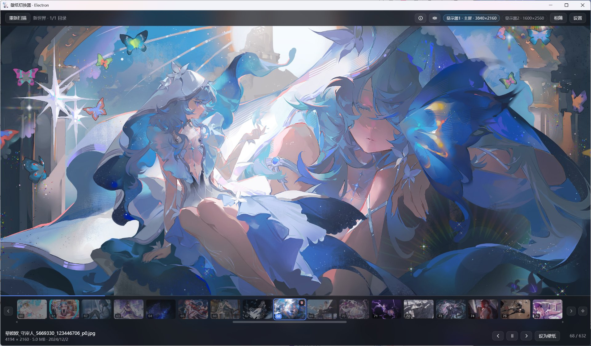
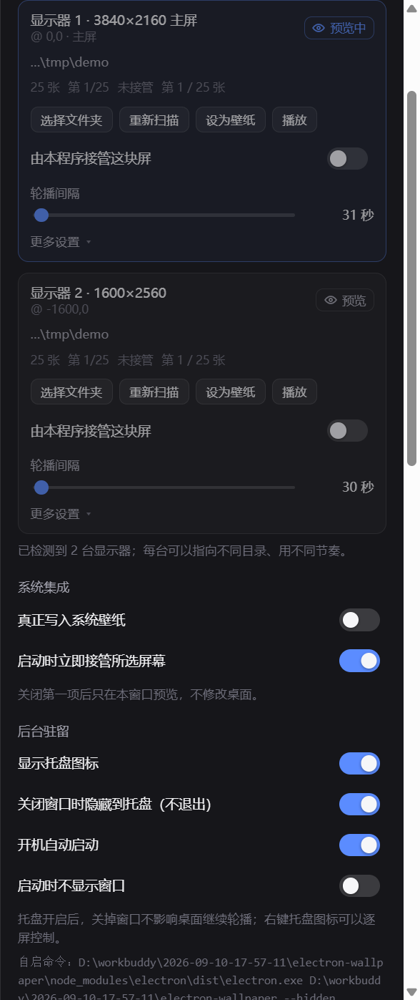
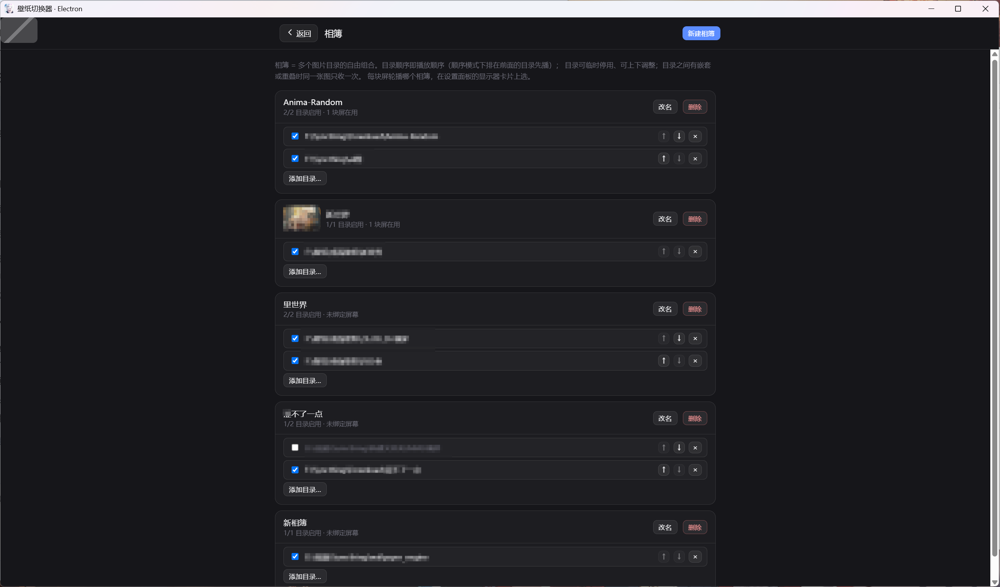
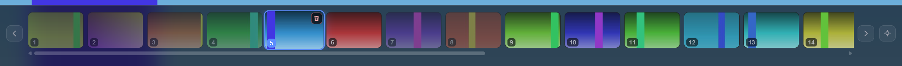
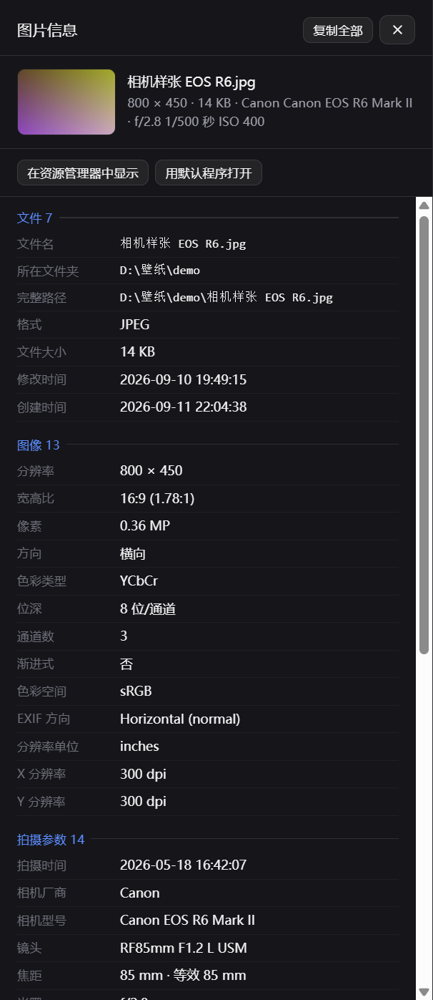
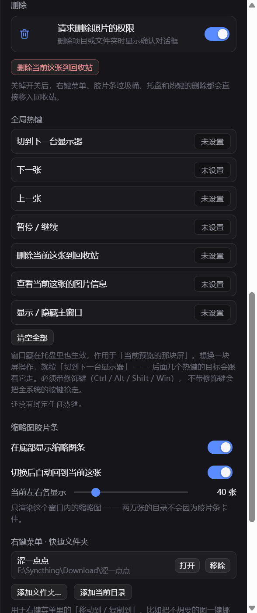

# 壁纸切换器

一个 Windows 桌面小工具：**把你硬盘里的图片文件夹，按你定的节奏，一张张设成桌面壁纸；还能让任意一张静态图变成 Live2D 般的 2.5D 立体动态壁纸。**

不联网、不登录、不装后台服务，图片始终在你自己的盘上。


▶ **[视频演示（Bilibili）](https://www.bilibili.com/video/BV1i9Yi6mE9H/)** —— 一分钟看懂它长什么样、怎么用

<p align="center">
  
</p>
<p align="center"><b>左边是你的一张普通图片，右边是开启动效后的桌面 —— 任意图片都能这样"活"起来</b></p>




*↑ 动态桌面：樱花粒子飘在真实壁纸上，桌面是活的*

## 它解决什么麻烦

| 你大概遇到过                 | 这里怎么解决                                                        |
| --------------------- | ------------------------------------------------------------- |
| 壁纸都是死的，想要会动的           | **深度视差**：任意静态图自动推理出深度，前后景分层移动出 2.5D 立体感 —— 内置 AI 引擎，不用做任何素材 |
| 两块屏想放不一样的图            | 每块屏单独指定图源和切换间隔 —— 系统自带的「幻灯片」在多屏下只能共用一套配置                      |
| 随机播放老连着出同一张           | 整批洗一次牌再顺着播，一个循环内不重复（系统幻灯片是每次现抽，撞车很正常）                         |
| 图库几万张，想边看边筛           | 看到不想要的，右键直接扔回收站，程序立刻换下一张接着播，不用停下来                             |
| 想知道刚才那张是什么            | 底栏缩略图胶片条：左边是看过的、右边是将要看的，点一下就跳回去                              |
| 想让它开机就自己跑             | 托盘常驻 + 开机自启 + 全局热键；关掉窗口也照旧换                                   |

## 适合谁用

对号入座，中得越多越适合：

| 你是这样的人 | 这里能给你什么 |
| --- | --- |
| **有多块显示器，还是竖屏 + 横屏混搭** | 每块屏各配各的：竖屏给竖图、横屏给横图，各自的相簿、间隔、动画、播放顺序互不干扰（系统幻灯片只能全屏共用一套） |
| **本地攒了几千几万张壁纸，散在各个文件夹** | 相簿把分散的目录凑成一组轮播；图始终在你自己的盘上，不联网、不登录、不上传 |
| **看到不喜欢的就想立刻清掉** | 轮播中右键直接移入回收站，程序立刻换下一张接着播，不用暂停不用翻文件夹 |
| **喜欢用手「翻」壁纸** | 画面上左右拖动、触控板横滑、触摸屏滑动，都能切上一张 / 下一张；桌面上右键也能换 |
| **想让壁纸动起来** | 深度视差让任意静态图变 2.5D 立体动效；视频壁纸 + 12 种粒子特效（雨落 / 樱花 / 烟花 / 星空流星…） |
| **用平板 / 笔记本，在意外表耗电** | 挂机、拔电池、锁屏时自动暂停，插回电源接着跑 |

**可能不适合你，如果：**

- 只想要一张静态壁纸永远不动 —— Windows 右键「个性化」就够了；
- 想要 3D 场景、音乐频谱那种重交互动态壁纸 —— 那是 Wallpaper Engine 的活；
- 用 macOS / Linux —— 壁纸写入依赖 Windows 的 COM 接口，没有跨平台版本。

## 三分钟上手

1. **加图** —— 顶栏「添加目录」（或 `Ctrl+O`），选一个放图片的文件夹。想一次管多个文件夹，去顶栏「相簿」把它们凑成一组。
2. **开播** —— 挑个切换间隔（比如 5 分钟），点「设为壁纸」。有两块以上显示器时会自动进每屏独立模式，每块屏一张卡片，各设各的。
3. **放着不管** —— 设置 → 系统 → 打开「显示托盘图标」和「开机自动启动」，之后它在后台自己换。
4. **想让它动起来**（可选）—— 设置 → 外观 → 打开「深度视差」，选个镜头轨迹风格即可；图多的目录也不用等，当前这张生成完就立刻变成立体动效。

> 第一次写入会把桌面切成「每屏图片」模式 —— 这是 Windows 逐屏设壁纸的前提，会顶掉系统幻灯片原来的设置。想换回去，在 Windows「个性化 → 背景」里重选一次即可。

## 它不是什么

- 不做 3D 建模 / 预制素材类动态壁纸 —— 那是 Wallpaper Engine 的活；深度视差是应用内 AI 推理实时生成的 2.5D 动效，不是 Live2D，也不需要任何预制素材（视频壁纸是另一回事：动态桌面直接播本地视频文件，见「动态桌面与粒子特效」）
- 不做跨屏拼接一整张大图
- 只支持 Windows 10 / 11

---

## 目录

- [它解决什么麻烦](#它解决什么麻烦)
- [适合谁用](#适合谁用)
- [三分钟上手](#三分钟上手)
- [功能](#功能)
- [显示器与轮播通道](#显示器与轮播通道)
- [相簿](#相簿)
- [播放顺序](#播放顺序)
  - [重启后从上次那张继续](#重启后从上次那张继续)
- [缩略图胶片条](#缩略图胶片条)
- [图片信息](#图片信息)
- [深度视差与动效](#深度视差与动效)
- [动态桌面与粒子特效](#动态桌面与粒子特效)
- [文件操作与删除](#文件操作与删除)
- [托盘与开机自启](#托盘与开机自启)
- [设置面板](#设置面板)
- [与同类工具的差异](#与同类工具的差异)
- [安装](#安装)
- [首次使用](#首次使用)
- [快捷键](#快捷键)
- [配置文件](#配置文件)
  - [playback.json（播放位置存档）](#playbackjson播放位置存档)
- [性能数据](#性能数据)
- [已知限制](#已知限制)
- [常见问题](#常见问题)
- [许可](#许可)

---

## 功能

| 类别     | 说明                                                        |
| ------ | --------------------------------------------------------- |
| 多显示器   | 统一配置或每屏独立两种模式；每屏可单独绑定相簿，单独设置间隔、过渡动画、填充方式、播放顺序             |
| 相簿     | 图片目录的自由组合：目录可多选导入、增删、排序、临时停用；目录顺序即播放顺序                    |
| 播放顺序   | 按名称顺序 / 随机不重复（整表洗牌后顺序播放，一个循环内不重复）                         |
| 缩略图胶片条 | 底栏缩略图导航，按播放顺序排列；窗口化渲染，与目录总张数无关                            |
| 交互     | 工具栏在无动作后自动淡出，时长可调；鼠标拖动 / 触控板横滑 / 触摸屏左右滑均可切换上、下一张          |
| 文件操作   | 右键菜单：复制图像 / 复制文件 / 移动或复制到预设文件夹 / 打开所在文件夹 / 用其他程序打开（程序列表 + 系统「打开方式」对话框）|
| 删除     | 移入系统回收站，不提供永久删除；默认每次确认；四个入口共用同一实现                         |
| 图片信息   | 读取 EXIF：文件 / 图像 / 拍摄参数 / 位置 / 来源 五组，枚举值转为可读文本             |
| 视差与动效   | 深度视差（内置 Depth-Anything ONNX 推理，JS 引擎零 Python 依赖；每屏可单独开关与选择风格，深度图按需生成并 LRU 缓存）、呼吸缩放、粒子特效（支持随机池）|
| 动态桌面   | 播放画面实时挂到桌面（Wallpaper Engine 那种活桌面），支持视频壁纸、时段滤镜与呼吸缩放；挂机 / 电池 / 锁屏 / 全屏自动暂停 |
| 后台驻留   | 托盘常驻、按显示器分组的托盘菜单、7 个可自定义的全局热键、开机自启                        |
| 数据     | 不联网、不登录、不订阅；配置与缩略图缓存均保存在本地                                |
| 设置面板   | 二十来个分组按「轮播 / 外观 / 操作 / 系统」分成四个标签页，记住上次停在哪一页               |

---

## 显示器与轮播通道

### 两种模式

| 模式   | 行为                                                      |
| ---- | ------------------------------------------------------- |
| 统一配置 | 所有显示器共用一套相簿与节奏，全部显示器显示同一张图片                             |
| 每屏独立 | 每台显示器对应一个独立轮播通道，各自维护绑定的相簿、间隔、动画、填充方式、播放顺序、是否递归、是否跳过同体积图 |

每屏独立模式下，未单独配置的显示器沿用顶层配置（`resolveProfile` 逐字段回落）。因此「先所有屏共用一套，之后再单独调整其中一块」是可用的。配置文件只保存与顶层不同的字段。

多显示器机器上首次选择目录后，程序会自动切换为每屏独立模式并将所选目录写入每块屏（目录以相簿的形式绑定）。该动作只执行一次（由 `autoMonitorSetup` 标记控制）；手动关闭每屏独立后不会被再次自动开启。



### 操作目标

顶栏的「预览：…」徽标或全局热键「切到下一台显示器」用于切换当前操作目标。切换后，下一张、上一张、暂停/继续、删除、查看图片信息均作用于该通道。

统一配置模式下只有一个通道，切换操作无效。


### 显示器热插拔

显示器数量变化后，程序重建通道列表：移除的显示器对应通道消失，新接入的显示器自动建立通道。正在进行中的轮播状态不受影响。

### 可调范围

| 参数      | 界面范围                   | 配置文件取值范围                  | 默认值      |
| ------- | ---------------------- | ------------------------- | -------- |
| 轮播间隔    | 3 – 3600 秒             | 1 秒 – 24 小时（越界收敛到该区间）     | 60 秒     |
| 过渡动画    | 滑动 / 淡入 / 缩放           | `slide` / `fade` / `zoom` | `slide`  |
| 动画时长    | 120 – 1500 毫秒          | 0 – 5000 毫秒               | 520 毫秒   |
| 图片填充    | 铺满裁切 / 完整显示            | `cover` / `contain`       | `cover`  |
| 胶片条可见张数 | 8 – 200 张              | 同左                        | 左右各 40 张 |
| 工具栏自动隐藏 | 0 – 20000 毫秒（0 = 一直显示） | 同左；0 或非法值均按「一直显示」处理       | 2400 毫秒  |
| 缩略图尺寸   | 界面不提供，配置文件可改           | 任意像素（长边）                  | 256 像素   |

---

## 相簿

频道不再直接绑定单个目录，而是绑定**相簿**——图片目录的自由组合。一个相簿可以随时增加或移除多个不同的图片目录，把分散在各处的图凑成一份轮播内容。

### 组合规则

| 规则        | 行为                                                      |
| --------- | ------------------------------------------------------- |
| 目录顺序即播放顺序 | 顺序模式下，相簿内的目录按列表顺序依次出现，组内按名称排；随机模式不受影响（拼好再整池洗牌）          |
| 目录可临时停用   | 停用的目录不参与扫描与轮播，但保留在列表里，随时可重新启用                           |
| 重复路径只算一次  | 目录之间有嵌套或重叠时（如同时加了 `D:\图` 和 `D:\图\子目录`），同一张图按完整路径去重，只收一次 |
| 失效目录不炸相簿  | 目录被删、改名或断盘时跳过它，其余目录照常轮播；设置面板在该屏卡片上给出可数的失效目录警告           |

### 两种管理入口



- **相簿页**（顶栏「相簿」进入）：新建相簿、重命名、添加 / 移除 / 停用目录、上下调整目录顺序、删除相簿，管理动作都在这个独立页面完成（Esc 或「返回」退出）。添加目录的系统选择框支持一次多选。删除相簿时，绑定它的频道自动解绑。
- **设置面板**：只做绑定 —— 统一模式用「相簿」下拉选择，每屏模式在显示器卡片上直接切换；卡片上另有一个「添加目录」快捷入口（没有相簿会自动建一个）。相簿的增删与目录调整一律去相簿页。

### 播放进度按相簿记忆

升级前按目录记的播放位置自动迁移：旧配置里的目录被包装成同名相簿，绑定关系与播放进度原样保留——升级后接着上次那张播，不会回到第一张。

### 增值细节

- **相簿封面**：相簿页的相簿卡片与每屏卡片的相簿下拉里展示封面缩略图（取自扫描缓存，不产生额外磁盘读取）。
- **胶片条目录分隔**：顺序模式下，相簿内不同目录的交界处在胶片条上有分隔线——一眼能看出「这一段是哪个目录的」。
- **信息面板显示来源**：图片信息面板新增「来源」一组，显示当前这张来自相簿里的哪个目录（点击可打开）。

---

## 播放顺序

播放顺序有两种：**按名称顺序**与**随机不重复**。

**随机不重复的实现方式**是先将整个文件列表洗牌，然后按洗牌后的顺序依次播放；不是按索引随机抽取。其结果是：

- 一个循环内每张图片恰好出现一次，循环结束后重新洗牌，因此第二轮顺序与第一轮不同；
- 胶片条上的排列即为真实播放顺序，「上一张」始终位于当前帧左侧一格。

**跳过同体积图**（`skipSizeTwin`，默认开启）在洗牌时生效，仅对文件数不超过 4096 的目录启用。规则是：相邻的两张图片若文件字节数完全相同，则跳过后者。内容相同的重复文件字节数必然相同，因此该策略可避免同一张图连续出现。对超过 4096 张的目录不启用，以控制洗牌开销；其代价是约 0.5% 的图片在同一循环内可能不被选中。

**顺序保持**：修改间隔、过渡动画、动画时长、填充方式不会改变当前播放顺序。只有更换绑定的相簿、切换播放顺序、或执行「重新扫描」会重新洗牌。**往相簿里增加目录也不重洗**：现有图片的顺序原位保留，新目录的图接在列表末尾——「往相簿里补一批图」不会把正在看的顺序搅乱。列表顺序本身不跨进程重启保留（每次启动重新洗牌），但**当前播到哪张会**——见下。

上述任何一次重排都会**立即反映到窗口里**——胶片条的排列与当前帧同步更新到新顺序，不需要切走再切回来。随机模式下走完一轮会重新洗牌，那一刻同样会同步（这是「每轮顺序都不同」的实现方式）。

### 重启后从上次那张继续

默认开启（`resumeLast`，可在设置面板的「系统集成」一组里关掉）。关掉之后每次启动都从第一张开始。

启动（包括开机自启）时会接着上次停下的那张播放，而不是回到第一张。两点实现上的取舍值得说明：

- **记的是路径，不是序号。** 随机模式下每次启动都会重新洗牌，序号只对「当时那份列表」有意义——存「第 27 张」下次启动只会落到另一张图上。所以记录的是「上次那张图的完整路径」，启动后在重排过的列表里把它找回来。图片被删掉或改名导致找不到时，才退回到序号并把索引对齐到列表范围内（总好过甩回第一张）。
- **换了相簿就不认旧记录。** 上一次的「第 27 张」指的是另一份内容里的另一张图，拿过来用只会莫名其妙地跳过一段。从旧版升级的用户不受影响：旧记录按目录路径在相簿内「认亲」，见[相簿](#相簿)。

记录写在 `%APPDATA%\electron-wallpaper\playback.json`，**与配置文件分开**：它是每次换图都要写的高频状态，混进 `config.json` 只会让 diff 全是噪声，也容易和手动改配置撞车。写入合并 1.5 秒内的多次改动（连点「下一张」只落一次盘），正常退出时再补一次。进程被强制结束最多丢最后一次切换——这种情况下也不需要精确到秒。

每台显示器各记一条（键就是频道 ID），互不影响；两路分别停在不同位置时，重启后各自回到各自那张。

---

## 缩略图胶片条

底栏显示一排缩略图，三种视觉状态：当前（高亮）、已播放（淡化）、未播放。点击任意缩略图跳转到该图片。



- **位置即播放队列**：胶片条按播放顺序排列，左侧为已播放，右侧为待播放。
- **窗口化渲染**：只渲染当前索引左右各 N 张（默认各 40，可设 8–200），渲染量与目录总张数无关。两万张的目录不会因胶片条产生卡顿。
- **缩略图生成**：由主进程按需生成并写入磁盘缓存，长边默认 256 像素。缓存目录默认为 `userData/thumbs`（`thumbCacheDir` 可改）。设置面板提供「打开缓存目录」「清理超额」「全部清空」三个操作。
- 胶片条可通过 `Ctrl+B` 或设置面板的复选框隐藏。
- 「切换后自动回到当前这张」（`filmstripAutoCenter`，默认开启）控制跳转后是否自动滚动到当前帧。

---

## 图片信息

`Ctrl+I` 或右键菜单的「图片信息…」打开（`infoPanel`，默认开启）。字段分为五组：

| 分组   | 内容                           |
| ---- | ---------------------------- |
| 文件   | 文件名、所在文件夹、文件大小、修改时间          |
| 图像   | 尺寸、宽高比、色彩空间、位深、PNG/WebP 块信息等 |
| 拍摄参数 | 相机厂商、机型、镜头、光圈、快门、ISO、焦距      |
| 位置   | GPS 经纬度与海拔                   |
| 来源   | 软件、版权、创建时间等                  |

枚举值转换为可读文本（显示 `sRGB` 而非 `1`，显示 `inches` 而非 `2`）；宽高比命中常见比例时显示比例名称（如 `16:9`）。面板提供「复制全部」，将全部字段导出为文本。EXIF 完全读不到时仍返回文件与图像两组。



---

## 深度视差与动效

给静态壁纸加 3D 感：应用按需为当前图片生成**深度图**（画面里每个像素离镜头的远近），播放时前后景按深度差分层移动，鼠标或镜头轨迹变化时壁纸呈现立体视差。

<p align="center">
  
</p>
<p align="center"><i>桌面实测录屏：左静态原图 → 右开启深度视差后的桌面（左上角为性能监控）</i></p>

**深度图生成（内置引擎，零依赖）**

- 推理在应用内完成：内置 Depth-Anything（ViT-S）ONNX 模型，走 onnxruntime-node（CPU），单张全链路约 1 秒，**不依赖 Python / PyTorch / 显卡**——安装包已带模型，装完即用。
- 按需生成：只有开启视差的屏幕正在显示的图片才会生成；同一张图只算一次，结果缓存到磁盘（默认 `userData/depth-cache`，`depthCacheDir` 可改），缓存总量 LRU 上限 2GB，超限按最久未用淘汰。
- 现场升级：深度图生成完成时，正在显示这张图的舞台立刻从普通平移缩放切换为视差，无需等待或手动刷新。

**开关与风格（设置面板 → 外观）**

- 全局总开关 + **每屏独立开关**：多显示器可以只给主屏开视差（视差渲染吃 GPU，副屏全开不划算）。
- 开启视差的屏幕可从**三种镜头轨迹**（circle / orbital / dolly）中选择动效风格。
- 外观页底部有状态行，实时显示深度引擎是否就绪、用的哪个引擎（JS·ONNX / Python）、模型路径——不可用时直接给出原因（如模型缺失）。

**降级策略（fail-soft）**

- 没生成深度图的图片自动回退为普通平移缩放，不影响轮播。
- 深度引擎整体不可用（如模型文件缺失）时自动禁用视差并在状态行报告原因；开发机可通过 `depthPython` / `depthWorkerScript` / `depthModelDir` / `depthOnnxModel` 覆盖引擎与模型路径（发布包不需要这些配置）。

**同页的其他动效**

- **呼吸缩放**：画面缓慢放大缩小的呼吸感，速度/幅度滑杆可调，与视差独立。
- **粒子特效**：每屏可单独设置，支持配置「随机池」——每次换图从池中随机抽取一种粒子风格。

---

## 动态桌面与粒子特效

「系统」页开启**动态桌面**后，播放画面会实时挂在桌面上（Wallpaper Engine 那种活桌面），视频壁纸、时段滤镜、呼吸缩放都在这块画面上生效；系统壁纸只在锚点时机写入，桌面不会频繁闪烁。统一配置和每屏独立两种模式都支持。


**暂停体系**：以下四种情形会自动暂停动态桌面（只暂停对应的那块屏），动一下或恢复条件即继续：

| 暂停条件 | 说明 |
| --- | --- |
| 全屏应用 | 某块屏被全屏应用占满时只暂停那一块（打游戏时壁纸不偷跑） |
| 锁屏 / 睡眠 | 锁屏、息屏、睡眠时暂停 |
| 挂机 | 键鼠无输入超过 `idlePauseMinutes`（默认 5 分钟，可设 3/5/10/15，0 = 关）也算「人离开」——纯熄屏不锁屏的平板靠它兜底 |
| 电池供电 | 拔电 2 秒内暂停、插回恢复（`GetSystemPowerStatus` 直查，不依赖系统消息投递） |

**暂停时停在完整帧**：暂停如果恰好落在切换动画进行到一半时，画面会被钉到动画的**终态**（完整的一张图），而不是定格在半截过渡的黑屏上；另有自愈巡检兜底，静止态下活动层没盖满屏会自动重画。

**全屏黑屏防护**：`hideOnPaused`（默认**关**）在暂停时把桌面画面整个**藏起来**而不是只停在当前帧——独占全屏游戏（如艾尔登法环）做显示模式切换时，桌面下挂着的窗口可能触发显卡驱动挂死（主屏失去信号、副屏冻结），藏掉后就不在这个坑里了。经常玩独占全屏游戏的话，在设置 → 系统里手动打开。

在它之上可以叠加一层**粒子特效**（设置 → 轮播 → 粒子特效）：

- **12 种特效**：雨落 / 樱花落 / 雪 / 萤火虫 / 星空流星 / 泡泡 / 落叶 / 彩带纸屑 / 烟花 / 火焰灰烬 / 雨落水花 / 雨滴挂屏
  （柳絮、光粒已并入雪 / 萤火虫——老配置选它们会自动迁到最像的特效）
- **泡泡**：肥皂泡七彩膜，色相随时间流转；上升途中缓缓鼓大，飘出屏幕后从底部重来
- **火焰灰烬**：每粒一色（全色相随机），重叠处经发光混色
- **随机池**：把若干种特效放进池子，每次换图从池中随机抽一种
- **绕开鼠标**：粒子自动避让光标（`particleCursor`，默认开）
- **按屏配置（与全局互斥）**：统一配置模式下在这里设全局默认；切到**每屏独立**后，全局开关收起、在显示器卡片里给单块屏设置（跟随全局 / 关闭 / 固定种类 + 数量），首次切换会有指路提示
- **烟花**：自动升空炸开，炸开直径按屏幕短边的 60%~96% 缩放，最多同时 5 发
- **时段滤镜**：早晨 / 中午 / 阴天 / 黄昏 / 夜晚五档色调，随画面一起挂在桌面上
- 粒子跟随动态桌面的帧率上限（`fpsCap`）与暂停体系（手动暂停 / 全屏 / 锁屏 / 挂机 / 电池供电时一并冻结），只作用于动态桌面画面，不写入系统壁纸

配置键：`particles`（种类，`""` = 关）+ `particleCount`（数量 0~1000，默认 256；烟花数量内置）+ `particleCursor`。三者都是 profile 键，可被 `monitors` 按屏覆盖。

### 视频壁纸与省电优化

动态桌面支持视频壁纸（把视频文件放进相簿即可）。视频解码是耗电大户，两项省电机制默认开启：

- **视频省电优化**（设置 → 轮播 → 视频省电优化，`videoOptimize`）：首次播放时把视频转码成降帧副本（60fps → 30fps 或 48fps，解码负载约减半），之后轮播永远直接服务副本，原件不动。副本缓存在 `optimizeCacheDir`（默认 `D:/video-optimize-cache`，可改），有体积上限自动清理。改帧率档位后旧副本不直供、按新档位重转。
- **播完再切**（`videoPlayFull`）：开着 = 视频完整播完再切下一张；关着 = 按轮播间隔定时切。

---

## 文件操作与删除

### 右键菜单

在图片或胶片条缩略图上右键打开（`contextMenu`，默认开启）：

| 菜单项       | 行为                                |
| --------- | --------------------------------- |
| 复制图像到剪贴板  | 复制像素数据，可粘贴到 Word、画图等程序。**大图（>12 MP）跳过 PNG 编码直接写 `CF_DIBV5`**（`toPNG()` 是同步的，66.7 MP 要冻住主进程 4.9 秒），小图保留注册格式 `PNG`；点下去先弹「正在复制图像（宽×高）…」再动手，写完回读系统剪贴板核对体积，Chromium 那条路不生效时自动改用系统兜底写入 |
| 复制文件到剪贴板  | 复制文件对象，可在资源管理器中粘贴                 |
| 移动到 / 复制到 | 预设文件夹的子菜单，用于批量整理（例如移入「垃圾桶」目录）     |
| 打开所在文件夹   | 打开所在目录并选中该文件                      |
| 用其他程序打开   | 子菜单：程序列表（选定的 exe 记录到 `openWith`，一点就开）+ 「选择程序…」+ 系统「打开方式」对话框 |
| 删除到回收站    | 走统一的删除流程                          |

「移动到 / 复制到」的目标来自 `quickFolders`（设置面板中维护，可添加、重命名、删除）。移动操作会在调度器内就地更新路径，不触发重新扫描，因此不会影响当前播放位置。

### 删除

五个入口——图片右键菜单、胶片条、托盘菜单、全局热键、**桌面右键菜单**——共用同一实现：

- 一律移入**系统回收站**，程序不提供永久删除；
- `confirmDelete`（默认 `true`）控制是否在删除前弹出确认框。确认框中勾选「不再询问」等同于关闭该选项，设置面板中可重新开启；
- 删除当前正在显示的图片时，会立即写入下一张，播放位置不跳变；
- 删除不重新洗牌，只做就地移除与索引对齐。



### 桌面右键菜单（切下一张 / 删掉光标那块屏的壁纸）

在**桌面空白处右键**就能换图或删图，不用先打开窗口：

```
桌面右键 → 切换到下一张壁纸        ← 把光标那块屏的图往后拨一张
桌面右键 → 删除当前显示器的壁纸    ← 把光标那块屏正在放的那张移入回收站
```

两项都按**光标位置**判断作用对象——哪块屏的壁纸看不顺眼了，就在那块屏上右键，别的屏不碰。  
窗口开着的时候，桌面上的变化也会同步回胶片条。找不到对应的屏、或那块屏当前没有图时会给出提示，  
不会静默失败。

- 两个开关在「设置 → 删除 → 桌面右键菜单」，可以**只装一个**（比如只想要「下一张」，不想把「删除」摆在桌面上）；
- 各自写在 `HKCU\Software\Classes\DesktopBackground\Shell\WallpaperSwitcherDesktopNext` 与 `…\WallpaperSwitcherDesktopDelete`（当前用户，不需要管理员权限）；两项都带 `SortOrderIndex`，让「下一张」排在「删除」前面；
- 命令行里记的是**程序当前所在路径**。挪过目录后设置面板会提示「对不上」，把开关关掉再打开就会重写；
- 不想用设置面板的话，命令行也可以：`node tools/install-shell-menu.js install|uninstall|status [next|delete]`（省掉项名就是两项一起）；
- App 没在运行时点菜单也管用：那条命令会把程序拉起来把事办完、然后自己退出，窗口不会弹出来打断你；
- **Windows 11 注意**：这类经典菜单项被系统收进了二级菜单，要在桌面上先点「显示更多选项」（或按 `Shift+F10`）才看得到。想进一级菜单得做成 MSIX 打包的 `IExplorerCommand`，代价和收益不成比例，没做。

---

## 托盘与开机自启

### 托盘

`tray`（默认开启）控制是否显示托盘图标。`closeToTray`（默认 `true`）控制关闭窗口时的行为：开启则隐藏到托盘，关闭则退出程序。`startHidden` 控制启动时是否直接隐藏窗口，用于配合开机自启。

托盘菜单按通道分组，每台显示器一个子菜单，内容为：状态行（播放中 / 已暂停 / 未接管 / 张数 / 当前序号）、下一张、上一张、暂停或继续、立即设为壁纸、重新扫描、删除到回收站、当前文件名。菜单顶层为：显示或隐藏主窗口、设置、全部暂停或全部继续、开机自启、打开配置目录、版本信息、退出。

托盘 tooltip 显示每台显示器的播放状态与当前文件名，截断至 120 字符（Windows 托盘 tooltip 上限约 127 字符）。

### 开机自启

通过 Electron 的 `setLoginItemSettings` 写入 Windows 标准启动项（注册表 `HKCU\...\Run` 下的条目），不安装常驻服务。界面中的开关状态读取系统的实际状态，而不是应用自行记录的状态。开发模式与打包模式写入的命令行参数不同，两种情形均已处理。

托盘菜单与窗口「文件」菜单各有「重新启动」一项：`app.relaunch` 带上当前启动参数（比如 `--hidden`）后 `app.quit()`，走完整的退出流程，播放进度照常落盘 —— 不用退出再手动双击。

---

## 设置面板

二十来个分组挤在一列里，找个开关要滚很久，所以按用途切成四个标签页，一次只显示一页：

| 标签页 | 内容                                                         |
| --- | ---------------------------------------------------------- |
| 轮播  | 轮播模式、相簿绑定、自动扫描间隔、每屏显示器卡片；统一模式下的相簿、轮播间隔、播放顺序、包含子文件夹、写入目标显示器、视频省电优化（开关 + 目标帧率）、粒子特效与随机池 |
| 外观  | 过渡动画、动画时长、图片填充方式、工具栏自动隐藏、缩略图胶片条                            |
| 操作  | 删除（确认开关、桌面右键菜单两项）、全局热键、快捷文件夹、右键菜单与图片信息面板                   |
| 系统  | 系统集成（写系统壁纸 / 启动即接管 / 记住播放位置）、动态桌面（画面开关、暂停条件：挂机档位与电池暂停、暂停时隐藏画面）、后台驻留（托盘、开机自启等）、缩略图缓存          |

- 上次停在哪个标签页记在 `config.settingsTab` 里，下次打开面板直接落回那一页；值不认识时退回第一页。
- 标签栏和底部的「释放内存」不随内容滚动，只有内容区自己滚 —— 翻到长列表底下也能直接换页。
- 每屏独立模式下，过渡动画 / 填充方式等统一项照旧隐藏（这些在显示器卡片的「更多设置」里逐屏设置），标签页只显示该项在当前模式下有意义的部分。
- 切页只是界面状态，不会触发频道重建。

---

## 与同类工具的差异

|                       | Windows 幻灯片 | Wallpaper Engine |      壁纸切换器     |
| --------------------- | :---------: | :--------------: | :------------: |
| 定位                    |     系统自带    |      动态壁纸引擎      |  本地图库轮播 + 动态桌面   |
| 授权方式                  |     随系统     |       付费，闭源      |   免费，开源（MIT）   |
| 每块屏独立配置               |     不支持     |        支持        |       支持       |
| 随机不重复                 |     不支持     |      播放列表随机      |  支持（整表洗牌后顺序播放） |
| 可见的播放队列               |     不支持     |        不支持       |   支持（缩略图胶片条）   |
| 轮播中删除、移动文件            |     不支持     |        不支持       | 支持（删除后立即写入下一张） |
| 完整 EXIF 信息            |     不支持     |       仅壁纸属性      |       支持       |
| 动态 / 视频壁纸            |     不支持     |        支持        | 支持（动态桌面：深度视差 / 粒子 / 时段滤镜 / 呼吸缩放） |
| 3D / 音频响应壁纸           |     不支持     |        支持        |       不支持      |
| 内置内容库                 |      无      |       创意工坊       |    无，使用本地目录    |
| 定时切换、随应用切换            |     不支持     |        支持        |    不支持，仅固定间隔   |

两类工具可同时安装，互不冲突。

> Wallpaper Engine 一列依据其 2.8.x 官方帮助文档整理，具体行为以其官方说明为准。

---

## 安装

### 使用打包版本

发行产物（r27 起默认只出安装包，免安装版按需 `npm run dist:portable`）：

- `壁纸切换器-Setup-<版本>.exe` —— NSIS 安装版，可自选安装目录；内置深度视差 JS 引擎与模型，**零 Python 依赖**

首次运行安装版时，Windows SmartScreen 可能提示「未知发布者」，原因是安装包未购买代码签名证书。选择「更多信息 → 仍要运行」即可。

### 从源码运行

```bash
git clone https://gitee.com/klanf/per-monitor-wallpaper.git
cd per-monitor-wallpaper
npm install
npm start
```

| 要求      | 说明                                                       |
| ------- | -------------------------------------------------------- |
| 操作系统    | Windows 10 / 11，不支持其他平台                                  |
| Node.js | 18 或更高版本                                                 |
| 运行时依赖   | Electron 44、koffi（用于调用 Win32 `IDesktopWallpaper` COM 接口） |

核心的壁纸写入功能通过 koffi 调用 Win32 `IDesktopWallpaper` COM 接口实现，因此没有跨平台版本。


### 开发与验证

测试素材是生成出来的，不进版本库。克隆后先跑一次：

```bash
npm run fixtures       # 生成 tools/fixtures/ 下的测试图（120 张渐变 PNG + 纯色 BMP）
npm run verify:unit    # 153 项调度器与配置单测，不需要启动界面
npm run verify:resume  # 28 项「重启后接着上次那张播」，不需要启动界面
npm run verify:wiring  # 37 项渲染层静态接线检查，不需要启动界面
npm run verify:clipboard  # 44 项剪贴板写入（用真剪贴板，跑完自动还原；含「大图快路」）
```

`verify:wiring` 是纯静态的：核对 `app.js` 里 `$('xxx')` 取的 id 在 `index.html` 里都还在（重排 DOM 最容易搬丢，丢了之后的症状是「点了没反应」，读代码很难看出来）、没有重复 id、设置面板的四个分类标签与内容页一一对得上。改完渲染层顺手跑一遍。

其余 `verify:*` 脚本需要先以 `npm run start:debug` 启动应用（带调试端口 9222），脚本会通过 CDP 驱动界面并断言结果。`npm run shot:readme` 会临时把轮播目录切到测试素材、截完再还原，避免把本机图库截进交付物。

两个不进测试、但排查时很好用的命令：

```bash
npm run wallpaper:now                     # 每台显示器当前挂的是哪张图（直接问系统，不看应用状态）
npm run app:eval -- "return (await wp.listChannels()).channels.map(c => c.index)"
                                          # 在运行中的应用里求值任意表达式（需先 start:debug）
```

`verify:resume` 用的是**两个 scheduler 实例 + 各自重新读盘的 Store**来模拟「关机再开机」，写入函数是替身，所以跑它不会动你的桌面。

要接手继续开发，先看 [docs/交接文档.md](docs/交接文档.md)：代码地图、概念词典、关键设计决定的理由、踩过的坑、待办清单都在里面。

需要反复重启应用做验证时，用 `python tools/launch-dev.py`（可选 `--cdp` / `--hidden`）。它替你做三件直接从 shell 起 Electron 会出问题的事：剔掉环境里注入的 `ELECTRON_RUN_AS_NODE`（留着会让 Electron 退化成纯 Node）、让进程脱离父进程组（否则跑完就被回收）、把输出重定向到 `%TEMP%\electron-wallpaper-dev.log`（用管道而不读会把进程吊死）。

跑**单个 Electron 脚本**（例如 `verify:clipboard`）则用 `python tools/run-electron.py tools/verify-clipboard.js`。它和上面那个分工不同 —— 它是**前台跑完并等退出码**，而且额外给一个**一次性的隔离 `user-data-dir`**：`launch-dev.py` 解决的是「怎么让应用活下去」，它解决的是「怎么让脚本在有应用正在跑的情况下还能跑起来」（否则第二个实例会在 Chromium 启动阶段被 profile 单例锁挡住，表现为卡住不动、无任何输出）。`npm run verify:clipboard` 已经走它。

想**重启你正在用的那个实例**（改完代码要生效），用 `python tools/restart-app.py`：默认只**列出**会关掉的进程树（dry-run），加 `--yes` 才按 **PID 树后序**关闭、再用桌面 VBS 拉起。别用 `proc-list.py --kill --under=<目录>` —— 它按镜像路径过滤，区分不了「同一项目的多个实例」，会连你正在跑的那个窗口一起关掉。

### 打包发行版

双击项目根目录的 `打包exe.bat`，或在命令行执行（r27 起构建链是**纯 npm/electron-builder，全程无 Python**）：

```bash
npm run dist             # NSIS 安装包（默认产物）
npm run dist:portable    # 免安装单文件（按需）
npm run dist:dir         # 只出 win-unpacked（验配置用，最快）
```

产物落在 `dist/`：`壁纸切换器-Setup-<版本>.exe`（安装包）。构建配置在 `package.json` 的 `build` 字段：深度模型 ONNX（~99MB）经 `extraResources` 进 `resources/models/depth-anything/`，原生模块（koffi / sharp / onnxruntime-node）经 `asarUnpack` 解包，语言包只保留 zh-CN / en-US。构建全程不依赖 Python；`tools/build-exe.py` 只是历史辅助脚本，不再是打包链路的一部分。

几个容易踩的点：

- 首次打包需要联网 —— electron-builder 会下载 nsis 等构建资源到 `%LOCALAPPDATA%\electron-builder\Cache`（约 40 MB，之后一直复用）。
- electron-builder 每次打包都会先清掉 `dist/win-unpacked/` 和 `dist/win-unpacked.tmp/`（各 70~90 个文件）再重新解压，所以脚本在开跑前会先替它清好。
- 若当前环境装了「一次删 50+ 个目标需人工确认」的保护层（例如 agent 会话），上面这两个目录会被**改名**到 `dist/_prev/` 而不是删除，脚本照常能出包 —— 确认新包没问题后把 `dist/_prev` 整个删掉即可。
- 打包和「`npm start` 起的开发实例」互不影响；但若 `dist/win-unpacked/` 里的程序正在运行，会锁住文件导致失败，脚本会在开跑前检测并提示先退出。
- 脚本只动 electron-builder 自己的产物，`dist/` 里你手动放进去的文件（例如分卷压缩包）不会被碰。

功能上等价于 `npm run dist`，多出来的只是前置检查、旧产物清理和产物清单。

### 支持的图片格式

`jpg` `jpeg` `jfif` `png` `bmp` `webp` `gif` `avif` `tif` `tiff`

目录扫描默认包含子文件夹（`recursive`，默认 `true`），深度上限 8 层，单个目录的文件数上限 200,000。

### 定时自动扫描

外部往目录里丢新图（Syncthing 同步、ComfyUI 出图、手动拷贝）程序不会自动知道 —— 扫描缓存只在手动「重新扫描」或程序自己改动目录时失效。设置面板&#x7684;**「自动扫描相簿」**&#x53EF;以定时补这一段：

| 档位 | 关闭 / 5 分钟 / 15 分钟 / 30 分钟 / 1 小时 / 3 小时 / 12 小时   |
| -- | ------------------------------------------------- |
| 默认 | **关闭**（`autoScanMinutes: 0`）                      |
| 上限 | 24 小时；最小 1 分钟（图库常在 Syncthing 目录里，太频繁会变成后台常驻的磁盘压力） |

与手动「重新扫描」的差别：**自动扫描不洗牌** —— 新图接在列表末尾、已删的图自然消失，  
当前正在显示的那张和播放顺序都不动（手动重扫会连顺序一起重洗）。

---

## 首次使用

1. **选择壁纸目录** —— 顶栏「选择文件夹」或 `Ctrl+O`。扫描完成后窗口内即开始预览轮播。
2. **确认落盘开关** —— 「真正写入系统壁纸」（`applyToSystem`，默认开启）决定是否实际修改桌面。关闭该项后，程序只在窗口内预览，不修改桌面壁纸，可用于先预览效果。
3. **多显示器场景** —— 检测到两台以上显示器且已选择目录时，程序自动切换为每屏独立模式，每块屏生成一张卡片并绑定刚组建的相簿；之后可在各卡片上分别修改相簿与节奏。
4. **后台驻留** —— 关闭窗口默认隐藏到托盘并继续轮播；「开机自动启动」写入系统启动项。
5. **壁纸还原** —— 每屏写入壁纸要求桌面处于「每屏图片」模式，这会改变系统原有的幻灯片设置。需要恢复时，在 Windows「个性化 → 背景」里重新选一次即可；源码目录另有 `npm run restore-wallpaper` 脚本（需要事先备好 `tools/wallpaper-backup.json` 存档，程序目前不会自动建档）。

---

## 快捷键

### 窗口内

| 按键             | 作用                      |
| -------------- | ----------------------- |
| `←` / `→`      | 上一张 / 下一张               |
| `空格`           | 暂停 / 继续                 |
| `F` / `F11`    | 切换全屏                    |
| `Esc`          | 关闭设置面板与图片信息面板           |
| `Ctrl+O`       | 选择目录（多选）——组建或补充当前屏绑定的相簿 |
| `Ctrl+R`       | 重新扫描（会重新洗牌）             |
| `Ctrl+S`       | 立即将当前帧写入桌面              |
| `Ctrl+,`       | 设置面板                    |
| `Ctrl+B`       | 显示 / 隐藏缩略图胶片条           |
| `Ctrl+I`       | 图片信息面板                  |
| `Ctrl+Shift+R` | 重新加载界面                  |

方向键与空格由渲染进程处理，未在应用菜单中绑定加速键，以避免一次按键触发两次切换。

### 鼠标与触摸手势

| 操作                     | 作用                 |
| ---------------------- | ------------------ |
| 在画面上按住左键左右拖（≥ 60 像素）   | 上一张 / 下一张          |
| 触摸屏左右滑动（≥ 60 像素）       | 上一张 / 下一张          |
| 触控板双指横滑（`deltaX` ≥ 30） | 上一张 / 下一张，400 毫秒节流 |
| 竖向滚动 / 纵向拖动            | 不切换（避免误触）          |

判定收得比较紧：横向位移要达到 60 像素，且横向要大于纵向的 1.5 倍 —— 否则斜着拖一下就会莫名切图。拖动过程只换光标，不做跟手位移，因为图片层的 `transform` 被切换动画占着。

**触摸屏支持的关键是画布上的 `touch-action: none`。** 不写这一行，左右拖会被浏览器判定为滚动手势接管，接管那一刻发出 `pointercancel`，拖动到一半的手势就被丢弃 —— 表现就是「鼠标能拖、手指划不动」。而且它只能写在画布本身（`.layer`），不能写在 `#stage` 上：`touch-action` 是「元素与所有祖先的交集」，祖先写 `none` 会把设置面板、图片信息面板、胶片条一起锁死，那些地方就再也滚不动了。

触摸与鼠标都会唤醒自动隐藏的工具栏 —— 唤醒绑在 `pointerdown` 上而不是 `mousedown`，因为触摸屏不会产生鼠标事件，只用鼠标事件的话工具栏一旦藏起来，手指就再也叫不回来。

长按图片不会弹系统菜单，走的是应用自己的右键菜单（Chromium 下长按触发 `contextmenu`）。顺便记一笔：`-webkit-touch-callout` 是 Safari/iOS 专有属性，**Chromium 的 CSS 解析器会直接丢弃它** —— 写了等于没写，别照着 Safari 的写法抄过来。

### 工具栏自动隐藏

顶栏与胶片条在一段时间内没有鼠标移动或触摸之后淡出，有任何动作就回来。时长在「设置 → 工具栏自动隐藏」中调节（`autoHideDelay`，默认 2400 毫秒，拖到最左端为 0，表示一直显示）。设置面板或图片信息面板打开期间不会隐藏。

### 全局热键

全局热键在主进程中注册，窗口隐藏到托盘后仍然生效。**8 个动作的默认值均为空**，即默认不绑定，需要在「设置 → 全局热键」中自行录入。

| 动作          | 作用                             |
| ----------- | ------------------------------ |
| 切到下一台显示器    | 将当前操作目标循环切换到下一个通道；下列动作的目标随之改变  |
| 下一张 / 上一张   | 切换当前操作目标所在显示器的壁纸               |
| 暂停 / 继续     | 暂停或恢复该通道的轮播                    |
| 删除当前这张到回收站  | 走统一的删除流程（尊重 `confirmDelete`）   |
| 查看当前这张的图片信息 | 显示主窗口并打开图片信息面板                 |
| 打开所在文件夹     | 在文件管理器中打开当前这张图所在目录并选中它（不弹出主窗口） |
| 显示 / 隐藏主窗口  | 等同于点击托盘图标                      |

约束与行为：

- 组合键**必须包含修饰键**（`Ctrl` / `Alt` / `Shift` / `Win`）。不含修饰键的全局热键会占用全系统输入，因此程序直接拒绝注册；
- 组合键被其他程序占用时，设置面板会在该项右侧标注原因（例如「已被其它程序占用」）；
- 注册失败的热键会在启动时通过托盘气泡提示，并在主进程日志中输出原因；
- 热键触发的结果（成功、失败原因、作用于哪块屏）在主进程日志中以 `[hotkey]` 前缀记录。

---


## 配置文件

配置保存在 `%APPDATA%\electron-wallpaper\config.json`。界面中的每次修改都会立即写入磁盘；写入采用「临时文件 + 重命名」方式，保证写入的原子性。读取时以默认值做深合并，因此旧版本配置文件缺少的键会自动补齐。

```jsonc
{
  "albumId": "alb_XXXX",            // 统一模式绑定的相簿
  "albums": [                       // 相簿列表：目录按列表顺序拼接为播放内容
    {
      "id": "alb_XXXX",
      "name": "横屏精选",
      "folders": [
        { "path": "D:\\壁纸\\横屏", "enabled": true },
        { "path": "D:\\壁纸\\风景", "enabled": false }   // 停用：保留但不参与轮播
      ]
    }
  ],
  "recursive": true,                // 是否包含子文件夹
  "interval": 60,                   // 轮播间隔（秒）
  "autoScanMinutes": 0,             // 定时重扫相簿的间隔（分钟，0 = 关闭）
                                    //   与手动「重新扫描」不同：只丢扫描缓存不洗牌，
                                    //   新图接在末尾、已删的图消失、当前那张不动
  "animation": "slide",             // slide | fade | zoom
  "duration": 520,                  // 动画时长（毫秒）
  "shuffle": false,                 // true = 随机不重复，false = 按名称顺序
  "skipSizeTwin": true,             // 洗牌时跳过与当前帧字节数相同的候选
  "fit": "cover",                   // cover | contain

  "applyToSystem": true,            // 总开关：false 时只预览，不修改桌面
  "applyOnStart": true,             // 启动时立即用当前帧接管所选显示器
  "resumeLast": true,               // 记住上次播到哪张，重启后接着播（记录在 playback.json）
  "monitor": "all",                 // 统一模式的写入目标：all | primary | window

  "perMonitor": false,              // 每屏独立
  "autoMonitorSetup": false,        // 是否已执行过「检测到多屏就自动开每屏独立」
  "monitors": {                     // 每屏覆盖项，只保存与顶层不同的字段
    "\\\\?\\DISPLAY#...": { "albumId": "alb_YYYY", "interval": 30, "fit": "contain" }
  },

  "tray": true,                     // 显示托盘图标
  "closeToTray": true,              // 关窗口 = 隐藏到托盘（false = 退出）
  "startHidden": false,             // 启动时不显示窗口
  "launchAtLogin": false,           // 开机自启（实际状态以系统为准）

  "autoHideDelay": 2400,            // 顶栏与胶片条在无动作多久后淡出（毫秒，0 = 一直显示）
  "settingsTab": "play",            // 设置面板停在哪个分类页：play | look | action | system
                                    //   记住上次看的那一页，值不认识时退回 play

  "filmstrip": true,                // 显示缩略图胶片条
  "filmstripRange": 40,             // 当前帧左右各保留多少张
  "filmstripAutoCenter": true,      // 跳转后自动回到当前帧
  "thumbSize": 256,                 // 缩略图长边像素
  "thumbCacheDir": "",              // 空 = userData/thumbs

  "liveWallpaper": false,           // 动态桌面：播放画面实时挂到桌面（Wallpaper Engine 那种活桌面）
  "liveStage": {                    // 动态桌面舞台
    "fpsCap": 30,                   // 帧率上限（5~240）
    "pauseOnFullscreen": true,      // 某块屏被全屏应用占满时，只暂停那一块
    "pauseOnBattery": true,         // 电池供电时暂停
    "pauseOnLock": true,            // 锁屏 / 息屏 / 睡眠时暂停
    "pauseOnIdle": true,            // 无输入超过 idlePauseMinutes 也当「人离开」暂停
    "idlePauseMinutes": 5,          // 无输入判定阈值（分钟，0 = 关闭；纯熄屏不锁屏的平板靠它省电）
    "hideOnPaused": false           // 暂停时把桌面画面整个藏起来（默认关；独占全屏游戏前手动开）
  },
  "videoPlayFull": false,           // 视频播完再切下一个（动态桌面下有意义）
  "videoOptimize": true,            // 视频省电优化：转码降帧副本缓存，解码负载约减半
  "optimizeTargetFps": 30,          // 副本目标帧率：30（推荐）| 48，其余值回落 30
  "optimizeCacheDir": "D:/video-optimize-cache",  // 副本缓存目录（可改）
  "breath": false,                  // 呼吸缩放特效（缓慢放大缩小）
  "breathPeriod": 6000,             // 呼吸周期 ms（2000~15000）
  "breathAmplitude": 2,             // 呼吸幅度 %（0.5~5，即 ±0.5%~±5%）
  "timeOfDay": "",                  // 时段滤镜：morning | noon | overcast | dusk | night
  "particles": "",                  // 粒子特效：12 种选一或 "random"（每次换图抽一种），"" = 关
  "particleCount": 256,             // 粒子数量 0~1000（烟花数量内置，最多同时 5 发）
  "particleCursor": true,           // 粒子绕开鼠标（斥力避让）
                                    //   以上均为 profile 键，可被 monitors 按屏覆盖

  "contextMenu": true,              // 图片右键菜单
  "infoPanel": true,                // 图片信息面板
  "confirmDelete": true,            // 删除前弹出确认框
  "quickFolders": [],               // 右键菜单的「移动到 / 复制到」目标
  "openWith": [],                   // 「用其他程序打开」的程序列表

  "hotkeys": {                      // 全局热键，空串 = 未绑定
    "cycleMonitor": "",
    "next": "Ctrl+Alt+Right",
    "prev": "",
    "playPause": "",
    "delete": "Ctrl+Alt+D",
    "toggleWindow": "",
    "info": "",
    "reveal": ""
  },

  "window": { "width": 1360, "height": 860, "fullscreen": false }
}
```

关于 `monitors` 的两条规则：

1. 键为 Win32 显示器设备路径（形如 `\\?\DISPLAY#...`），值只包含该显示器与顶层不同的字段；
2. 将某个字段设为 `null` 可删除该显示器的覆盖项，使其回落至顶层配置。

布尔型字段在读写时会做一次收敛：历史配置中遗留的 `"random"` / `"order"` 等字符串会被识别为对应的布尔值，因此旧配置文件无需手工修改。

`applyToSystem: false` 可用于只调整窗口预览而不影响桌面。需要所有显示器使用完全相同的配置时，关闭 `perMonitor` 即可，`monitors` 中没有条目的显示器会自动回落。

### playback.json（播放位置存档）

与 `config.json` 同目录，单独一个文件，**不是配置**——它记录「每一路轮播上次停在哪张」，供下次启动接着播（见[重启后从上次那张继续](#重启后从上次那张继续)）：

```jsonc
{
  "version": 1,
  "channels": {
    "\\?\DISPLAY#...": {
      "index": 738,                    // 在**上次那份列表**里的位置（只作退化手段）
      "path": "F:\\壁纸\\...\\x.png",   // 关键字段：上次那张图的完整路径
      "album": "alb_XXXX",             // 上次绑定的相簿；换了相簿的记录按路径兜底匹配
      "folder": "F:\\壁纸\\桌面壁纸",    // 旧版记录遗留的目录字段：升级后按「路径在相簿内」认亲
      "playing": true,                 // 暂停状态也一并记住
      "at": 1757826000000              // 写入时间，超过 120 天的记录读取时丢弃
    }
  }
}
```

这个文件可以随时删掉：删了就等于没记录，下次启动从第一张开始。超过 120 天的记录（比如早就拔掉的显示器）会在下次读取时自动丢弃。

---

## 性能数据

以下数据为开发机（本地固态硬盘、约 3 万张图片的目录）实测结果，供参考：

| 项目            | 数据                                                 |
| ------------- | -------------------------------------------------- |
| 目录扫描          | 约 3 万张 / 116 GB，200 – 300 ms                       |
| 缩略图生成（冷）      | 单张 60 – 180 ms                                     |
| 缩略图生成（命中系统缓存） | 单张 6 – 7 ms                                        |
| 缩略图排序         | 排序器只构造一次；逐次构造 `Intl.Collator` 在十万张规模下会占去扫描流程一半以上时间 |

图片列表常驻内存。胶片条采用窗口化渲染，渲染量与目录总张数无关。

---

## 已知限制

| 限制             | 说明                                      |
| -------------- | --------------------------------------- |
| 仅 Windows      | 壁纸写入依赖 Win32 `IDesktopWallpaper` COM 接口 |
| 无定时与随应用切换      | 只支持固定间隔轮播                               |
| 不支持 3D / 音频响应壁纸 | 动态桌面支持视频壁纸、粒子特效与深度视差；3D 场景、音频响应类不支持        |
| 随机顺序不跨重启保留     | 播到哪张会记住（接着上次那张播），但随机洗牌结果每次启动重来             |
| 每屏写入会改变系统幻灯片设置 | 想换回去就在 Windows「个性化 → 背景」里重选                            |
| 删除为单张操作        | 不支持多选批量删除                               |
| 大目录未分页         | 列表常驻内存，十万张以上建议改成分页                      |
| 缩略图缓存无容量上限自动回收 | 需手动执行「清理超额」或「全部清空」                      |
| 安装包未签名         | 首次运行会出现 SmartScreen 提示                  |

---


## 常见问题

**每屏壁纸会覆盖系统自带的幻灯片设置？**

会。逐屏写入壁纸要求桌面处于「每屏图片」模式，这是 Windows 的机制。在 Windows「个性化 → 背景」里重新选一次即可切回；源码目录的 `npm run restore-wallpaper` 也能逐屏还原，但同样需要事先备好存档。

**为什么首次滚动胶片条较慢？**

缩略图由主进程按需生成，冷调用单张 60 – 180 ms，命中系统缩略图缓存后为 6 – 7 ms。生成结果会写入磁盘，第二次访问同一目录时速度明显提升。

**是否支持 Windows 以外的系统？**

不支持。核心功能依赖 Win32 的 `IDesktopWallpaper` COM 接口。

**目录可以放多少张图片？**

实测 3 万张（116 GB）的目录扫描耗时约 200 – 300 ms。胶片条采用窗口化渲染，滚动不卡顿。列表常驻内存，十万张以上建议后续改成分页。

**全局热键按下没有反应？**

依次检查三项：一，「设置 → 全局热键」中该项右侧是否有占用提示，若有则更换组合键；二，组合键是否包含修饰键，不含修饰键的组合会被拒绝注册；三，主进程日志中是否存在 `[hotkey]` 前缀的记录，该记录包含失败原因与作用的显示器。

**开机自启已开启，但重启后未生效？**

设置面板中该行显示的是系统实际状态。若显示为开启但系统中不存在启动项，通常是启动项被清理软件移除所致，关闭后重新开启可重新写入。

**删除图片后播放顺序会改变吗？**

不会。删除只做就地移除与索引对齐，不重新洗牌。若删除的是当前正在显示的图片，会立即写入下一张，播放位置不跳变。

**选择了「不再询问」之后如何恢复每次确认？**

在设置面板的「删除」分组中重新开启「请求删除照片的权限」。

**如何从源码构建发行版本？**

双击项目根目录的 `打包exe.bat`，或者：

```bash
npm run dist           # NSIS 安装包到 dist/
npm run dist:portable  # 免安装单文件（按需）
npm run dist:dir       # 只出 win-unpacked（验配置用，最快）
```

详见上文「[打包发行版](#打包发行版)」。r27 起构建链是纯 npm/electron-builder，全程无 Python。

**运行验证脚本是否会影响桌面壁纸？**

验证脚本在运行期间会关闭 `applyToSystem`，不修改桌面壁纸；脚本结束后恢复原配置。

---

## 许可

[MIT](https://opensource.org/licenses/MIT)，完整文本见 [LICENSE](LICENSE)。

`assets/` 下的应用图标由本项目作者自行生成，随仓库一并分发。生成所用的源图未打进仓库（见 `.gitignore` 里的 `tools/icon-source.png`）—— 如需换成自己的图标，把一张正方形 PNG（≥ 256×256）放到该路径后执行 `npm run icon` 即可，会同时重写 `assets/icon.ico` 与 `assets/icon.png`。
